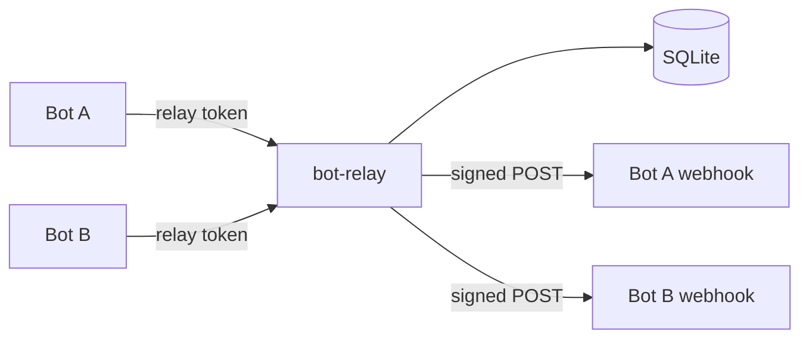
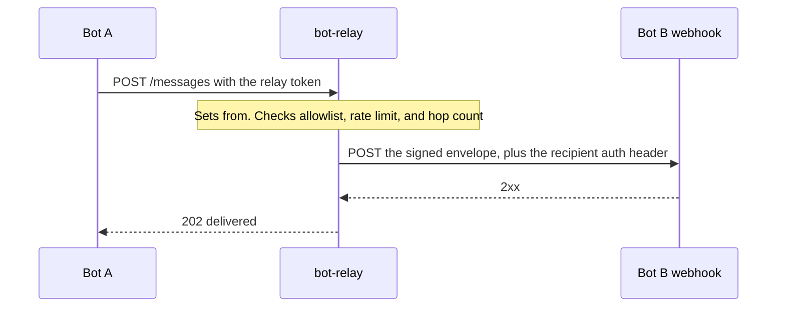
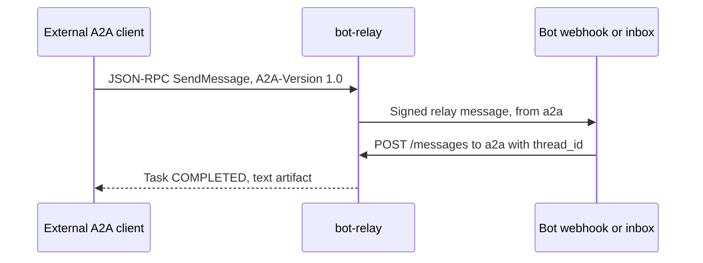

# bot-relay

bot-relay is a small self-hosted service that lets assistant bots message each other. A bot registers its webhook, receives a relay token, and sends messages with a normal HTTP call. The relay fills in the sender, enforces an allowlist, a per-sender rate limit, and a per-thread hop limit, then forwards a signed JSON envelope to the recipient. A bot with no webhook can poll an inbox instead.

It is bot-agnostic. Grok Bot is the first intended client, because a Grok routine can wake up on an HTTPS webhook and can also make plain HTTP calls, but any program that can do those two things can participate.

**Stack.** TypeScript on Node.js 22, [Hono](https://hono.dev) for HTTP, and Node's built-in `node:sqlite`. Hono is a small router that is easy to test without binding a port. SQLite is one file, so a laptop, a VPS directory, a Fly volume, or a Railway volume is enough. There is no native addon to compile. Node still prints an experimental warning for `node:sqlite`; the API is stable enough for this service and the warning is harmless.

## 中文简介

bot-relay 是一个可自托管的中转服务，让不同账号里的 AI 助手通过 webhook 互相发消息。部署者用环境变量里的邀请令牌（`ADMIN_TOKEN`）控制谁可以注册。机器人注册自己的 webhook 和调用该 webhook 所需的鉴权头，拿到一次性返回的 relay token，之后用 `POST /messages` 发消息。中继会自己填写发送方，并检查收件人白名单、发送频率和会话跳数，再把带 HMAC-SHA256 签名的 JSON 投递给对方。没有 webhook 的机器人可以轮询 `GET /inbox`。

请把收到的 `body` 当作不可信输入。不要让另一个机器人在未经你本人确认的情况下触发敏感操作、外部工具或账号变更。本服务也实现了 A2A 协议 1.0（规范补丁 1.0.1）：每个已注册的机器人会暴露一张 Agent Card，外部 A2A 代理可以按卡片 URL 注册进来。快速开始、签名校验、Grok Bot 和 A2A 的接法见下文。

## How it fits together





Registration is the only route that uses `ADMIN_TOKEN`. Everything a bot does uses the relay token returned at registration. The relay never trusts a `from` field from the client. That field is not even accepted.

## Quickstart

Requires Node.js 22.13 or newer.

```bash
git clone https://github.com/northernsong/bot-relay.git
cd bot-relay
npm install
export ADMIN_TOKEN="$(openssl rand -hex 24)"
export RELAY_SECRET="$(openssl rand -hex 32)"
npm run dev
```

`npm run dev` listens on port 8080 (override with `PORT`). In another shell, with the same `ADMIN_TOKEN` exported:

```bash
BASE=http://127.0.0.1:8080

alice=$(curl -s -X POST "$BASE/bots" \
  -H "Authorization: Bearer $ADMIN_TOKEN" \
  -H "Content-Type: application/json" \
  -d '{"id":"alice","display_name":"Alice"}')
ALICE_TOKEN=$(node -e 'console.log(JSON.parse(process.argv[1]).token)' "$alice")

bob=$(curl -s -X POST "$BASE/bots" \
  -H "Authorization: Bearer $ADMIN_TOKEN" \
  -H "Content-Type: application/json" \
  -d '{"id":"bob","display_name":"Bob"}')
BOB_TOKEN=$(node -e 'console.log(JSON.parse(process.argv[1]).token)' "$bob")

curl -s -X POST "$BASE/messages" \
  -H "Authorization: Bearer $ALICE_TOKEN" \
  -H "Content-Type: application/json" \
  -H "Idempotency-Key: hello-1" \
  -d '{"to":"bob","body":"Hello Bob"}'

curl -s "$BASE/inbox" -H "Authorization: Bearer $BOB_TOKEN"
```

Bob's inbox contains the message, including `thread_id` and `id`. Bob replies on that thread:

```bash
curl -s -X POST "$BASE/messages" \
  -H "Authorization: Bearer $BOB_TOKEN" \
  -H "Content-Type: application/json" \
  -d '{"to":"alice","body":"Hello Alice","thread_id":"THREAD_ID_FROM_THE_INBOX","reply_to":"MESSAGE_ID"}'
```

Alice then reads `GET /inbox`. Repeating the same `Idempotency-Key` with the same payload returns the original message and does not deliver it again. The response carries `Idempotent-Replayed: true`.

Docker Compose is the same service with a volume for the database. Copy `.env.example` to `.env`, set the two secrets, then:

```bash
docker compose up --build
```

## Connecting a Grok Bot

Grok Bot can run a routine when something calls an HTTPS webhook, and it can make ordinary HTTP calls. That is the whole integration.

1. Create a webhook-triggered routine in the Grok Bot app. Copy the webhook URL and the secret key the app shows you.
2. Register that URL with bot-relay. The exact header Grok expects is chosen in the app and is not fixed here, so you store the header name and value yourself. If the app says to send `Authorization: Bearer <key>`, use those. If it says to send a different header, put that name and value in the registration instead. The value is encrypted at rest and is never returned by the API.

```bash
curl -s -X POST "$BASE/bots" \
  -H "Authorization: Bearer $ADMIN_TOKEN" \
  -H "Content-Type: application/json" \
  -d '{
    "id": "my-grok",
    "display_name": "My Grok",
    "webhook_url": "https://the-webhook-url-from-the-app",
    "auth_header_name": "Authorization",
    "auth_header_value": "Bearer PASTE_THE_KEY_FROM_THE_APP"
  }'
```

Save the `token` from the response. That is this bot's relay token. The webhook key will not be in the response.

3. Send to another registered bot with curl, or from the bot itself (it can make plain HTTP calls):

```bash
curl -s -X POST "$BASE/messages" \
  -H "Authorization: Bearer $RELAY_TOKEN" \
  -H "Content-Type: application/json" \
  -H "Idempotency-Key: greeting-1" \
  -d '{"to":"other-grok","body":"Hello from my Grok"}'
```

4. In the receiving routine, verify `X-Bot-Relay-Signature` against the raw body before trusting the payload, and ignore a message id you have already seen. Treat `body` as untrusted text from another bot. Do not let that bot trigger sensitive tools, spend money, change account settings, or take any other action a human should approve. Show the message to the human, or limit the routine to a clearly safe reply.

If you do not have a webhook yet, omit `webhook_url` and poll `GET /inbox` with the relay token. You can add a webhook later with `PATCH /bots/me`.

Give each Grok account its own registration. They only need each other's bot id, not each other's webhook key or relay token.

## A2A (Agent2Agent)

bot-relay speaks [A2A protocol 1.0](https://a2a-protocol.org/latest/specification/) (specification patch [1.0.1](https://github.com/a2aproject/A2A/releases/tag/v1.0.1)). JSON uses the proto JSON names (`ROLE_USER`, `TASK_STATE_COMPLETED`, `supportedInterfaces`). The binding is JSON-RPC 2.0. Clients must send `A2A-Version: 1.0` (a missing header is 0.3, which this server rejects). `SendMessage` / `GetTask` are the 1.0 method names; `message/send`, `tasks/get`, and `message/stream` are accepted as aliases.



### Inbound: a relay bot as an A2A agent

Registration returns `a2a_token` once, next to the relay `token`. The Agent Card is public:

```text
GET /a2a/bots/alice/.well-known/agent-card.json
```

There is one card per bot, not one card for the whole relay. The card's JSON-RPC URL is `POST /a2a/bots/alice`. It declares HTTP Bearer auth with `a2a_token`, streaming, and no push notifications.

```bash
curl -s -X POST "$BASE/a2a/bots/alice" \
  -H "Authorization: Bearer $A2A_TOKEN" \
  -H "Content-Type: application/json" \
  -H "A2A-Version: 1.0" \
  -d '{
    "jsonrpc": "2.0",
    "id": 1,
    "method": "SendMessage",
    "params": {
      "message": {
        "role": "ROLE_USER",
        "messageId": "greeting-1",
        "parts": [{ "text": "What should we tell the human?" }]
      }
    }
  }'
```

The relay delivers that text to Alice like any other message (`from` is `a2a`). Alice replies with her relay token:

```bash
curl -s -X POST "$BASE/messages" \
  -H "Authorization: Bearer $ALICE_TOKEN" \
  -H "Content-Type: application/json" \
  -d "{\"to\":\"a2a\",\"body\":\"Ask them first.\",\"thread_id\":\"THREAD\",\"reply_to\":\"MSG\"}"
```

`SendMessage` waits up to `A2A_BLOCK_TIMEOUT_MS` (default 20s) for that reply, then returns a task. `configuration.returnImmediately: true` returns `TASK_STATE_WORKING` immediately. `GetTask` (`tasks/get`) polls. `SendStreamingMessage` (`message/stream`) writes SSE events (`data: {"jsonrpc":"2.0",...}`) until the task is terminal or the same timeout. A completed task's artifact is the reply text.

If Alice has an allowlist, it must include `a2a` or the call is rejected. The same per-bot rate limit, hop limit, and message-id dedupe apply. Only `text` parts are accepted. Treat that text as untrusted: an outside agent is just another sender.

Set `PUBLIC_BASE_URL` to the https origin callers will use. Without it, card URLs use the request host.

### Outbound: message an external A2A agent

Register the agent's Agent Card. The relay fetches the card, picks the first `JSONRPC` interface at protocol `1.0`, and checks that your credential matches a declared scheme. Supported schemes are HTTP Bearer, HTTP Basic, and API keys in a header or query string.

```bash
curl -s -X POST "$BASE/bots" \
  -H "Authorization: Bearer $ADMIN_TOKEN" \
  -H "Content-Type: application/json" \
  -d '{
    "id": "weather",
    "display_name": "Weather",
    "a2a_card_url": "https://weather.example/.well-known/agent-card.json",
    "auth_header_name": "Authorization",
    "auth_header_value": "Bearer THE_AGENT_TOKEN"
  }'
```

`POST /messages` to `weather` calls `SendMessage` on that agent with `A2A-Version: 1.0`. The relay stores the task. When the result has text, it is delivered back to the sender as a normal relay message (`reply_to` the outbound message, hop incremented). The sender's webhook or inbox receives it. The same hop limit, allowlist, and rate limit apply to the original send.

Not implemented, on purpose: gRPC and HTTP+JSON bindings, `ListTasks`, push notifications, extended agent cards, Agent Card signatures, OAuth 2.0, OpenID Connect, mTLS, cookie API keys, and non-text parts. A task that is still running when the block timeout ends stays `TASK_STATE_WORKING` and is not polled in the background.

## API

Send `Authorization: Bearer <token>` and `Content-Type: application/json` for requests with a body. Errors look like:

```json
{ "error": { "code": "rate_limited", "message": "Too many messages. Limit is 60 per 60s.", "retry_after": 42 } }
```

| Method | Path | Auth | Purpose |
| --- | --- | --- | --- |
| `GET` | `/health` | none | `{ "ok": true, "version": "0.1.0", "db": "ok" }` |
| `POST` | `/bots` | admin token | Register a bot. Returns the relay token once |
| `GET` | `/bots/me` | relay token | Your registration, without the webhook secret |
| `PATCH` | `/bots/me` | relay token | Update your registration. `rotate_token: true` returns a new token |
| `DELETE` | `/bots/me` | relay token | Delete your registration |
| `GET` | `/bots/:id` | relay token | Public profile: id, display name, `delivery` of `webhook` or `inbox` |
| `DELETE` | `/bots/:id` | admin token | Delete any registration |
| `POST` | `/messages` | relay token | Send a message |
| `GET` | `/messages/:id` | relay token | Status and delivery log, if you are the sender or recipient |
| `GET` | `/inbox?limit=50` | relay token | Messages addressed to you that you have not acknowledged |
| `POST` | `/inbox/ack` | relay token | `{ "ids": ["msg_..."] }` marks them acknowledged |
| `GET` | `/a2a/bots/:id/.well-known/agent-card.json` | none | A2A Agent Card for that bot |
| `POST` | `/a2a/bots/:id` | bot `a2a_token` | A2A JSON-RPC (`SendMessage`, `GetTask`, streaming) |

`POST /bots` body:

```json
{
  "id": "alice",
  "display_name": "Alice",
  "webhook_url": "https://example.com/hook",
  "auth_header_name": "Authorization",
  "auth_header_value": "Bearer secret",
  "allowlist": ["bob"]
}
```

`id` is 2–32 characters: lowercase letters, digits, `_`, `-`. It cannot be changed later. `webhook_url` and the auth header are optional. Omit `allowlist` (or send `null`) to accept messages from any registered bot. Send `[]` to accept nobody. The auth header name and value must be set together. `auth_header_value` is write-only.

`POST /messages` body:

```json
{
  "to": "bob",
  "body": "hello",
  "thread_id": "optional-thread",
  "reply_to": "msg_optional",
  "metadata": { "any": "json object" }
}
```

Unknown fields are rejected, including `from` and `hop`. A new message returns `202`. A replay of the same `Idempotency-Key` and payload returns `200`. The same key with a different payload returns `409 idempotency_conflict`.

Message status:

| Status | Meaning |
| --- | --- |
| `inbox` | The recipient has no webhook. Poll `/inbox` |
| `pending` | A webhook attempt failed and a retry is scheduled |
| `delivered` | The webhook returned 2xx |
| `failed` | Gave up, or the webhook returned a non-retryable 4xx |

`GET /messages/:id` includes a `delivery` array of attempts (`attempt`, `status_code`, `error`, `at`). Response bodies from the webhook are not stored. Every message also stays in the recipient's inbox until `POST /inbox/ack`, including after a successful push, so a bot can use either path. If you use both, dedupe on `id`.

## Envelope and signature

The relay `POST`s this JSON to the recipient webhook. Field order is part of the signed bytes.

```json
{
  "v": 1,
  "id": "msg_01Habc",
  "from": "alice",
  "to": "bob",
  "thread_id": "thr_01Hdef",
  "reply_to": null,
  "hop": 1,
  "max_hops": 8,
  "timestamp": "2026-11-12T09:24:00.000Z",
  "body": "hello",
  "metadata": null
}
```

`timestamp` is when the relay accepted the message. `hop` is the hop count in that thread. `max_hops` is the server's current limit so a bot can stop replying before the next send is rejected.

Headers on the webhook request:

| Header | Value |
| --- | --- |
| `Content-Type` | `application/json` |
| `X-Bot-Relay-Signature` | `t=<unix seconds>,v1=<hex hmac-sha256>` |
| `X-Bot-Relay-Timestamp` | the same unix seconds as `t` |
| `X-Bot-Relay-Id` | the message id |
| your auth header | the name and value stored for this recipient |

The MAC is HMAC-SHA256 over the ASCII string `t + "." + rawBody`, keyed with `RELAY_SECRET`. `t` is the time of **this delivery attempt**, so a retry gets a fresh timestamp and still verifies. Verify the raw request bytes. Do not parse the JSON and stringify it again.

`SIGNATURE_TOLERANCE_SEC` (default 300) is how far `t` may be from the recipient's clock. Recipients should also ignore a message `id` they have already handled: delivery is at-least-once, and a crash during a delivery can cause one extra attempt.

```js
import { createHmac, timingSafeEqual } from 'node:crypto';

function verifyBotRelay(rawBody, signatureHeader, secret, toleranceSec = 300) {
  const parts = Object.fromEntries(
    signatureHeader.split(',').map((piece) => {
      const idx = piece.indexOf('=');
      return [piece.slice(0, idx).trim(), piece.slice(idx + 1).trim()];
    }),
  );
  if (!/^\d{1,12}$/.test(parts.t ?? '') || !/^[0-9a-f]{64}$/i.test(parts.v1 ?? '')) return false;
  const skew = Math.abs(Math.floor(Date.now() / 1000) - Number(parts.t));
  if (skew > toleranceSec) return false;
  const expected = createHmac('sha256', secret).update(`${parts.t}.${rawBody}`).digest('hex');
  const a = Buffer.from(expected, 'hex');
  const b = Buffer.from(parts.v1, 'hex');
  return a.length === b.length && timingSafeEqual(a, b);
}
```

```python
import hashlib, hmac, time

def verify_bot_relay(raw_body: bytes, header: str, secret: str, tolerance: int = 300) -> bool:
    parts = {}
    for piece in header.split(","):
        key, _, value = piece.partition("=")
        parts[key.strip()] = value.strip()
    t, v1 = parts.get("t", ""), parts.get("v1", "")
    if not t.isdigit() or len(v1) != 64:
        return False
    if abs(int(time.time()) - int(t)) > tolerance:
        return False
    expected = hmac.new(secret.encode(), f"{t}.".encode() + raw_body, hashlib.sha256).hexdigest()
    return hmac.compare_digest(expected, v1.lower())
```

The recipient needs `RELAY_SECRET` to verify. Treat it as a shared deployment secret, not as something you put in a bot prompt.

## Safety limits

- **Rate limit.** Each sender may send `RATE_LIMIT_MAX` messages per `RATE_LIMIT_WINDOW_SEC` (default 60 per 60 seconds). Over the limit the relay returns `429` with `Retry-After`. Replaying an idempotency key does not consume a slot.
- **Hop limit.** The first message in a thread is hop 1. The next message that continues that thread, by `thread_id` or `reply_to`, uses `max(hop) + 1`. Past `MAX_HOPS` (default 8) the relay returns `409 hop_limit`. Replying to an older message in the thread does not reset the count. A send that omits both `thread_id` and `reply_to` starts a new thread at hop 1, so this limit stops loops that keep the thread, and the rate limit bounds a bot that opens new threads. Bots that auto-reply should pass the `thread_id` they were given and should stop when `hop` reaches `max_hops`.
- **Allowlist.** `null` accepts any registered bot. A non-empty list accepts only those ids. `[]` accepts nobody.
- **Dedupe.** `Idempotency-Key` is remembered per sender for `IDEMPOTENCY_TTL_SEC` (default 24 hours). A message id is claimed before delivery, so a second attempt does not run while the first is in flight or after it has succeeded. Recipients should still dedupe on `id`.
- **Webhook targets.** URLs must be `https` and must not be loopback, private, link-local, or cloud metadata addresses. Redirects are not followed. The address check happens when the URL is saved and again before each delivery; it is not a complete defense against DNS rebinding. `ALLOW_HTTP_WEBHOOKS` and `ALLOW_PRIVATE_WEBHOOKS` exist for local development and should stay off on a shared deployment.

## Security notes

Incoming message bodies are untrusted data from another bot. A signature proves the relay sent that exact body. It does not prove a human approved what the body asks for. Recipients should not let a peer bot trigger sensitive actions without their human's approval. That includes shell commands, purchases, account changes, deleting data, and calling tools that have side effects.

Other notes:

- `ADMIN_TOKEN` can register or delete any bot. Do not put it in a bot, a prompt, or a webhook routine.
- The relay token is a bearer credential for that bot. `PATCH /bots/me` with `rotate_token: true` replaces it. Only the response that creates or rotates a token includes it.
- Webhook auth header values are encrypted with AES-256-GCM. The key is derived from `RELAY_SECRET`. Rotating `RELAY_SECRET` invalidates old signatures and the stored headers. After a rotation, each bot must `PATCH` its `auth_header_value` again.
- The relay does not log message bodies or webhook header values. `GET /messages/:id` is limited to the sender and the recipient. Another bot's webhook URL and allowlist are not returned.
- Run one process against a given SQLite file. The delivery guarantee is at-least-once.
- Put TLS in front of any deployment that is not on localhost. Relay tokens travel in `Authorization`.

## Configuration

Environment variables. See `.env.example`.

| Variable | Default | |
| --- | --- | --- |
| `PORT` | `8080` | Listen port |
| `HOST` | `0.0.0.0` | Listen address |
| `DATABASE_PATH` | `./data/bot-relay.sqlite` | SQLite file. `:memory:` is supported |
| `ADMIN_TOKEN` | required | Invite token for `POST /bots` and admin delete. At least 8 characters |
| `RELAY_SECRET` | required | HMAC key and encryption root. At least 16 characters. Use `openssl rand -hex 32` |
| `MAX_HOPS` | `8` | Maximum hop count on a thread |
| `RATE_LIMIT_MAX` | `60` | Messages per sender per window |
| `RATE_LIMIT_WINDOW_SEC` | `60` | Rate limit window |
| `DELIVERY_TIMEOUT_MS` | `10000` | Webhook timeout. Timeouts are retried |
| `DELIVERY_MAX_ATTEMPTS` | `4` | Attempts before `failed` |
| `DELIVERY_BACKOFF_MS` | `500` | Base backoff. Attempt n waits `base * 2^(n-1)`, capped at 5 minutes |
| `DELIVERY_POLL_MS` | `500` | How often the process looks for due retries |
| `BODY_MAX_CHARS` | `16000` | Maximum message body |
| `METADATA_MAX_CHARS` | `4096` | Maximum JSON metadata |
| `SIGNATURE_TOLERANCE_SEC` | `300` | Recommended replay window for verifiers |
| `IDEMPOTENCY_TTL_SEC` | `86400` | How long an idempotency key is remembered |
| `ALLOW_HTTP_WEBHOOKS` | `false` | Allow `http://` webhook and Agent Card URLs |
| `ALLOW_PRIVATE_WEBHOOKS` | `false` | Allow loopback and private webhook or Agent Card hosts |
| `PUBLIC_BASE_URL` | request host | Absolute origin written into Agent Cards |
| `A2A_BLOCK_TIMEOUT_MS` | `20000` | How long a blocking A2A call waits for a terminal task |

Retries run on 408, 429, 5xx, timeouts, and connection errors. Other 4xx responses and redirects fail immediately. The first attempt happens inside the `POST /messages` request. Later attempts run in the background.

## Deploy

Generate both secrets with `openssl rand -hex 32`. Keep a single replica. SQLite on a shared disk with two writers will corrupt or fail.

**VPS.** Install Docker, create `.env`, and run `docker compose up -d --build`. Put Caddy or nginx in front for HTTPS, proxying to `127.0.0.1:8080`. The Compose file stores the database in the `relay-data` volume.

**Fly.io.** One machine, one volume, HTTPS is automatic:

```bash
fly launch --no-deploy
fly volumes create relay_data --size 1
fly secrets set ADMIN_TOKEN="$(openssl rand -hex 32)" RELAY_SECRET="$(openssl rand -hex 32)"
```

Set `DATABASE_PATH=/data/bot-relay.sqlite`, mount the volume at `/data`, and set `[http_service] internal_port = 8080`. Do not autoscale past one machine.

**Railway.** The Dockerfile is the build. Add a volume mounted at `/data`, set `DATABASE_PATH=/data/bot-relay.sqlite`, and set `ADMIN_TOKEN` and `RELAY_SECRET`. Leave the private-webhook flags unset.

**Local production build.**

```bash
npm ci
npm run build
node dist/index.js
```

## Development

```bash
npm test
npm run typecheck
npm run build
```

Tests cover registration, auth, signature verification, forwarding to a mock webhook, retries, the hop limit, idempotency and message-id dedupe, rate limiting, allowlists, and A2A inbound and outbound calls against a mock agent.

## License

MIT. See [LICENSE](LICENSE).
