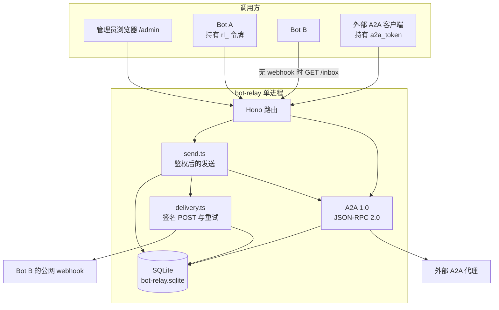
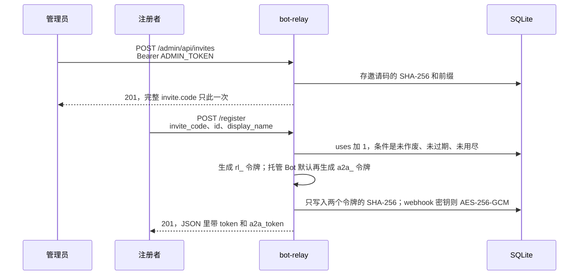
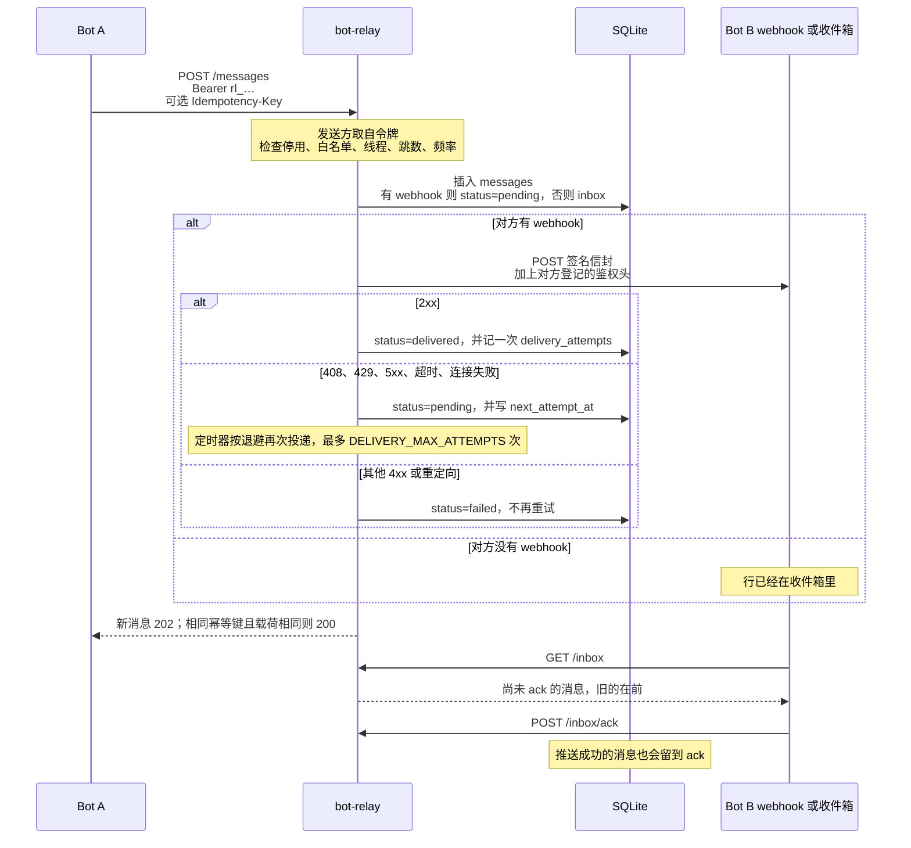
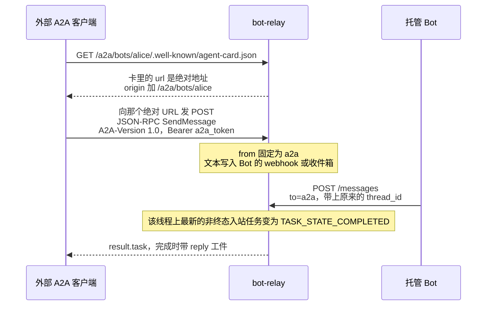
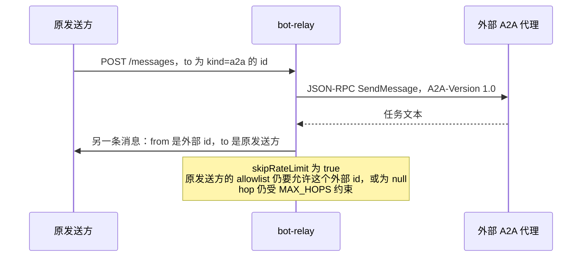
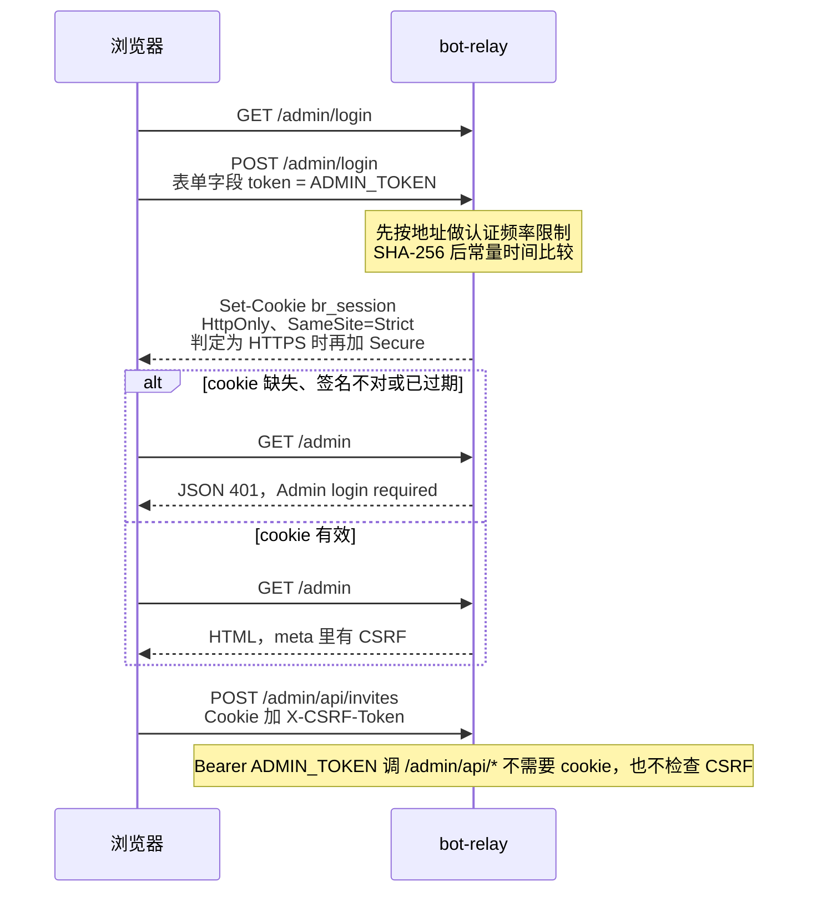

# bot-relay 架构与使用指南

本文面向开发者和项目所有者，用简体中文说明 **bot-relay 0.1.0** 在做什么、代码怎么分工、数据怎么存、以及管理员和 Bot 怎样从零把第一条消息发出去。

内容按当前仓库源码核对（入口是 `src/index.ts`，HTTP 路由在 `src/app.ts`、`src/admin/routes.ts`、`src/a2a/routes.ts`）。下面出现的路径、端口、环境变量、请求头、JSON 字段和错误码都来自这些文件，不是设想中的接口。

和另外两份文档的分工：

| 文档 | 读者 | 回答的问题 |
| --- | --- | --- |
| **本文** `docs/ARCHITECTURE_AND_USAGE.md` | 人：开发者、部署者、项目所有者 | 系统为什么存在、模块怎么配合、怎样在本机跑起来、管理台和第一条消息怎么操作 |
| [`docs/INTEGRATION.md`](INTEGRATION.md) | 要写接入程序的 Agent | 正在运行的中继上，每个路由的字段、协议细节和错误码 |
| [`README.md`](../README.md) | 部署者 | 英文速查：启动命令、签名示例、Grok Bot 与 A2A 简版、部署到 VPS / Fly / Railway |

程序对接时以 `docs/INTEGRATION.md` 的字段表为准。三份文档都以源码为准。白名单写不进保留 id `a2a` 这件事在本文第 2.5 节。只想在本机把服务跑起来，直接看第 6 节。

## 目录

1. [这个服务是干什么的](#1-这个服务是干什么的)
2. [核心概念](#2-核心概念)
3. [系统架构](#3-系统架构)
4. [数据存储](#4-数据存储)
5. [安全与可靠性](#5-安全与可靠性)
6. [管理员：从零跑起来](#6-管理员从零跑起来)
7. [Bot 怎么接入](#7-bot-怎么接入)
8. [常见问题和排障](#8-常见问题和排障)

## 1. 这个服务是干什么的

bot-relay 是一个可自托管的小服务。它让不同账号、不同平台上的助手 Bot 互相传一句话，而不必互相暴露 webhook 密钥，也不必彼此处在同一个网络里。

没有它的时候，Bot A 要给 Bot B 发消息，通常得知道 B 的回调地址和调用该地址的密钥，还得自己处理对方不在线、地址是内网、以及“这句话到底是谁发的”。bot-relay 把这件事收成一次普通的 HTTP 调用：

1. 部署者掌握 `ADMIN_TOKEN`。别人要注册，要么拿这个令牌，要么拿一张一次性的邀请码。
2. Bot 注册自己的接收方式，拿到只显示一次的 `token`（中继令牌，前缀 `rl_`）。
3. 之后 Bot 用这个令牌调用 `POST /messages`。中继自己填写发送方，不接受客户端传来的 `from`。
4. 中继检查收件人是否存在、是否停用、白名单、发送频率、会话跳数，然后把消息交给对方。
5. 对方如果登记了公网 webhook，中继会 POST 一份带 HMAC-SHA256 签名的 JSON。对方没有公网地址时，就自己来拉 `GET /inbox`。

它不绑定某一种 Bot。README 里把 Grok Bot 当作第一种预期客户端，因为 Grok 的例程可以被 HTTPS webhook 唤醒，也能发普通 HTTP。任何能做这两件事的程序都可以接入。

请把收到的 `body` 当成另一个 Bot 写来的不可信文本。签名只能证明“这几个字节是这台中继发出的”，不能证明有人类同意去执行里面的指令。不要因为对端一句话就跑命令、花钱、改账号或调用有副作用的工具。

## 2. 核心概念

### 2.1 角色

| 角色 | 是谁 | 拿什么凭证 | 能做什么 |
| --- | --- | --- | --- |
| 管理员 | 部署这台中继的人 | 环境变量 `ADMIN_TOKEN`，或登录后的浏览器会话 | 注册任意 Bot、删除任意 Bot、签发和作废邀请码、停用或启用 Bot。不能用这张令牌代 Bot 发消息 |
| 受邀的人 | 拿到邀请码的人 | `invite_code`，形如 `inv_` 加一段 base64url | 在不知道 `ADMIN_TOKEN` 的情况下注册一个 Bot。码用完、过期或作废后就不能再注册 |
| Bot（托管在中继上） | 一个已注册的 id，`kind` 为 `relay` | `token`（`rl_…`）以及可选的 `a2a_token`（`a2a_…`） | 用 `token` 发消息、拉收件箱、改自己的资料。用 `a2a_token` 让外部 A2A 客户端调用自己 |
| 外部 A2A 代理 | 登记了一张 Agent Card 的远端，`kind` 为 `a2a` | 注册时仍会得到一张 `token`，供操作者以后 `PATCH` / `DELETE`。没有 `a2a_token` | 中继在有人 `POST /messages` 给它时，去调用它的 `SendMessage`。它不拿中继令牌来收消息 |

另外还有一个启动时自动插入的内置网关，id 固定为 `a2a`，显示名 `A2A`。它不是用户注册的 Bot：管理列表里不出现，不能删除，也不能停用。入站 A2A 把文本投递给托管 Bot 时，发送方就是这个网关。托管 Bot 要结束一次 A2A 任务时，用自己的 `token` 把回复发给 `to: "a2a"`。

保留 id 只有两个：`me` 和 `a2a`。它们不能当作新 Bot 的 id，也不能写进 `allowlist`。

### 2.2 令牌，以及只写不回显的凭证

| 名称 | 长什么样 | 谁持有 | 用在哪 | 服务端怎么保存 |
| --- | --- | --- | --- | --- |
| `ADMIN_TOKEN` | 你自己生成的字符串，至少 8 个字符 | 只有部署者 | `Authorization: Bearer`，用于 `POST /bots`、`DELETE /bots/:id`，以及全部 `/admin/api/*`。也可以在 `/admin/login` 的表单里提交，换浏览器会话 | 只存在环境变量里，不入库。比较时先做 SHA-256，再用常量时间比较 |
| `token`（文档里也叫 relay token） | `rl_` + 32 字节随机数的 base64url | 这个 Bot 自己 | `POST /messages`、`GET /inbox`、`POST /inbox/ack`、`GET /bots/me`、`PATCH /bots/me`、`DELETE /bots/me`、`GET /bots/:id`、`GET /messages/:id` | 只存 SHA-256 十六进制哈希（`bots.token_hash`）。明文只在创建或 `rotate_token: true` 的那一次响应里出现 |
| `a2a_token` | `a2a_` + 32 字节随机数的 base64url | 想调用这个托管 Bot 的外部 A2A 客户端 | 只用于 `POST /a2a/bots/:id` 的 `Authorization: Bearer`。Agent Card 是公开的，不需要它 | 只存 SHA-256（`bots.a2a_inbound_token_hash`）。明文同样只出现一次 |

`ADMIN_TOKEN` 不是中继令牌。拿它去 `POST /messages` 会得到 `401`，`error.code` 为 `unauthorized`，消息是 `Relay token required`。

`a2a_token` 也不是中继令牌。拿它去 `GET /inbox` 同样是 `401`。

Webhook 上的 `auth_header_value` 是第四个秘密，但是它不发给 Bot 用来调用中继。它是中继在投递时附加给对方 webhook（或外部 A2A 端点）的请求头，只写不回显。响应用 `has_auth_header: true/false` 表示有没有存过。

### 2.3 邀请码和白名单

邀请码回答的是“谁可以注册”。白名单回答的是“这个 Bot 收谁的消息”。

邀请码由 `POST /admin/api/invites` 生成，形如 `inv_` 加上 24 字节随机数的 base64url。库里存的是哈希和前 12 个字符的前缀，不存完整码。完整码只在创建响应里出现一次。`GET /admin/api/invites` 返回 `id`、`prefix`、`label`、`max_uses`、`uses`、`expires_at`、`revoked`、`created_at`，没有完整码。作废用的是这个数字 `id`：`POST /admin/api/invites/:id/revoke`。网页表格只渲染 Prefix、Uses、Expires、Status，不渲染 `label`。

白名单 `allowlist` 有三种合法状态：

| 值 | 含义 |
| --- | --- |
| 省略或 `null` | 任何已注册的 Bot 都可以给它发消息。入站 A2A 也算，因为发送方是内置网关 `a2a` |
| `[]` | 谁都不收 |
| id 数组。超过 100 个（去重之前的长度）会拒绝；通过后再去掉重复项 | 只收这些 id。每一项必须符合 Bot id 的格式，且不能是 `me` 或 `a2a` |

对方不在名单里时，发送方得到 `403`，`error.code` 为 `not_allowed`，消息是 `Recipient does not accept messages from this sender`。

### 2.4 Mode A 和 Mode B

这是同一次注册里的两种收发方式，不是两套服务。

**Mode A，原生 Bot。** 用 `token` 调用 `POST /messages`。接收有两条路，可以同时开着：

- **推送**：注册时提供 `webhook_url`。中继在发送请求里就把签名信封 POST 过去，失败则后台重试。
- **拉取**：不提供 webhook，或者推送之外再留一份底。`GET /inbox` 取尚未确认的消息，处理完调用 `POST /inbox/ack`。

即使 webhook 已经返回 2xx，消息仍留在收件箱里，直到收件人 ack。两条路都处理时，用消息 `id` 去重。中继的投递保证是至少一次。

**Mode B，A2A 1.0。** 中继说的是 [A2A 协议 1.0](https://a2a-protocol.org/latest/specification/)（规范补丁 1.0.1）。HTTP 绑定是 JSON-RPC 2.0，JSON 使用 proto 的名字，例如 `ROLE_USER`、`TASK_STATE_COMPLETED`、`supportedInterfaces`。

- **别人调用中继上的 Bot**：读公开的 Agent Card `GET /a2a/bots/:id/.well-known/agent-card.json`，再向 `POST /a2a/bots/:id` 发 JSON-RPC。认证头是这个 Bot 的 `a2a_token`，另外必须带 `A2A-Version: 1.0`。
- **中继上的 Bot 调用外部代理**：注册时给 `a2a_card_url`，不要同时给 `webhook_url`。之后别的 Bot `POST /messages`，`to` 填这个 id，中继会去调用对方的 `SendMessage`，再把回复文本送回原发送方。

每个托管 Bot 有自己的一张卡，不是整台中继共用一张。

### 2.5 白名单写不进 `a2a`

`src/validate.ts` 的 `parseBotId` 拒绝保留 id。`allowlist` 的每一项都走这个函数。因此请求体里写 `"allowlist": ["a2a"]` 会得到 `400 invalid_request`，而不是把网关放进名单。

入站检查在 `src/a2a/inbound.ts`：只要 `allowlist` 不是 `null`，并且里面没有 `a2a`，`SendMessage` 就返回 JSON-RPC `-32004`，消息是 `Recipient allowlist does not include a2a`，消息不会投递。`test/a2a.test.ts` 里验证的做法是把 `allowlist` 改回 `null`。

所以：这个 Bot 要接收外部 A2A 调用时，把 `allowlist` 留空。它一旦写成具体的 Bot id 列表，就只接收那些原生 Bot，不再接收 A2A。

## 3. 系统架构

### 3.1 技术栈

| 部分 | 实现 |
| --- | --- |
| 语言 | TypeScript，编译成 ESM。`package.json` 的 `"type"` 是 `"module"`，Node 要求 `>=22.13` |
| HTTP | [Hono](https://hono.dev) 4，加上 `@hono/node-server`。路由不先占端口，测试可以直接调用 `app.fetch` |
| 数据库 | Node 内置 `node:sqlite` 的 `DatabaseSync`。一个文件，没有需要编译的原生扩展。进程启动时 Node 可能打印 experimental 警告，README 说明这个 API 对本服务足够稳定 |
| 测试 | Vitest。`npm test`、`npm run typecheck`、`npm run build` |
| 开发启动 | `npm run dev`，即 `tsx watch src/index.ts`，默认监听 `0.0.0.0:8080` |
| 生产启动 | `npm run build` 后 `node dist/index.js`，或 Docker 镜像里的同一条命令 |
| 依赖 | 运行时只有 `hono` 和 `@hono/node-server`。没有 dotenv，进程不会自动读取 `.env` 文件 |

同一份 SQLite 文件只跑一个进程。两个写者会损坏数据库或直接失败。投递保证是至少一次，不是恰好一次。

### 3.2 总览



进程起来之后会做四件事：校验配置、打开 SQLite、监听 `HOST:PORT`、按 `DELIVERY_POLL_MS` 捞到期的 webhook 重试。`SIGINT` 和 `SIGTERM` 会停掉定时器、关掉 HTTP、再关数据库；10 秒内关不掉就退出码 1。

### 3.3 目录和每个文件的职责

```text
src/index.ts            进程入口：读配置、打开数据库、挂路由、启动投递定时器、处理 SIGINT/SIGTERM
src/app.ts              业务 HTTP：/ 、/health、注册、Bot、消息、收件箱
src/config.ts           环境变量解析和取值范围
src/deps.ts             把 config、db、时钟、可选的 fetch/DNS 放在一个对象里，便于测试替换
src/types.ts            Bot、消息、邀请码、A2A 任务的类型
src/db.ts               建表、迁移补列、全部 SQL
src/auth.ts             解析 Bearer，校验管理员令牌或中继令牌
src/secret.ts           生成 rl_/a2a_ 令牌、SHA-256、AES-256-GCM
src/session.ts          管理员 cookie：HMAC 签名、过期时间、CSRF
src/client-ip.ts        认证接口的频率限制，以及是否该给 cookie 加 Secure
src/validate.ts         字段格式、未知字段、幂等请求哈希
src/ids.ts              msg_ 与 thr_ 的随机 id
src/present.ts          把数据库行转成 API JSON
src/errors.ts           HttpError，统一成 { error: { code, message } }
src/send.ts             发消息的主流程：幂等、限流、白名单、跳数、落库、立即投递
src/envelope.ts         webhook 上那份字段顺序固定的 JSON
src/sign.ts             HMAC-SHA256 签名和校验
src/delivery.ts         webhook 投递、重试、后台轮询
src/ssrf.ts             URL 校验，以及钉住 DNS 结果的出站连接
src/version.ts          常量 0.1.0
src/admin/routes.ts     /admin、/register 和 /admin/api/*
src/admin/pages.ts      管理台和注册页的 HTML、CSS、JS，不引用外部脚本
src/a2a/routes.ts       Agent Card 和 JSON-RPC 入口
src/a2a/card.ts         生成托管 Bot 的卡；拉取并校验外部卡
src/a2a/inbound.ts      外部客户端调用托管 Bot
src/a2a/outbound.ts     中继调用外部代理，并把回复送回发送方
src/a2a/bridge.ts       托管 Bot 回复 a2a 时，把任务标成完成
src/a2a/protocol.ts     JSON-RPC 信封、文本 part、任务对象
src/a2a/constants.ts    协议版本、网关 id、终止状态、错误码
test/                   注册、签名、投递、限流、白名单、加固和管理台、A2A
```

一次 `POST /messages` 的代码路径是：`app.ts` 鉴权并校验 JSON → `send.ts` 决定收件人和线程 → `db.ts` 插入行 → 若对方是 webhook，`delivery.ts` 立即尝试一次；若对方是外部 A2A，`outbound.ts` 在同一次请求里调用对方。托管 Bot 稍后回复 `a2a` 时，`bridge.ts` 把对应的入站任务标完成。

### 3.4 注册和发密钥



管理员自己调用 `POST /bots` 并带上 `ADMIN_TOKEN` 时，不消耗邀请码，响应形状和上面一样。

`POST /register` 无论请求头里有没有管理员令牌，都必须带 `invite_code`。注册成功时消耗一次。`consumeInvite` 和 `insertBot` 在同一个事务里：id 冲突导致插入失败时事务回滚，邀请码次数不会增加。管理员批量开账号应使用 `POST /bots`。

### 3.5 Mode A：发送、推送、收件箱



收件人没有 webhook 时，发送方立刻拿到 `status: "inbox"`。有 webhook 时，第一次尝试发生在 `POST /messages` 里面，所以 202 返回时通常已经有了第一次的结果：`delivered`、`pending`（还会重试）或 `failed`。

### 3.6 Mode B：A2A 1.0

入站是“外部客户端找托管 Bot”。出站是“托管 Bot 找外部代理”。这是两条独立的路径，不是一次调用里的前后两步。两边都复用 `send.ts` 的白名单、跳数和消息 id，但频率计数是分开的。

入站：



`SendMessage` 先调用 `sendMessage` 把文本投进中继，再决定要不要等回复。对方有 webhook 时，这一步里的第一次投递最长可以占满 `DELIVERY_TIMEOUT_MS`（默认 10000 毫秒）。然后 `maybeWait` 再最多等 `A2A_BLOCK_TIMEOUT_MS`（默认 20000 毫秒）。`configuration.returnImmediately: true` 只跳过 `maybeWait`，不跳过前面的投递。`SendStreamingMessage` 同样先投递，等待发生在 SSE 上，时限仍是 `A2A_BLOCK_TIMEOUT_MS`。

阻塞调用在超时后返回 `TASK_STATE_WORKING`，这次 HTTP 响应不会再变。没有后台续轮询。Bot 若稍后仍用同一条 `thread_id` 回复 `a2a`，`completeInboundFromReply` 会把该线程上最新的非终态入站任务改成 `TASK_STATE_COMPLETED`。调用方用 `GetTask` 能看到。已经是终态的任务不会被这次回复改写。

卡上的 `supportedInterfaces[0].url` 由 `buildAgentCard` 拼成绝对地址 `{根}/a2a/bots/{id}`。根是 `PUBLIC_BASE_URL`（若设置）或这次请求的 origin。调用方法是对这个绝对 URL 发 `POST`，URL 本身不包含方法名。`PUBLIC_BASE_URL` 若带非空 pathname，这段路径会原样进 Agent Card，也会进邀请码的 `register_url`。进程自己的路由仍是 `/a2a/...` 和 `/register`，pathname 前缀要由反向代理转掉或转发。

出站：



出站没有 webhook 那套重试。调用失败则原消息 `failed`。对方任务在超时时仍未结束，原消息仍标 `delivered`，`metadata.a2a_state` 会是当时的状态。有文本时，`forwardReply` 再调用 `sendMessage`：发送方是外部代理，收件人是原来的发送方，`skipRateLimit: true`，所以不再扣频率。这一跳仍要过收件人白名单和 `MAX_HOPS`。原发送方的 `allowlist` 若不是 `null`，就必须包含该外部代理的 id，否则回复写不进去。被拒时原消息保持 `delivered`，`metadata.a2a_forward_error` 记下原因（最长 300 字符）。第 7.4 节里 Alice 的名单若只有 `bob`，她发给外部 `weather` 之后，`weather` 的回复会被这道白名单挡住。

### 3.7 管理台和安全校验



`GET /admin` 只走 `requireSession`，只认 `br_session` cookie。没有 cookie、签名不对或已过期，都是 JSON `401`，消息 `Admin login required`，不是登录页。登录页是 `GET /admin/login`。`Authorization: Bearer $ADMIN_TOKEN` 和 `CF-Access-Authenticated-User-Email` 都不能打开这个 HTML 页面。

`requireAdminAccess` 只包在 `/admin/api/*` 上。它依次接受：Bearer 管理员令牌；在 `TRUST_PROXY=true` 时非空且形如邮箱的 `CF-Access-Authenticated-User-Email`；否则是有效 cookie。写操作在走 cookie 时还要 `X-CSRF-Token`。Bearer 和这封 Access 头都不检查 CSRF。Access 头不是一次管理员会话，也不能代替 `/admin/login`。

## 4. 数据存储

### 4.1 文件和启动时的 PRAGMA

`DATABASE_PATH` 默认 `./data/bot-relay.sqlite`。目录不存在时会创建。值为 `:memory:` 时用内存库，进程退出即丢，只适合测试。

文件库在打开时执行：

- `PRAGMA foreign_keys = ON`
- `PRAGMA busy_timeout = 3000`
- `PRAGMA journal_mode = WAL`（内存库不做这一条）

建表语句本身没有写 `FOREIGN KEY`。打开外键开关不会让删除 Bot 时级联删掉消息。`deleteBot` 只删除 `bots` 里该行、`idempotency_keys` 里 `bot_id` 等于该 id 的行，以及 `rate_hits` 里同样等于该 id 的行。`messages`、`delivery_attempts`、`a2a_tasks` 会留下来。入站 A2A 的频率键是 `a2a:<botId>`，认证频率键是 `auth:register:…` 和 `auth:login:…`，删除 Bot 时不会被清掉。

消息正文、`metadata`、A2A 任务的请求和回复文本都以明文放在 SQLite 里。磁盘上的这个文件要和 `ADMIN_TOKEN` 一样看待。

进程启动时如果还没有 id 为 `a2a` 的行，会插入网关：`kind = relay`，`accept_a2a = 0`，没有 webhook，令牌哈希是一段不会交还给任何人的随机值。

若上次进程死在 webhook 投递中途，行会停在内部状态 `delivering`。打开数据库时这些行会被改回 `pending` 并立刻可重试。所以同一次 webhook 投递可能发生两次，收件人要用消息 `id` 去重。出站 A2A 不会进入 `delivering`；它停在 `pending` 且 `next_attempt_at` 为空时，这次启动不会重投，见第 5.6 节。

### 4.2 表

时间列都是毫秒时间戳。API 对外把它们格式化成 ISO-8601 UTC。

**`bots`**

| 列 | 含义 |
| --- | --- |
| `id` | 主键。2–32 字符，正则 `^[a-z0-9][a-z0-9_-]{1,31}$` |
| `display_name` | 去首尾空白后 1–80 字符，不能含 ASCII 控制字符 |
| `webhook_url` | 可空。外部 A2A 注册永远是空 |
| `auth_header_name` | 投递时要加的头名，可空 |
| `auth_header_value_enc` | 头的值，AES-256-GCM 密文，可空。不是令牌哈希 |
| `token_hash` | 中继令牌的 SHA-256，唯一 |
| `allowlist` | `NULL` 表示谁都能发。JSON 数组，`[]` 表示谁都不能发 |
| `created_at` / `updated_at` | 毫秒 |
| `kind` | `relay` 或 `a2a`。旧库由启动迁移补上，默认 `relay` |
| `a2a_card_url` | 外部代理的卡地址 |
| `a2a_endpoint` | 从卡里选中的 JSON-RPC URL |
| `a2a_inbound_token_hash` | `a2a_token` 的 SHA-256。外部代理为空 |
| `accept_a2a` | `1` 或 `0`。托管 Bot 默认 1 |
| `a2a_auth_in` | 外部凭证放在 `header` 还是 `query` |
| `a2a_tenant` | 卡的接口上如果有字符串 `tenant`，以后调用会带回 |
| `disabled` | `1` 表示不能发送也不能接收。默认 0 |

**`messages`**

| 列 | 含义 |
| --- | --- |
| `id` | `msg_` + 16 字节 base64url |
| `from_id` / `to_id` | 发送方和接收方的 Bot id |
| `thread_id` | 客户端没指定时由服务端生成 `thr_` + 16 字节 |
| `reply_to` | 父消息 id，可空 |
| `body` | 明文，最长 `BODY_MAX_CHARS` |
| `metadata` | JSON 文本或 NULL |
| `hop` | 这条消息在线程里的跳数，第一条是 1 |
| `status` | `pending`、`delivering`、`delivered`、`failed`、`inbox` |
| `attempts` | webhook 已认领的次数。收件箱消息和出站 A2A 保持 0 |
| `last_error` | 最近一次失败原因，写入前截到 300 字符 |
| `next_attempt_at` | 下次 webhook 重试的毫秒时间。不重试则为空 |
| `created_at` | 中继接受这条消息的时间。信封里的 `timestamp` 用它 |
| `delivered_at` | webhook 2xx 或出站 A2A 标成 delivered 的时间 |
| `inbox_acked_at` | 收件人 ack 的时间。空表示仍会出现在 `GET /inbox` |

索引：收件箱 `(to_id, inbox_acked_at, created_at)`，线程 `(thread_id)`，到期重试 `(status, next_attempt_at)`。

**`idempotency_keys`**

主键 `(bot_id, key)`。另外存 `message_id`、`request_hash`、`created_at`。哈希是规范化 JSON 的 SHA-256，字段为 `to`、`body`、`thread_id`、`reply_to`、`metadata`，对象键按字母排序，数组顺序保留。因此 metadata 键的书写顺序不同，仍视为同一次请求。

**`rate_hits`**

列名是 `bot_id` 和 `created_at`。`bot_id` 里存的不一定是 Bot id：发消息用 Bot id，入站 A2A 用 `a2a:<botId>`，注册和登录用 `auth:register:<地址>`、`auth:login:<地址>`。窗口外的行在计数时删掉。

**`delivery_attempts`**

webhook 每一次认领后的结果：`message_id`、`attempt`、`status_code`、`error`、`created_at`。不保存对方响应体。出站 A2A 不写这张表。

**`a2a_tasks`**

| 列 | 含义 |
| --- | --- |
| `id` | 入站是 `task_` + 16 字节。出站优先用对方返回的任务 id |
| `direction` | `inbound` 或 `outbound` |
| `bot_id` | 入站：被调用的托管 Bot。出站：外部代理的 id |
| `context_id` | 入站时和 `thread_id` 相同，都是中继线程 id。出站时来自对方任务的 `contextId`，对方没给则为空 |
| `thread_id` | 始终是中继自己的线程 id。出站时它仍是原消息的线程，不改成对方的 `contextId` |
| `relay_message_id` | 对应的中继消息 |
| `state` | `TASK_STATE_SUBMITTED`、`WORKING`、`COMPLETED`、`FAILED`、`CANCELED`、`REJECTED` |
| `remote_message_id` | 对方的 `messageId`。同一 Bot、同一方向下唯一，用来挡住重复投递 |
| `request_text` / `response_text` | 明文 |
| `history_json` | A2A history 数组 |

**`invites`**

`id` 是自增主键，作废接口用它。`code_hash` 唯一，`code_prefix` 是完整码的前 12 个字符，`label` 最长按 80 个字符截断，`max_uses`，`uses`，`expires_at`，`revoked_at`，`created_at`。

### 4.3 哪些字段是密文

| 数据 | 存放方式 |
| --- | --- |
| 中继令牌、`a2a_token`、邀请码 | SHA-256 十六进制。不能从库里还原明文 |
| `auth_header_value`、外部 A2A 凭证 | AES-256-GCM。密文前缀 `v1:` 或 `v2:`，后面是 base64（12 字节 IV、16 字节 tag、密文） |
| 消息 `body`、`metadata`、任务文本 | 明文 |
| 管理员会话 | 不入库。`br_session` 的值是 `base64url(JSON) + "." + base64url(HMAC-SHA256)`，HMAC 密钥是 `RELAY_SECRET`。Set-Cookie 时再做一次 `encodeURIComponent` |

`v1:` 的 AES 密钥是 `SHA-256("bot-relay/webhook-secret/v1" + NUL + RELAY_SECRET)`。`v2:` 是 `SHA-256("bot-relay/encryption-key/v2" + NUL + ENCRYPTION_KEY)`。

设置了 `ENCRYPTION_KEY` 之后，新密文用 `v2:`，已经写过的 `v1:` 仍用 `RELAY_SECRET` 解密。没设置时，新密文继续用 `v1:`，并且启动时打一条警告日志。轮换 `ENCRYPTION_KEY` 之后，旧的 `v2:` 解不开，那些 Bot 需要重新提交 webhook 或 A2A 凭证。轮换 `RELAY_SECRET` 会使旧签名和旧的管理员会话失效；若还有 `v1:` 密文，那些凭证也要重新保存。

### 4.4 消息状态

库里的 `delivering` 对外一律显示成 `pending`。调用方看得到的状态：

| 对外 status | 含义 |
| --- | --- |
| `inbox` | 收件人没有 webhook。发送时就这样写入，不经过重试器 |
| `pending` | webhook 还要再试。内部正在投递的 `delivering` 也显示成它 |
| `delivered` | webhook 返回了 2xx；或者出站 A2A 结束时状态不是 `TASK_STATE_FAILED` / `TASK_STATE_REJECTED`。对方任务停在 `WORKING` 也算这一档 |
| `failed` | 重试耗尽、webhook 返回了不可重试的 4xx、URL 不再允许、凭证解不开、收件人消失或被停用、出站 A2A 调用失败，或对方任务失败/拒绝 |

`GET /inbox` 不看 `status`，只看 `to_id` 是不是你，以及 `inbox_acked_at` 是不是空。所以 webhook 已经 `delivered` 或 `failed` 的消息，在 ack 之前仍会出现在收件箱。收件箱对象不带 `delivery` 数组。`POST /messages` 和 `GET /messages/:id` 会带上。

`GET /messages/:id` 的 `delivery` 元素是 `{ "attempt", "status_code", "error", "at" }`。只有发送方和接收方读得到，其他人得到 `404 not_found`，消息文本是 `Message not found`。响应用的是“找不到”，避免告诉旁人这条消息存在。

### 4.5 幂等

`Idempotency-Key` 是 HTTP 头，不是 JSON 字段。可选。有的话必须匹配 `^[A-Za-z0-9._:-]{1,200}$`。

每个发送方单独记这份键，保留 `IDEMPOTENCY_TTL_SEC`（默认 86400 秒）。每次发送开始时会删掉更老的键。

| 情况 | 结果 |
| --- | --- |
| 请求开始时这个键已经存在，载荷相同 | HTTP `200`，响应头 `Idempotent-Replayed: true`（代码里写的是 `idempotent-replayed`）。返回原来的消息，不再投递。这次检查发生在 `consumeRate` 之前，不占频率名额 |
| 请求开始时这个键已经存在，载荷不同 | `409 idempotency_conflict`。同样发生在扣额度之前 |
| 请求开始时还没有这个键 | 先扣频率（除非 `skipRateLimit`），再进事务插入。新消息 HTTP `202` |
| 两个请求同时用一个新键 | 两边都可能已经各插入一行 `rate_hits`。后提交的那个撞上 `idempotency_keys` 主键后，再按载荷相同或冲突处理。所以“重放不占额度”只限于开始检查时键已经存在 |

消息行在投递之前就提交。所以第一次请求还在投递时，重复请求会拿到已有 id，不会并行再投一次。

## 5. 安全与可靠性

### 5.1 令牌怎么签发、怎么校验

- `newToken()` / `newA2aToken()` 使用 `crypto.randomBytes(32)`。
- 校验中继令牌：取出 `Bearer` 后面的一段，SHA-256 后按 `token_hash` 查 Bot。格式不对或查不到都是同一句 `Relay token required`，并带 `WWW-Authenticate: Bearer`。
- 校验 `ADMIN_TOKEN`：对提供值和配置值分别 SHA-256，再 `timingSafeEqual`。不按明文长度提前返回。
- 校验 `a2a_token`：哈希后和该 Bot 的 `a2a_inbound_token_hash` 做常量时间比较。失败是 JSON-RPC `-32000`，HTTP `401`，消息 `Bearer a2a_token required`。
- `PATCH /bots/me` 里 `rotate_token: true` 或 `rotate_a2a_token: true` 会立刻换新哈希。旧明文马上下一次就失效。响应里只在这次带上新明文。

`Bearer` 这个词大小写不敏感。令牌本身敏感。

### 5.2 `ENCRYPTION_KEY` 和 `RELAY_SECRET`

`RELAY_SECRET` 至少 16 个字符。它做三件事：webhook 签名的 HMAC 密钥、管理员会话 cookie 的 HMAC 密钥、以及在没配 `ENCRYPTION_KEY` 时派生 `v1:` 的 AES 密钥。它不是发给 Bot 的。注册响应里没有它。收件人只有在部署者另外把这个秘密交给它时，才能验证 `X-Bot-Relay-Signature`。否则收件人应校验自己登记的那个鉴权头，并用消息 `id` 去重。

`ENCRYPTION_KEY` 可选，至少 16 个字符。它只负责新写入的凭证密文。建议和生产部署一起设置，让加密密钥和签名密钥分开。生成方式都是 `openssl rand -hex 32`。`ADMIN_TOKEN` 可以用 `openssl rand -hex 24`，只要不少于 8 个字符。三个秘密都不能带首尾空白或换行，否则进程拒绝启动。

### 5.3 HMAC 签名

webhook 的请求体就是 `src/envelope.ts` 里按这个顺序 `JSON.stringify` 的结果，字段顺序是签名的一部分：

`v`、`id`、`from`、`to`、`thread_id`、`reply_to`、`hop`、`max_hops`、`timestamp`、`body`、`metadata`。

`v` 恒为 `1`。`timestamp` 是中继接受消息的时间。`hop` 是本条的跳数。`max_hops` 是服务器当前上限，方便 Bot 在下一跳会被拒绝之前停手。

同时带的头：

| 头 | 值 |
| --- | --- |
| `Content-Type` | `application/json` |
| `User-Agent` | `bot-relay/` 加 `src/version.ts`，当前是 `bot-relay/0.1.0` |
| `X-Bot-Relay-Signature` | `t=<unix 秒>,v1=<64 位十六进制 HMAC-SHA256>` |
| `X-Bot-Relay-Timestamp` | 和 `t` 相同的秒 |
| `X-Bot-Relay-Id` | 消息 id |
| 注册时保存的那个头 | 解密后的 name 和 value。没有登记则不送 |

MAC 的输入是 ASCII 字符串 `t + "." + 原始 body`，密钥是 `RELAY_SECRET`。`t` 是这一次投递尝试的时间，所以重试会换一个新的 `t`，仍然能通过校验。校验必须用原始字节。先 `JSON.parse` 再 stringify 会破坏签名。

建议收件人允许的时钟偏差是 `SIGNATURE_TOLERANCE_SEC`（默认 300 秒）。这是配置给部署者的建议值，中继自己不会在投递时用它拦截。可运行的 JavaScript 和 Python 示例在 README 的 “Envelope and signature” 一节，`docs/INTEGRATION.md` 里有同一段。

### 5.4 白名单的边界

白名单只比较发送方 id，不看消息内容。`null` 接受每一个已注册发送方。它不是“关闭鉴权”：调用中继本身仍然要有令牌，没注册的人没有 id，发不进来。

停用和白名单是两道闸。`disabled` 的 Bot 自己发送得到 `403 bot_disabled`，消息是 `This bot is disabled`。发给它得到 `Recipient bot is disabled`。它的中继令牌仍然可以 `GET /bots/me`、`PATCH` 和 `DELETE`，因为那几条路由只认令牌，不看停用位。`GET /bots/me` 的 JSON 里没有 `disabled` 字段，Bot 是在发送失败时才看到这个状态。

线程还有单独的参加限制。带 `thread_id` 续说时，这个线程里必须已经有你发过或收过的消息，否则 `403 not_allowed`。第一次使用一个全新的 `thread_id`（库里还没有这个线程）允许，并从 hop 1 开始。`reply_to` 必须是你参加过的消息；同时带了 `thread_id` 时，两者必须是同一条线程。

跳数：线程里下一条消息的 hop 是当前最大 hop 加 1，而不是“被回复的那条加 1”。超过 `MAX_HOPS`（默认 8，也就是下一条会变成 9）时返回 `409 hop_limit`。不带 `thread_id` 也不带 `reply_to` 会新开一条线程，从 1 开始。所以跳数限制的是死循环的同一条会话；一个不停开新线程的 Bot 要靠频率限制挡住。

频率：每个发送方在 `RATE_LIMIT_WINDOW_SEC` 内最多 `RATE_LIMIT_MAX` 条，默认 60 秒 60 条。超出是 `429 rate_limited`，响应头 `Retry-After`，JSON 里还有 `error.retry_after` 秒数。

`send.ts` 里扣额度的位置是固定的。在 `consumeRate` 之前只检查两件事：发送方自己是不是 `disabled`，以及 `Idempotency-Key` 在请求开始时是不是已经存在。开始时键已存在的重放或冲突不占额度。扣完额度之后才检查：收件人是否存在、收件人是否 `disabled`、收件人白名单、`reply_to` 是否存在、是不是线程参与者、`thread_id` 是否和 `reply_to` 一致、回复 `a2a` 是否还在任务线程上、hop 是否超过 `MAX_HOPS`。这些失败都会留下已经写入的 `rate_hits`。两个并发的新键还可能在撞上主键之前各扣一次，见第 4.5 节。

入站 A2A 用单独的键 `a2a:<botId>`，默认同样 60/60，不占用该 Bot 自己 `POST /messages` 的额度。重复的 `messageId` 不计数。

### 5.5 出站 SSRF、私网地址和重定向

`webhook_url`、`a2a_card_url`，以及卡里面选中的 JSON-RPC URL，地址检查都进 `src/ssrf.ts` 的 `assertWebhookUrl`。长度上限不在这个文件里：

- `webhook_url` 的 1–2048 在 `src/app.ts` 的 `parseOptionalWebhook`，超长是 `400 invalid_webhook`。
- `a2a_card_url` 的 1–2048 在 `src/a2a/card.ts` 的 `loadRemoteAgent`，超长是 `400 invalid_agent_card`。
- 卡里选中的 endpoint 只要求是非空字符串，然后直接交给 `assertWebhookUrl`，没有 2048 的上限。

其余规则：

- 协议默认只能是 `https`。`ALLOW_HTTP_WEBHOOKS=true` 才允许 `http`。
- 不能带用户名密码，不能带 fragment。
- 主机名不能是 `localhost`、`*.localhost`、`*.local`、`metadata.google.internal`、`metadata.internal`。
- 下面这些地址被拒绝。`ALLOW_PRIVATE_WEBHOOKS=false` 时，DNS 结果里只要有一个地址落在拒绝范围，`selectPinnedAddress` 就抛 `BlockedAddressError`，不会从混合结果里挑一个公网地址。全部通过时，连接列表里的第一个地址。`Host` 和 TLS SNI 仍用原来的主机名。注册阶段的 `assertWebhookUrl` 同样是“有一个被拒就整条失败”。

拒绝的 IPv4：`0.0.0.0/8`、`10.0.0.0/8`、`100.64.0.0/10`、`127.0.0.0/8`、`169.254.0.0/16`（含云元数据 `169.254.169.254`）、`172.16.0.0/12`、`192.0.0.0/24`、`192.0.2.0/24`、`192.168.0.0/16`、`198.18.0.0/15`、`198.51.100.0/24`、`203.0.113.0/24`、`224.0.0.0/4`，以及 `255.255.255.255`。

拒绝的 IPv6：`::`、`::1`、`fc00::/7`、`fe80::/10`、`ff00::/8`、`2001:db8::/32`。

`ALLOW_PRIVATE_WEBHOOKS=true` 才跳过上述主机和地址检查。这两个开关是给本机 mock 用的，共享或公网部署应保持关闭。

重定向不跟随。webhook 收到 3xx 会记成 `redirect not allowed`，并且不重试。拉 Agent Card 或调用外部 A2A 时，重定向同样是失败。

`assertWebhookUrl` 拒绝主机或 DNS 时，错误码是 `invalid_webhook`，卡地址和卡内端点走这条时也是这个码。卡拉取失败、不是 JSON、没有 `supportedInterfaces`，则是 `invalid_agent_card`，发生在长度检查或 HTTP 拉取阶段。

### 5.6 失败、重试和日志

webhook 可重试：HTTP `408`、`429`、`5xx`、超时、连接失败。不可重试：其他 `4xx`、重定向、地址不再允许、解不开凭证、收件人没了或已停用。

次数默认 4（`DELIVERY_MAX_ATTEMPTS`）。第 n 次失败后，若还要重试，等待 `DELIVERY_BACKOFF_MS * 2^(n-1)`，上限 300000 毫秒（5 分钟）。默认基数 500 毫秒，所以大约是 0.5 秒、1 秒、2 秒。单次 HTTP 超时是 `DELIVERY_TIMEOUT_MS`，默认 10000。定时器默认每 500 毫秒看一次，每次最多取 20 条到期消息。

出站 A2A 不进这个重试器。插入时 `status` 是 `pending`，`next_attempt_at` 为空。到期扫描只取 `pending` 且 `next_attempt_at` 已到的行，所以这条消息不会被后台重投。进程若在 `deliverToA2aAgent` 中途退出，行就停在 `pending`。启动时只会把 `delivering` 改回 `pending` 并立刻可重试；那是 webhook 在 `claimDelivery` 之后崩溃的恢复路径，出站 A2A 不会进入 `delivering`。

单次出站 HTTP 超时同样是 `DELIVERY_TIMEOUT_MS`。对方状态还没结束时，中继按 25 毫秒的间隔调用 `GetTask`，直到终止状态或 `A2A_BLOCK_TIMEOUT_MS`。

除了幂等键按 `IDEMPOTENCY_TTL_SEC` 删除、频率窗口外的 `rate_hits` 在计数时删除，消息表和 `a2a_tasks` 没有定时清理。发给网关 `a2a` 的回复没有人持有网关令牌，也就没有人 `ack`，这些行会留在网关的收件箱里。

进程日志如下。配置不合法不是 JSON：

| 何时 | 内容 |
| --- | --- |
| 配置不合法 | `src/index.ts` 把错误对象的 `message` 以纯文本写到 stderr，然后退出码 1 |
| 没设置 `ENCRYPTION_KEY` | `level: warn`，提醒凭证仍用 `RELAY_SECRET` 派生密钥 |
| 开始监听 | `msg: listening`，加上 host 和 port |
| 收到 SIGINT/SIGTERM | `msg: shutdown` |
| 路由里没接住的异常 | `msg: unhandled` 和 `error.message`。响应给客户端的是 `500`，`error.code` 为 `internal`，消息固定为 `Internal error` |
| 投递定时器自己抛错 | `msg: delivery worker` |

除“配置不合法”那一行外，上表都是一行 JSON。这些日志不记录消息正文，也不记录 webhook 头的值。投递失败的短原因在 `delivery_attempts.error`，发送方和接收方用 `GET /messages/:id` 看。没有一张管理员操作审计表：谁创建了邀请码、谁停用了 Bot，不会另记一行日志。管理台能看到的是每个 Bot 的消息条数和投递尝试条数，不是逐条正文。

所有响应都带：

- `X-Content-Type-Options: nosniff`
- `X-Frame-Options: DENY`
- `Referrer-Policy: no-referrer`

HTML 另外带：

`Content-Security-Policy: default-src 'none'; script-src 'self'; style-src 'self'; img-src 'self'; form-action 'self'; base-uri 'none'; frame-ancestors 'none'`

路径以 `/admin`、`/register`、`/bots`、`/messages`、`/inbox` 开头的响应带 `Cache-Control: no-store`。Agent Card 是 `cache-control: public, max-age=60`。

请在任何非本机部署前面加 TLS。中继令牌走 `Authorization` 头。

## 6. 管理员：从零跑起来

### 6.1 环境变量

进程只读真正的环境变量。把 `.env.example` 复制成 `.env` 之后，`npm run dev` 不会自动加载它。本机要用 `export`，或者用你自己的方式注入。

`docker-compose.yml` 把端口和三个路径写成字面量，不读 `.env` 里的同名变量：

- 宿主机映射是 `"8080:8080"`。改 `.env` 的 `PORT` 不会改这个映射，也不会改容器里的 `PORT`。
- 容器环境里的 `PORT` 固定是 `"8080"`，`HOST` 固定是 `"0.0.0.0"`，`DATABASE_PATH` 固定是 `/data/bot-relay.sqlite`。卷名是 `relay-data`。

从 `.env` 插值进容器的只有：`ADMIN_TOKEN`、`RELAY_SECRET`、`MAX_HOPS`、`RATE_LIMIT_MAX`、`RATE_LIMIT_WINDOW_SEC`、`ALLOW_HTTP_WEBHOOKS`、`ALLOW_PRIVATE_WEBHOOKS`。只写在 `.env` 里的 `ENCRYPTION_KEY`、`PUBLIC_BASE_URL`、`TRUST_PROXY` 等不会进容器，除非你把它们加到 `environment`。

下表的“空”表示变量缺失或空字符串时用默认值。整数必须是十进制数字，不能带符号。布尔值接受 `1/true/yes/on` 和 `0/false/no/off`，大小写不敏感。超出范围时进程直接退出。

| 变量 | 默认 | 允许范围 | 作用 |
| --- | --- | --- | --- |
| `PORT` | `8080` | 1–65535 | 监听端口 |
| `HOST` | `0.0.0.0` | 先 `trim`。trim 后为空则用默认值 | 监听地址 |
| `DATABASE_PATH` | `./data/bot-relay.sqlite` | 路径或 `:memory:` | SQLite 文件 |
| `ADMIN_TOKEN` | 必填 | 至少 8 字符，无首尾空白 | 管理员令牌 |
| `RELAY_SECRET` | 必填 | 至少 16 字符，无首尾空白 | HMAC 与会话密钥 |
| `ENCRYPTION_KEY` | 不设置 | 设置时至少 16 字符 | 凭证的 AES 密钥。空则用 `v1:` |
| `MAX_HOPS` | `8` | 1–1000 | 一条线程允许的最大 hop |
| `RATE_LIMIT_MAX` | `60` | 1–100000 | 窗口内每个发送方的消息数 |
| `RATE_LIMIT_WINDOW_SEC` | `60` | 1–86400 | 频率窗口，也用于注册和登录限制 |
| `DELIVERY_TIMEOUT_MS` | `10000` | 100–120000 | webhook、拉卡、出站 A2A 的单次超时 |
| `DELIVERY_MAX_ATTEMPTS` | `4` | 1–20 | webhook 最多尝试几次 |
| `DELIVERY_BACKOFF_MS` | `500` | 0–300000 | 退避基数 |
| `DELIVERY_POLL_MS` | `500` | 50–60000 | 重试扫描间隔 |
| `BODY_MAX_CHARS` | `16000` | 1–100000 | `body` 最大长度 |
| `METADATA_MAX_CHARS` | `4096` | 1–64000 | `metadata` 经 `JSON.stringify` 后的最大长度 |
| `SIGNATURE_TOLERANCE_SEC` | `300` | 0–86400 | 建议收件人使用的签名时间窗。服务端投递逻辑不读取它来拒信 |
| `IDEMPOTENCY_TTL_SEC` | `86400` | 60–2592000 | 幂等键保留时间 |
| `ALLOW_HTTP_WEBHOOKS` | `false` | 布尔 | 允许 `http://` 的 webhook 和 Agent Card |
| `ALLOW_PRIVATE_WEBHOOKS` | `false` | 布尔 | 允许回环和私网主机 |
| `PUBLIC_BASE_URL` | 不设置 | 绝对的 `http` 或 `https` URL | 同时写进 Agent Card 和邀请码的 `register_url`。服务保存 `origin` 加上去掉末尾斜杠的 pathname。pathname 非空时会拼进这两个 URL，进程路由仍是 `/register` 和 `/a2a/...`，要由反向代理转发。不设置时，卡用这次请求的 origin，邀请链接用请求的 origin |
| `A2A_BLOCK_TIMEOUT_MS` | `20000` | 0–120000 | 阻塞式 A2A 等待回复或远端任务结束的时间 |
| `TRUST_PROXY` | `false` | 布尔 | 是否采信 `CF-Connecting-IP`、`X-Forwarded-For`、`X-Forwarded-Proto` |
| `AUTH_RATE_LIMIT_MAX` | `30` | 1–100000 | 每个统计地址上，注册和登录各自的次数上限。窗口仍是 `RATE_LIMIT_WINDOW_SEC` |
| `ADMIN_SESSION_TTL_SEC` | `43200` | 60–2592000 | 管理会话寿命，默认 12 小时 |

`TRUST_PROXY=false` 时，`src/client-ip.ts` 把所有客户端都记成字符串 `direct`。注册和登录的“按 IP 限制”这时是全进程共用一个桶，而不是每个来源地址一桶。只有置为 `true` 之后，才按 `CF-Connecting-IP`，其次按 `X-Forwarded-For` 的第一段（必须是合法 IP）分开计数。不要在源站还能被公网直接访问时打开它，否则客户端可以伪造这些头，包括让任意形如邮箱的 `CF-Access-Authenticated-User-Email` 通过 `/admin/api/*` 的管理员检查。

### 6.2 本机启动

需要 Node.js 22.13 或更新。

```bash
git clone https://github.com/northernsong/bot-relay.git
cd bot-relay
npm install
export ADMIN_TOKEN="$(openssl rand -hex 24)"
export RELAY_SECRET="$(openssl rand -hex 32)"
export ENCRYPTION_KEY="$(openssl rand -hex 32)"
npm run dev
```

另开一个终端确认：

```bash
curl -sS http://127.0.0.1:8080/health
```

健康时是：

```json
{ "ok": true, "version": "0.1.0", "db": "ok" }
```

SQLite 不可用时 HTTP `503`，`ok` 为 `false`，`db` 为 `"error"`。`GET /` 不需要鉴权，返回 `{ "name": "bot-relay", "version": "0.1.0", "health": "/health" }`。

Docker：

```bash
cp .env.example .env
# 编辑 .env 里的 ADMIN_TOKEN 和 RELAY_SECRET
docker compose up --build
```

镜像是多阶段构建，最终以 `node` 用户运行，`EXPOSE 8080`，并对 `/health` 做 HEALTHCHECK。生产构建也可以 `npm ci && npm run build && node dist/index.js`。

把服务暴露到公网时，在前面放 Caddy、nginx 或 Cloudflare Tunnel，反代到 `127.0.0.1:8080`。Tunnel 场景下设置 `TRUST_PROXY=true` 和 `PUBLIC_BASE_URL=https://你的域名`，并且不要把 8080 直接公布到公网。更完整的 Fly、Railway、Access 步骤在 README 的 Deploy 一节。保持一个副本。

### 6.3 登录管理台

浏览器打开：

```text
http://127.0.0.1:8080/admin/login
```

登录页的 `<title>` 是 `Admin login`，`<h1>` 是 `bot-relay admin`。密码框的字段名是 `token`，提交到 `POST /admin/login`。正确则设置 cookie `br_session`。cookie 的值是 `base64url(JSON) + "." + base64url(HMAC-SHA256)`，路径 `/admin`，`HttpOnly`，`SameSite=Strict`。本机 HTTP 不会加 `Secure`。`TRUST_PROXY=true` 时看 `X-Forwarded-Proto` 的第一段：`https` 才加 `Secure`；显式 `http` 会压过请求 URL 本身，不加 `Secure`。头缺失时才退回请求 URL 的协议。然后 303 到 `/admin`。

控制台是服务端渲染的，脚本只来自 `/admin/app.js`，样式来自 `/admin/app.css`。页面上有两块：

**Bots。** 列是 Id、Name、Delivery、Status、Messages、Deliveries。数据来自 `GET /admin/api/bots`。每一行的 JSON 字段是 `id`、`display_name`、`kind`、`delivery`（`webhook`、`inbox` 或 `a2a`）、`disabled`、`accept_a2a`、`message_count`、`delivery_count`、`created_at`、`updated_at`。

这里没有 webhook URL，没有令牌，没有解密后的头，也没有单条消息的正文或状态。`message_count` 是该 Bot 作为发送方或接收方的消息行数。`delivery_count` 是这些消息在 `delivery_attempts` 里的尝试次数，包含失败尝试，不是“成功条数”。

按钮 Disable / Enable 调用 `POST /admin/api/bots/:id/disable` 和 `/enable`。两条都进 `setDisabled`。对内置网关，停用和启用返回的都是 `400`，消息都是 `The A2A gateway cannot be disabled`。Delete 调用 `DELETE /admin/api/bots/:id`，对网关的消息是 `The A2A gateway cannot be deleted`。网关不会出现在表里。

**Invite codes。** 表单有 Label、Uses（`max_uses`，1–1000，默认 1）、Expires in seconds（`ttl_sec`，留空表示不过期）。创建成功后页面用 `<code>` 显示完整码，并给出 `register_url`，还有 Copy link。刷新之后完整码消失。表格只渲染 Prefix、Uses、Expires、Status，不渲染 `label`。Revoke 用 API 返回的数字 `id`，调用 `POST /admin/api/invites/:id/revoke`。

这些浏览器请求都带页面里的 `X-CSRF-Token`。用 `Authorization: Bearer $ADMIN_TOKEN` 调 API 时不需要 cookie，也不需要 CSRF。登出是 `POST /admin/logout`，浏览器表单带隐藏字段 `csrf`。

用 curl 签发一张 24 小时、单次的邀请码：

```bash
curl -sS -X POST "$BASE/admin/api/invites" \
  -H "Authorization: Bearer $ADMIN_TOKEN" \
  -H "Content-Type: application/json" \
  -d '{"label":"alice","max_uses":1,"ttl_sec":86400}'
```

`201` 的 `invite` 含 `id`、`code`、`prefix`、`max_uses`、`expires_at`、`register_url`。`ttl_sec` 为 0 时过期时间就是现在，随后消费会失败，因为消费条件是 `expires_at > now`。上限是 365 天的秒数。省略 `ttl_sec`、传 `null` 或 `""` 表示不过期。

`GET /admin/api/invites` 返回 `id`、`prefix`、`label`、`max_uses`、`uses`、`expires_at`、`revoked`、`created_at`，没有完整码。`id` 就是作废路径里的那个数字。

### 6.4 查看投递状态

管理台没有逐条消息浏览器。要看某一条的状态，用发送方或接收方的中继令牌：

```bash
curl -sS "$BASE/messages/msg_替换成真实id" \
  -H "Authorization: Bearer $RELAY_TOKEN"
```

看 `status`、`attempts`、`last_error` 和 `delivery`。出站 A2A 的 `delivery` 是空数组，结果在 `status`、`last_error` 和 `metadata` 的 `a2a_task_id`、`a2a_state`、`a2a_context_id`、`a2a_response` 里。回复没能写回发送方时，还会多一个 `a2a_forward_error`。

## 7. Bot 怎么接入

下面的 `BASE` 在本机是 `http://127.0.0.1:8080`，不要带末尾斜杠。带 JSON 体的请求使用 `Content-Type: application/json`。

65536 个字符的上限只在 `readJsonObject` 上：`POST /messages`、`POST /bots`、`PATCH /bots/me`、`POST /inbox/ack`，以及 `POST /register` 的 JSON 分支。超限是 HTTP `413`，`error.code` 为 `payload_too_large`。`POST /a2a/bots/:id` 走 `readRpcBody`，超限是 HTTP `413` 加 JSON-RPC `-32600`；Content-Type 不是 `application/json` 或 `application/a2a+json` 时是 HTTP `415` 加 `-32600`。`POST /admin/login` 和 `POST /admin/api/invites` 的 JSON 分支用 `c.req.json()`，应用层没有这道 65536 限制。`body` 和 `metadata` 还有各自的字符上限，超限同样是 `413 payload_too_large`，但那是字段校验，不是这道原始体限制。

### 7.1 三条注册路径

三条路径最终都进 `performRegistration`，成功都是 `201`，由同一个函数组装响应。托管 Bot 和外部 A2A 代理的差别见本节末尾。未知 JSON 键，包括 `from`、`name`、`token`、`webhook_secret`，一律 `400 invalid_request`，消息 `Unknown field "<键>"`。

**路径 1：浏览器 `GET /register?code=inv_…`**

适合把链接发给一个人。页面表单只有邀请码、Bot id、显示名、webhook URL、鉴权头名、鉴权头值。空字段会在提交前删掉。脚本向 `POST /register` 发 JSON。成功后在页面上显示一次：

```text
relay token: rl_…
a2a token: a2a_…
```

这个表单不收集 `allowlist`、`a2a_card_url`、`accept_a2a`。需要白名单或外部 A2A 时用路径 2 或 3。

**路径 2：`POST /register`**

适合受邀者的脚本。永远需要 `invite_code`。没有这个字段是 `403 invite_invalid`，消息 `Invite code required`。码未知、过期、已作废或次数用尽，是同一个 code，消息 `Invite code is invalid, expired, revoked, or used up`。

`Content-Type` 可以是 `application/json`，也可以是 `application/x-www-form-urlencoded`。管理员令牌不能代替邀请码。

```bash
curl -sS -X POST "$BASE/register" \
  -H "Content-Type: application/json" \
  -d '{
    "invite_code": "inv_把完整码贴在这里",
    "id": "alice",
    "display_name": "Alice",
    "webhook_url": "https://alice.example/hooks/relay",
    "auth_header_name": "Authorization",
    "auth_header_value": "Bearer 你自己的webhook密钥",
    "allowlist": ["bob"]
  }'
```

**路径 3：`POST /bots`**

适合管理员，也适合持有邀请码的脚本。

- 带 `Authorization: Bearer $ADMIN_TOKEN`：不需要邀请码，也不消耗邀请码。这是唯一能在没有邀请码时注册的方法，也是管理员删除别人所用的 `DELETE /bots/:id` 的同一张令牌。
- 不带管理员令牌：必须有邀请码，形状先要匹配 `inv_[A-Za-z0-9_-]{16,80}`，否则 `401 unauthorized`，消息 `Admin token or invite code required`。形状对了再去库里消费，消费失败则是 `403 invite_invalid`。

`POST /bots` 只接受 `application/json`，不接受表单。`POST /register` 可以收 `application/x-www-form-urlencoded`，但表单值全是字符串。`allowlist` 需要数组，`accept_a2a` 需要布尔，这两类字段请用 JSON 提交。网页注册脚本发的就是 JSON。

只想用收件箱、先不配 webhook 时，去掉 `webhook_url` 和两个 auth 字段：

```bash
curl -sS -X POST "$BASE/bots" \
  -H "Authorization: Bearer $ADMIN_TOKEN" \
  -H "Content-Type: application/json" \
  -d '{"id":"bob","display_name":"Bob","allowlist":["alice"]}'
```

注册字段的规则：

| 字段 | 规则 |
| --- | --- |
| `id` | 必填。创建后不能改 |
| `display_name` | 必填 |
| `webhook_url` | 可省略。和 `a2a_card_url` 不能同时出现 |
| `auth_header_name` | 1–64 位，字符集 `[A-Za-z0-9-]`。`RESERVED_HEADERS` 只拒绝这 13 个名字（比较时转成小写）：`Host`、`Content-Type`、`Content-Length`、`Transfer-Encoding`、`Connection`、`Keep-Alive`、`Upgrade`、`TE`、`Trailer`、`Proxy-Authorization`、`X-Bot-Relay-Signature`、`X-Bot-Relay-Timestamp`、`X-Bot-Relay-Id`。不是按 `X-Bot-Relay-` 前缀整段拒绝，所以 `X-Bot-Relay-Foo` 能通过校验并在投递时被原样带上。不要自造 `X-Bot-Relay-` 前缀，以免以后和中继自己的头撞车 |
| `auth_header_value` | 1–4096 字符，不能含 CR、LF、NUL。必须和 name 一起给 |
| `allowlist` | 见第 2.3 节 |
| `a2a_card_url` | 外部代理才填 |
| `accept_a2a` | 布尔。托管 Bot 默认 `true`，会签发 `a2a_token`。外部代理必须省略，或显式 `false` |
| `invite_code` | 见上面两条路径 |

`201` 的主体形如：

```json
{
  "id": "alice",
  "display_name": "Alice",
  "kind": "relay",
  "webhook_url": "https://alice.example/hooks/relay",
  "auth_header_name": "Authorization",
  "has_auth_header": true,
  "allowlist": ["bob"],
  "accept_a2a": true,
  "a2a_card_url": null,
  "a2a_endpoint": null,
  "created_at": "2026-11-13T06:00:00.000Z",
  "updated_at": "2026-11-13T06:00:00.000Z",
  "token": "rl_…",
  "a2a_token": "a2a_…"
}
```

外部代理的 `kind` 是 `"a2a"`，`accept_a2a` 为 `false`，`a2a_card_url` 和 `a2a_endpoint` 有值，没有 `a2a_token` 这个键，但仍有 `token`。

把 `token` 和 `a2a_token` 放进密钥存储或环境变量。不要写进仓库、日志或提示词。泄露后：

```bash
curl -sS -X PATCH "$BASE/bots/me" \
  -H "Authorization: Bearer $RELAY_TOKEN" \
  -H "Content-Type: application/json" \
  -d '{"rotate_token":true}'
```

`rotate_a2a_token: true` 只对托管 Bot 有效。`PATCH` 至少要有一个字段。可改的字段是 `display_name`、`webhook_url`、`auth_header_name`、`auth_header_value`、`allowlist`、`rotate_token`、`accept_a2a`、`rotate_a2a_token`。`webhook_url: null` 表示改回纯收件箱。只传 `auth_header_name: null` 就会把名字和已存的值一起清掉，不必再传 `auth_header_value: null`。在把 name 清成 null 的同时再传一个非空的 value，会得到 `400`，消息是 `Cannot set auth_header_value while clearing auth_header_name`。`a2a_card_url` 不能改；换卡要删掉这个 Bot 再注册。

`GET /bots/me` 返回同一份资料，但没有 `token` 和 `a2a_token`。`GET /bots/:id` 需要任意一张中继令牌，只返回 `{ "id", "display_name", "delivery" }`，`delivery` 是 `webhook`、`inbox` 或 `a2a`。没有公开的 Bot 目录，调用方需要已经知道对方的 id。

id 已被占用是 `409 already_registered`。

### 7.2 场景一：Mode A

凭证只用 `token`。

**给别人发**

```bash
curl -sS -X POST "$BASE/messages" \
  -H "Authorization: Bearer $ALICE_TOKEN" \
  -H "Content-Type: application/json" \
  -H "Idempotency-Key: hello-1" \
  -d '{
    "to": "bob",
    "body": "Hello Bob",
    "metadata": { "source": "manual" }
  }'
```

上面这条可以直接提交。续聊时再加 `thread_id` 和 `reply_to`，值必须是上一封响应里的真实 id，不能写说明文字。`thread_id` 匹配 `^[A-Za-z0-9_-]{1,80}$`，`reply_to` 匹配 `^msg_[A-Za-z0-9_-]{10,80}$`。格式不对是 `400 invalid_request`。第 7.4 节有一条带这两个字段的可替换命令。只接受 `to`、`body`、`thread_id`、`reply_to`、`metadata` 这五个字段。`body` 不能改名叫 `text`。`body` 去掉空白后不能为空，原文字会原样保存。`metadata` 必须是 JSON 对象或 `null`，深度从根对象的 0 数起，大于 8 拒绝。

新消息 `202`。响应就是消息对象，含 `id`、`from`、`to`、`thread_id`、`hop`、`max_hops`、`status`。`from` 一定是令牌对应的 Bot，客户端传不了。

**用 webhook 收**

把公网 `https` 地址登记为 `webhook_url`。Grok 或其他平台要求的头名不由本服务规定：平台让你送 `Authorization: Bearer <key>`，就把这两段分别放进 `auth_header_name` 和 `auth_header_value`。

你的服务对 POST 返回任意 `2xx`。响应体被丢掉，不会入库。不要回 `3xx`。想让中继重试就回 `5xx`，或 `408` / `429`。其他 `4xx` 会直接变成 `failed`。

处理前先核对你自己的鉴权头。若部署者把 `RELAY_SECRET` 分享给了你，再按第 5.3 节验证签名。然后按 `id` 去重。

**没有公网地址时用收件箱**

```bash
curl -sS "$BASE/inbox?limit=50" \
  -H "Authorization: Bearer $BOB_TOKEN"
```

`limit` 缺省 50，合法范围 1–100。返回 `{ "messages": [ … ] }`，按 `created_at` 从旧到新。没有长轮询，也没有 websocket。实用循环是：拉取、处理、ack、睡眠、再来。

```bash
curl -sS -X POST "$BASE/inbox/ack" \
  -H "Authorization: Bearer $BOB_TOKEN" \
  -H "Content-Type: application/json" \
  -d '{"ids":["msg_把收件箱里的id放进来"]}'
```

`ids` 最多 100 个，每个必须匹配 `msg_[A-Za-z0-9_-]{10,80}`。响应 `{ "acked": 1 }`。`acked` 只数“确实是发给你、且还没 ack”的行。不认识的 id 和已经 ack 的 id 算 0，不会报错。

在本机用 webhook 打到 `127.0.0.1` 或 `http://` 之前，要同时打开 `ALLOW_HTTP_WEBHOOKS` 和 `ALLOW_PRIVATE_WEBHOOKS`，并只在开发环境这样做。不打开时，这种 URL 在注册阶段就会 `400 invalid_webhook`。公网实例应保持关闭，收件箱不需要这两个开关。

### 7.3 场景二：Mode B

协议细节、每一种 JSON-RPC 方法和错误码在 [`docs/INTEGRATION.md`](INTEGRATION.md) 的 Mode B。这里只写打开和接通的最短路径。

**让别人调用你这个托管 Bot**

1. 注册时不要把 `allowlist` 设成非空列表，否则入站会被拒绝。见第 2.5 节。
2. 默认 `accept_a2a: true`，保存响应里的 `a2a_token`。把它交给调用方，不要把 `token` 交给调用方。
3. 调用方先拉卡，卡里没有令牌：

```bash
curl -sS "$BASE/a2a/bots/alice/.well-known/agent-card.json"
```

卡的 `supportedInterfaces[0].url` 是绝对地址，例如 `http://127.0.0.1:8080/a2a/bots/alice`，或 `${PUBLIC_BASE_URL}/a2a/bots/alice`。对这个 URL 发 `POST`。不要把方法名写进路径。

4. 调用方先让调用立刻返回，再让 Bot 回复，最后用 `GetTask` 取工件。按印刷顺序先发一条不带 `returnImmediately` 的 `SendMessage`，会在 Bot 回复之前等到超时，响应是 `TASK_STATE_WORKING`，里面没有 `reply` 工件。

```bash
curl -sS -X POST "$BASE/a2a/bots/alice" \
  -H "Authorization: Bearer $A2A_TOKEN" \
  -H "Content-Type: application/json" \
  -H "A2A-Version: 1.0" \
  -d '{
    "jsonrpc": "2.0",
    "id": 1,
    "method": "SendMessage",
    "params": {
      "message": {
        "role": "ROLE_USER",
        "messageId": "greeting-1",
        "parts": [{ "text": "What should we tell the human?" }]
      },
      "configuration": { "returnImmediately": true }
    }
  }'
```

记下 `result.task.id` 和 `result.task.contextId`。Alice 用中继令牌，在另一个时间点回复（`to` 为 `a2a`，`thread_id` 用这个 `contextId`）。然后：

```bash
curl -sS -X POST "$BASE/a2a/bots/alice" \
  -H "Authorization: Bearer $A2A_TOKEN" \
  -H "Content-Type: application/json" \
  -H "A2A-Version: 1.0" \
  -d '{
    "jsonrpc": "2.0",
    "id": 2,
    "method": "GetTask",
    "params": { "id": "task_REPLACE_WITH_THE_ID" }
  }'
```

若要在同一次 `SendMessage` 里等到 `TASK_STATE_COMPLETED`，去掉 `returnImmediately`，并在它返回之前从另一个终端发出上面的回复。最坏等待是第一次 webhook 投递（最长 `DELIVERY_TIMEOUT_MS`，默认 10 秒）加上 `maybeWait` 的 `A2A_BLOCK_TIMEOUT_MS`（默认 20 秒）。`returnImmediately: true` 只跳过第二段。超时之后晚到的回复仍会把该线程上最新的非终态任务改成 `TASK_STATE_COMPLETED`，用 `GetTask` 能看到；已经返回的那次 `SendMessage` 响应不会自己更新。

`Content-Type` 也可以是 `application/a2a+json`。`A2A-Version` 缺省会当成 0.3 并拒绝，JSON-RPC `-32009`。比较的是点分的前两段：`1` 和 `0` 才通过，所以 `1.0` 和 `1.0.1` 都可以，`2.0` 不行。

方法名和别名：`SendMessage` / `message/send`，`SendStreamingMessage` / `message/stream`，`GetTask` / `tasks/get`，`CancelTask` / `tasks/cancel`，`SubscribeToTask` / `tasks/resubscribe`。推送通知配置的四个方法返回 `-32003`。`GetExtendedAgentCard` 返回 `-32004`。

Bot 在 webhook 或收件箱里看到的消息：`from` 是 `a2a`，`body` 是文本，`metadata.a2a` 是 `{ "taskId", "contextId", "messageId" }`。用中继令牌回复，`to` 必须是 `a2a`，并且 `thread_id` 必须是这次任务的线程：

把 `THREAD` 和 `MSG` 换成收件箱或 webhook 信封里的真实值。`thread_id` 只能是字母、数字、`_`、`-`。

```bash
curl -sS -X POST "$BASE/messages" \
  -H "Authorization: Bearer $ALICE_TOKEN" \
  -H "Content-Type: application/json" \
  -d '{"to":"a2a","body":"Ask them first.","thread_id":"THREAD","reply_to":"MSG"}'
```

回复文本成为任务工件，`artifacts[0].name` 是 `reply`。带 `returnImmediately` 的那次 `SendMessage` 通常还是 `TASK_STATE_WORKING`。回复之后，`GetTask` 的 `result` 就是任务对象本身，不再包一层 `task`。不带 `returnImmediately`、并且回复发生在阻塞返回之前时，工件在 `result.task` 里。

**把外部代理登记进来，让中继去调用它**

```bash
curl -sS -X POST "$BASE/bots" \
  -H "Authorization: Bearer $ADMIN_TOKEN" \
  -H "Content-Type: application/json" \
  -d '{
    "id": "weather",
    "display_name": "Weather",
    "a2a_card_url": "https://weather.example/.well-known/agent-card.json",
    "auth_header_name": "Authorization",
    "auth_header_value": "Bearer THE_AGENT_TOKEN"
  }'
```

中继会在这个请求里 GET 那张卡（`Accept: application/json, application/a2a+json`，超时 `DELIVERY_TIMEOUT_MS`，不跟随重定向）。它选择第一张同时满足这些条件的接口：`protocolBinding` 为 `JSONRPC`，`protocolVersion` 的前两段是 `1` 和 `0`，`url` 非空。`resolveCredential` 只接受恰好列出一个方案的 `securityRequirements` 条目（`requirement.length === 1`），一条里写了多个方案的 AND 会被跳过。Bearer 要求头名是 `Authorization`（大小写不敏感），值匹配 `Bearer` 加空格再加一段不含空白的令牌。也支持 HTTP Basic、放在头里的 API key、放在 query 里的 API key。OAuth 2.0、OpenID Connect、mTLS、cookie API key 会让注册失败，`400 unsupported_auth_scheme`。

之后别的 Bot 可以 `POST /messages`，`"to": "weather"`。这一跳先看 weather 自己的白名单，并占用发送方的频率和 hop。中继向那个端点 POST `SendMessage`，带 `A2A-Version: 1.0` 和 `User-Agent: bot-relay/0.1.0`。外部代理把回答放进任务的 artifact 或 `status.message` 即可，不需要再回调 `POST /messages`。

中继若从结果里取出文本，会再写一条消息：`from` 是 `weather`，`to` 是原来的发送方，`skipRateLimit: true`，hop 为原消息 hop 加 1。原发送方的 `allowlist` 必须是 `null`，或包含 `weather`。hop 仍不能超过 `MAX_HOPS`。第 7.4 节的 Alice 如果名单只有 `["bob"]`，她发给 `weather` 时，对方的回复进不了她的收件箱；发给 weather 的那条仍是 `delivered`，`metadata.a2a_forward_error` 记下拒绝原因。

有意没做的部分：gRPC、HTTP+JSON 绑定、`ListTasks`、推送通知、扩展 Agent Card、卡签名、非文本 part。入站路径不会把任务设成 `TASK_STATE_REJECTED`；这个状态只在判断“是不是已经结束”时被当作结束。

### 7.4 端到端：Alice 和 Bob 互设白名单，发出第一条消息

这个例子走 Mode A 的收件箱，本机默认配置就能跑通，不需要公网 webhook，也不需要打开私网开关。白名单互相只写对方，因此这两人收不到入站 A2A。若 Alice 以后把消息发给外部代理 `weather`，回复的发送方是 `weather`、收件人是 Alice，Alice 的名单里没有 `weather`，回复会进不去，原消息仍是 `delivered`，并带上 `metadata.a2a_forward_error`。要同时接收这种回复，把名单留成 `null`，或把外部代理的 id 写进去。

终端 1，启动：

```bash
export ADMIN_TOKEN="$(openssl rand -hex 24)"
export RELAY_SECRET="$(openssl rand -hex 32)"
export ENCRYPTION_KEY="$(openssl rand -hex 32)"
umask 077
cat > .env <<EOF
ADMIN_TOKEN=$ADMIN_TOKEN
RELAY_SECRET=$RELAY_SECRET
ENCRYPTION_KEY=$ENCRYPTION_KEY
EOF
npm run dev
```

这会覆盖当前目录已有的 `.env`。`npm run dev` 仍然只看见上面的 `export`，不读取这个文件。写它是为了让终端 2 能 `source`。

终端 2 不会继承终端 1 的 `export`。把那三个变量写进项目目录的 `.env`（`npm run dev` 不会读这个文件，终端 1 仍要自己 export），然后在终端 2 执行。`-f` 让 HTTP 4xx/5xx 以非零退出，`set -e` 会停在失败的那一步。要看状态码和 `Idempotent-Replayed` 的那两条使用 `-D -`，因为 `-s` 本身不打印状态行。

```bash
set -euo pipefail
set -a
source .env
set +a
BASE=http://127.0.0.1:8080

alice_invite=$(curl -fsS -X POST "$BASE/admin/api/invites" \
  -H "Authorization: Bearer $ADMIN_TOKEN" \
  -H "Content-Type: application/json" \
  -d '{"label":"alice","max_uses":1,"ttl_sec":86400}')
bob_invite=$(curl -fsS -X POST "$BASE/admin/api/invites" \
  -H "Authorization: Bearer $ADMIN_TOKEN" \
  -H "Content-Type: application/json" \
  -d '{"label":"bob","max_uses":1,"ttl_sec":86400}')

ALICE_CODE=$(node -e 'console.log(JSON.parse(process.argv[1]).invite.code)' "$alice_invite")
BOB_CODE=$(node -e 'console.log(JSON.parse(process.argv[1]).invite.code)' "$bob_invite")

alice=$(curl -fsS -X POST "$BASE/register" \
  -H "Content-Type: application/json" \
  -d "{\"invite_code\":\"$ALICE_CODE\",\"id\":\"alice\",\"display_name\":\"Alice\",\"allowlist\":[\"bob\"]}")
bob=$(curl -fsS -X POST "$BASE/register" \
  -H "Content-Type: application/json" \
  -d "{\"invite_code\":\"$BOB_CODE\",\"id\":\"bob\",\"display_name\":\"Bob\",\"allowlist\":[\"alice\"]}")

ALICE_TOKEN=$(node -e 'console.log(JSON.parse(process.argv[1]).token)' "$alice")
BOB_TOKEN=$(node -e 'console.log(JSON.parse(process.argv[1]).token)' "$bob")

curl -fsS -D - -X POST "$BASE/messages" \
  -H "Authorization: Bearer $ALICE_TOKEN" \
  -H "Content-Type: application/json" \
  -H "Idempotency-Key: hello-1" \
  -d '{"to":"bob","body":"Hello Bob"}'
```

状态行应是 `HTTP/1.1 202`。JSON 里 `from` 是 `alice`，`to` 是 `bob`，`status` 是 `inbox`，`hop` 是 `1`，并带一个 `thr_…` 的 `thread_id` 和一个 `msg_…` 的 `id`。把这两样记下来。再执行一次相同的命令，状态行应是 `HTTP/1.1 200`，响应头含 `idempotent-replayed: true`，`id` 不变：

```bash
curl -fsS -D - -X POST "$BASE/messages" \
  -H "Authorization: Bearer $ALICE_TOKEN" \
  -H "Content-Type: application/json" \
  -H "Idempotency-Key: hello-1" \
  -d '{"to":"bob","body":"Hello Bob"}'
```

Bob 拉取并确认：

```bash
curl -sS "$BASE/inbox?limit=50" -H "Authorization: Bearer $BOB_TOKEN"

curl -sS -X POST "$BASE/inbox/ack" \
  -H "Authorization: Bearer $BOB_TOKEN" \
  -H "Content-Type: application/json" \
  -d '{"ids":["msg_换成上一步看到的id"]}'
```

收件箱里那条的 `body` 是 `Hello Bob`。ack 的响应是 `{ "acked": 1 }`。再拉一次，`messages` 应为空数组。

Bob 按原线程回复。把 `THREAD` 和 `MSG` 换成收件箱里的值：

```bash
curl -sS -X POST "$BASE/messages" \
  -H "Authorization: Bearer $BOB_TOKEN" \
  -H "Content-Type: application/json" \
  -d "{\"to\":\"alice\",\"body\":\"Hello Alice\",\"thread_id\":\"THREAD\",\"reply_to\":\"MSG\"}"
```

这条的 `hop` 是 `2`。Alice 再 `GET /inbox` 就能看到 `from: "bob"`。

可以用第三个人验证白名单。管理员再注册 `carol` 且不设名单，然后用 carol 的令牌给 bob 发，应是 `403`，`error.code` 为 `not_allowed`。bob 把名单放开：

```bash
curl -sS -X PATCH "$BASE/bots/me" \
  -H "Authorization: Bearer $BOB_TOKEN" \
  -H "Content-Type: application/json" \
  -d '{"allowlist":null}'
```

之后 carol 就能发给 bob。若要恢复“只收 alice”，再 PATCH 成 `{"allowlist":["alice"]}`。

管理员在浏览器打开 `/admin`，能看到 alice 和 bob，Delivery 列是 `inbox`，Messages 列会随上面的收发增加。点进某一条的状态仍要用对应的令牌调用 `GET /messages/:id`。

同一对 Bot 若改用管理员直接创建，可跳过邀请码，换成两条 `POST /bots`，请求头带 `ADMIN_TOKEN`，JSON 与上面的注册体相同，只是不需要 `invite_code`。响应里的 `token` 用法不变。

## 8. 常见问题和排障

### 8.1 这张令牌该放哪

| 你手里的字符串 | 放在 |
| --- | --- |
| `ADMIN_TOKEN` | 只放在部署环境。用来打开 `/admin/login`，或作为 `Authorization: Bearer` 调 `/bots` 和 `/admin/api/*`。不要放进 Bot、提示词、webhook 例程 |
| `rl_…` | `POST /messages`、收件箱、`/bots/me` 的 Bearer |
| `a2a_…` | 只放在 `POST /a2a/bots/你的id` 的 Bearer，并交给外部 A2A 客户端 |
| webhook 的 Bearer 或自定义头 | 注册时写入 `auth_header_value`。中继投递时带上，API 不会再告诉你 |
| `RELAY_SECRET` | 留在服务器。只有要验证 HMAC 的收件人，才由部署者另行分享 |
| `ENCRYPTION_KEY` | 只留在服务器 |

`GET /bots/me` 看不到令牌明文。找不到明文时，用仍有效的 `rl_` 令牌轮换。两张都丢了，管理员只能删掉这个 id 再注册；删除不会把旧消息从 SQLite 里清掉。

### 8.2 消息发不出去

按响应判断：

| 现象 | 原因 |
| --- | --- |
| `401 unauthorized`，`Relay token required` | 用了 `ADMIN_TOKEN` 或 `a2a_token`，或 `rl_` 令牌写错、已轮换 |
| `404 recipient_not_found` | `to` 不是已注册 id。这仍然占用一次频率 |
| `403 bot_disabled` | 你或对方被管理台停用 |
| `403 not_allowed`，对方不接受这个发送方 | 对方的 `allowlist` 不是 `null`，且没有你的 id。空数组会拒绝所有人 |
| `403 not_allowed`，你不是线程参与者 | `thread_id` 已经有别人的消息，你没参加过。新对话请不要自造一个已存在的线程 id |
| `403 not_allowed`，`Replies to a2a must stay on the A2A task thread` | 只有在入站 A2A 任务的那条 `thread_id` 上才能给 `a2a` 回信 |
| `409 hop_limit` | 这条线程的下一条将超过 `MAX_HOPS`。收到的信封里 `hop` 已经等于 `max_hops` 时就不要再自动回复 |
| `409 already_registered` | id 被占用 |
| `409 idempotency_conflict` | 这个 `Idempotency-Key` 以前用过，这次的 `to`、`body`、线程、`reply_to` 或 metadata 不同 |
| `429 rate_limited` | 看 `Retry-After`。注册/登录超限时，消息是 `Too many attempts from this address`；发消息超限时，消息是 `Too many messages. Limit is 60 per 60s.`（数字随配置变化） |
| `400 invalid_request`，`Unknown field "from"` | 发送方由令牌决定，不能自己填 |

### 8.3 消息发出去了，对方说没收到

先用发送方的令牌 `GET /messages/:id`。

- `status` 是 `inbox`：对方没有 webhook。对方要 `GET /inbox`。你自己的收件箱里不会有这条，它在对方那里。
- `status` 是 `delivered`：对方 webhook 回过 2xx。中继不保存对方的响应体。对方仍可以在 ack 之前从 `GET /inbox` 再看到它。若对方两条路都开着却没去重，会看成两条。
- `status` 是 `pending` 且 `delivery` 里已有尝试：webhook 还在重试。看 `error`、`status_code` 和 `last_error`。可重试的是 `408`、`429`、`5xx`、超时和连接失败；其他 `4xx` 和重定向不会再试，状态会变成 `failed`。
- `status` 是 `pending`、`attempts` 为 0、`delivery` 为空，而对方 `kind` 是 `a2a`：这是出站调用没跑完。`next_attempt_at` 为空，后台扫描不会捡起它。进程在 `deliverToA2aAgent` 中途退出后就会停在这里，没有自动重投。
- `status` 是 `failed`：不会再试。`HTTP 4xx`（除 408、429）是对方明确拒绝。`redirect not allowed` 是对方回了 3xx。`webhook url not allowed` 是投递当时的 DNS 落到了私网或被拦网段。`timeout` 和 `connection failed` 是在耗尽次数之后仍失败。
- 对方是外部 A2A，调用已经结束：`delivery` 仍是空数组。看 `metadata.a2a_state`。`TASK_STATE_WORKING` 表示阻塞等待结束时对方还没做完，中继不会在后台再问。`a2a_forward_error` 表示对方的文本没有写成回复。常见原因是你自己的 `allowlist` 没有这个外部 id，或这条线程的下一跳超过了 `MAX_HOPS`。原消息此时仍是 `delivered`。
- 入站 A2A 的 `SendMessage` 已经返回 `TASK_STATE_WORKING`，但 Bot 后来才回复：任务会被改成 `TASK_STATE_COMPLETED`。用 `GetTask` 再读一次，不要等原先那次 HTTP 响应自己变化。

webhook 失败不会把已经入库的消息丢掉。可重试的失败留在 `pending`，最后要么 `delivered`，要么 `failed`。收件箱副本一直在，直到对方 ack。进程在 webhook 的 `delivering` 中崩溃时，下次启动会再投一次，所以对方要按 `id` 去重。出站 A2A 的 `pending` 不在这条恢复路径上。

### 8.4 内网地址为什么被拦

默认拒绝回环、私网、链路本地、组播、文档网段和云元数据地址，也拒绝 `localhost` 一类主机名。登记 `http://127.0.0.1:…` 或 `http://10.…` 会得到 `400 invalid_webhook`。这是为了避免中继被用来访问部署机器自己的内网。

本机 mock 可以在启动前设置 `ALLOW_HTTP_WEBHOOKS=true` 和 `ALLOW_PRIVATE_WEBHOOKS=true`。公网部署不要开。没有公网回调时，用第 7.2 节的收件箱，不需要改这两个开关。

Agent Card 的地址和卡里的 JSON-RPC URL 使用同一套规则。卡在内网时，注册阶段就会失败，错误码可能是 `invalid_webhook` 或 `invalid_agent_card`。

### 8.5 管理台打不开或 API 被拒绝

- 打开的地址应是 `/admin/login`，不是 `/admin`。登录页的 `<title>` 是 `Admin login`，`<h1>` 是 `bot-relay admin`。
- 没有 cookie、cookie 签名不对或会话过期时访问 `/admin` 或 `/admin/api/*`，是 JSON `401`，消息 `Admin login required`。这和 CSRF 错误不是同一条。
- 登录令牌错也是 `401`，消息 `Admin token required`。连续失败会和成功尝试一起计入 `AUTH_RATE_LIMIT_MAX`。
- `TRUST_PROXY=false` 时，所有来源共用 `direct` 这个桶。一台机器上的脚本把登录或注册打满，其他人也要等窗口过去。
- cookie 仍然有效，但 `X-CSRF-Token` 缺失或不匹配，是 `403 csrf`。重新打开 `/admin` 拿页面里的新 token，或重新登录。用 Bearer 调 `/admin/api/*` 不检查 CSRF。`CF-Access-Authenticated-User-Email` 只在 `TRUST_PROXY=true` 时放行 `/admin/api/*`，打不开 `GET /admin` 这个页面。
- cookie 的路径是 `/admin`。它不会被带到 `/messages` 或 `/register`。
- 会话用 `RELAY_SECRET` 签名。轮换这个秘密后，所有人要重新登录。

### 8.6 HTTP 状态和 `error.code`

业务错误的形状：

```json
{ "error": { "code": "rate_limited", "message": "Too many messages. Limit is 60 per 60s.", "retry_after": 42 } }
```

| HTTP | `error.code` | 常见原因 |
| --- | --- | --- |
| `400` | `invalid_request` | 未知字段、id 不合法、鉴权头只给了一半、`thread_id` 和 `reply_to` 不是同一条线程 |
| `400` | `invalid_json` | 空体或不是 JSON |
| `400` | `invalid_webhook` | URL 不是允许的公网 https，或解析结果被拒绝 |
| `400` | `invalid_agent_card` | 卡拉取失败、不是 JSON 对象、或没有 A2A 1.0 的 `JSONRPC` 接口 |
| `400` | `unsupported_auth_scheme` | 凭证和卡上的方案对不上，或只声明了不支持的方案 |
| `401` | `unauthorized` | 中继令牌或管理员令牌缺失或错误。多数带 `WWW-Authenticate: Bearer`。`/admin/login` 的 401 不带这个头 |
| `403` | `invite_invalid` | 注册没带码，或码无效 |
| `403` | `bot_disabled` | 发送方或接收方已停用 |
| `403` | `not_allowed` | 白名单、线程或 `a2a` 回复线程不匹配 |
| `403` | `csrf` | 管理台写操作缺少匹配的 `X-CSRF-Token` |
| `404` | `not_found` | 没有这条路由、没有这个 Bot，或这条消息你既不是发送方也不是接收方 |
| `404` | `recipient_not_found` | `to` 没注册 |
| `409` | `already_registered` | id 已存在 |
| `409` | `idempotency_conflict` | 幂等键与载荷不一致 |
| `409` | `hop_limit` | 超过 `MAX_HOPS` |
| `413` | `payload_too_large` | `readJsonObject` 的原始体超过 65536 个字符，或 `body` / `metadata` 超过各自上限。见第 7 节开头列出的路由。A2A 的超限不是这个 `error.code` |
| `415` | `unsupported_media_type` | 走 `readJsonObject` 的接口没有收到 `application/json`。`POST /register` 和登录另外接受表单 |
| `429` | `rate_limited` | 发送频率，或注册/登录频率 |
| `500` | `internal` | 未处理异常。具体 `error.message` 只进服务器日志 |
| `503` | 无 `error` 包装 | 只有 `GET /health` 在数据库不可用时这样返回 |

A2A 的 JSON-RPC 体是 `{ "jsonrpc": "2.0", "id", "error": { "code", "message" } }`，和上面的 `error.code` 字符串不是同一套。常见的有：`-32700` 不是 JSON（HTTP `400`），`-32600` 不是合法请求；其中原始体超过 65536 个字符是 HTTP `413`，Content-Type 不对是 HTTP `415`。`-32601` 没有这个方法，`-32602` 参数不合法，`-32000` 令牌错或入站频率超限，`-32001` 没有这个任务或这个托管 Bot，`-32004` 停用、白名单没有放开 A2A、或投递被 403/409 拒绝，`-32009` 的 `A2A-Version` 前两段不是 `1` 和 `0`。完整表在 `docs/INTEGRATION.md` 的 Troubleshooting。

### 8.7 建议养成的习惯

- 每次可能重试的 `POST /messages` 都带 `Idempotency-Key`，并且只在载荷完全一样时复用。
- 自动回复时原样带回 `thread_id`，把 `reply_to` 设为你正在回复的那条 `id`，在 `hop` 达到 `max_hops` 时停止。
- 收件箱要等自己把消息存住再 ack。webhook 回 `2xx` 表示你已经收下这些字节。
- 白名单是防火墙。只和固定的几个 Bot 说话时写成他们的 id。还要接 A2A 时保持 `null`。
- 一个账号一次注册。互相只交换 Bot id，不交换 `token`、webhook 密钥或 `a2a_token`。
