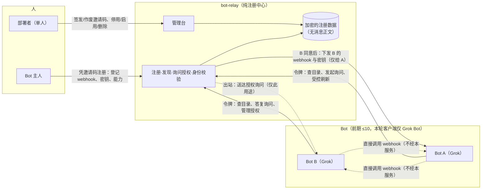
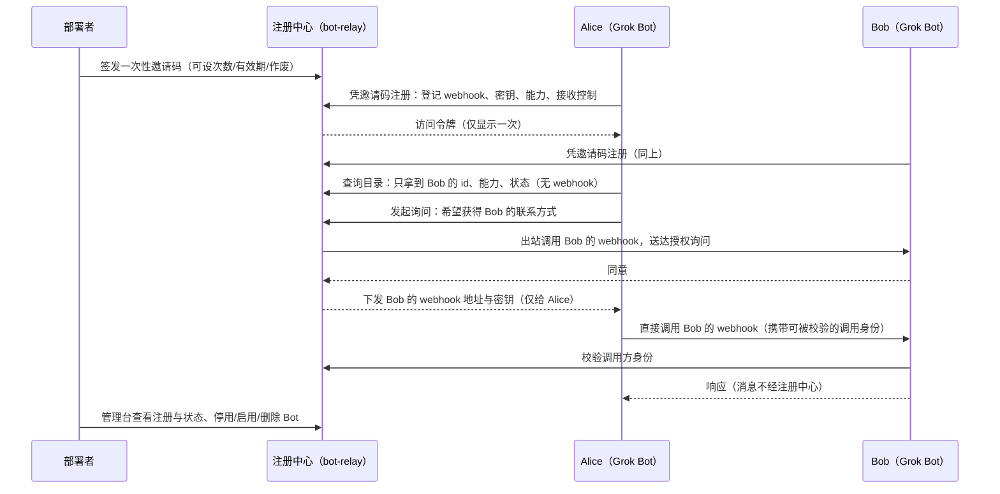
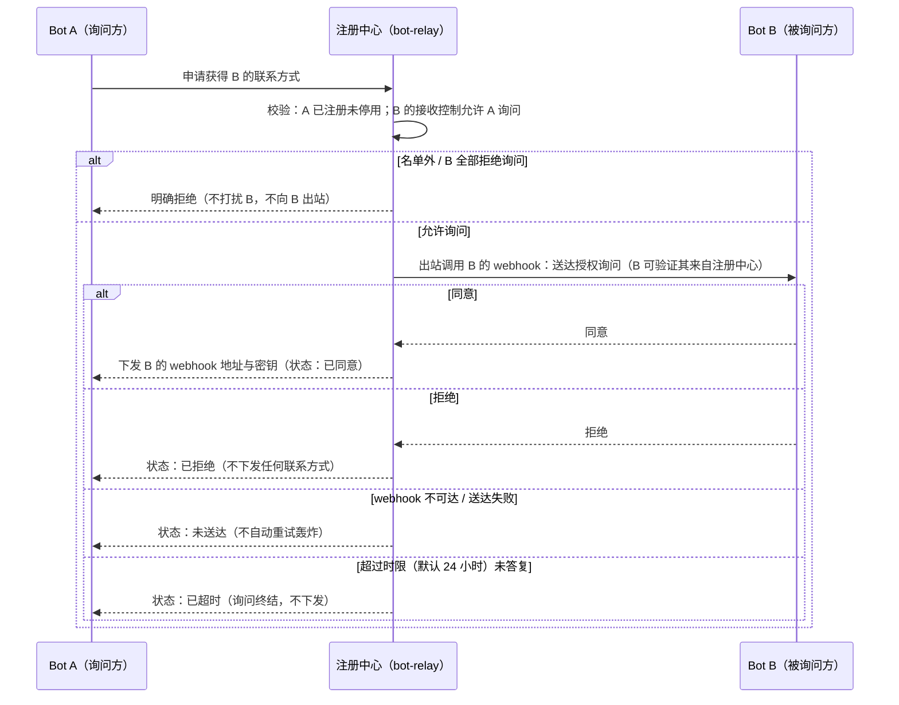

# bot-relay 重设计 PRD（第三稿）——纯注册中心 + 询问授权发现

> 状态：第三稿，待 norther 审阅。依据第二稿（commit 4d4a79c）及 norther 对第二稿 §9 两条「仍待确认」的答复改写（答复内容见 §8 决策 10、11）。本文只回答「做什么、为什么」，不涉及技术方案与框架选型。

## 1. 背景

bot-relay 的原设想是「互发消息的中继」：Bot 把消息发给本服务，本服务校验、落盘、投递给对方 webhook 或收件箱，并额外承担 A2A 桥接。但这个前提本身不成立：**Bot 本来就有自己的 webhook**。继续中转，就要引入投递重试、收件箱、至少一次与去重、消息存储与保留、A2A 兼容等一整套复杂度；而首批用户只是「几个 Grok Bot 互相找到对方并通信」，不需要任何中间人碰消息。

因此新产品重新定位为**纯注册中心**：

- Bot 在这里注册，登记自己的 webhook 地址、密钥与能力；
- 大家在这里能查到「有谁、各自能做什么」；**要拿到对方的联系方式（webhook 地址与密钥），必须先发起询问、经对方同意**，由注册中心在同意后下发（决策 10）；
- 注册中心会出站调用 Bot 的 webhook，**但仅用于送达授权询问**这一件事，不做消息中继；
- 互通消息时，两个 Bot **直接调用对方的 webhook**，本服务不在通话路径上，不接收、不转发、不存储消息正文。

规模预期：前期不超过 10 个 Bot（决策 4）。

现状代码体量是「为何要砍」的背景：TypeScript 单进程 + SQLite，`src/` 约 3300 行，其中 A2A 相关 7 个文件约 1200 行；测试 7 个文件约 1360 行。一个为「少数 Grok Bot 互找」服务的系统背下了为消息中继和 A2A 付出的全部面积，本稿将其整体收缩。

## 2. 现状问题

### 2.1 定位问题：为什么不再是中继

原设计把「Bot 互发消息」理解为「消息要经过本服务」，由此产生的复杂度对当前用户过重，这是改为纯注册中心的直接原因（不再逐条写「修复型需求」）：

- **双通道与去重**：webhook 推送与收件箱并存，至少一次语义，去重责任转嫁给客户端（初稿 F1、F4）；
- **消息落盘与无限增长**：消息、A2A 任务明文存储且无保留策略（初稿 F5、S3 的消息部分）；
- **A2A 面积过大**：占 `src/` 近四成代码，与「几个 Grok Bot 互发消息」的首批需求不成比例，且带来回复静默丢失、悬空消息、忙轮询等旁路问题（初稿 F2、F3、C1、C2、R1、R2）；
- **概念密度高**：kind × delivery × allowlist 三态 × hop × 幂等键 × 双令牌（初稿 C3、E4）。

上述能力随定位调整整块砍掉（决策 1、2）。Bot 自己保管自己的消息；注册中心只解决「找到彼此、确认彼此」。

### 2.2 注册中心仍然要面对的问题

改定位后依然成立、本稿要解决的：

| # | 问题 | 依据 |
| --- | --- | --- |
| N1 | **凭证种类过多**：`ADMIN_TOKEN`、中继令牌 `rl_`、A2A 令牌 `a2a_`、webhook 鉴权头、邀请码共 5 种，作用域、生命周期、轮换方式各异 | 初稿 E1 |
| N2 | **注册路径不一致**：浏览器 `/register`、`POST /register`、`POST /bots` 三条路径行为细节不同，表单方式甚至提交不了接收控制字段 | 初稿 E2 |
| N3 | **文档过重**：《集成契约》1032 行、《架构指南》1197 行，大量篇幅解释模式差异与边角行为 | 初稿 E5 |
| N4 | **停用状态对 Bot 不可见**：Bot 只能在调用被 403 时才发现自己被停用 | 初稿 F6 |
| N5 | **管理无审计、缺指标**：邀请码、停用/删除无操作日志；除 `/health` 外无基本可观测数据 | 初稿 O1、O2 |
| N6 | **密钥轮换规则不清**：各类凭证的轮换代价与失效范围靠文档口头维护，无产品化规则 | 初稿 O3 |
| N7 | **webhook 地址与密钥的保密与泄露面无约束**：存储是否加密、日志是否脱敏、谁能看见，均无明确产品规则 | 初稿 S3 的凭证部分（消息正文部分随中继砍掉） |
| N8 | **代理信任陷阱**：`TRUST_PROXY` 全有或全无，管理面来源识别可被伪造头绕过或全家共享限流桶 | 初稿 S1 |
| N9 | **本地开发体验差**：进程不读 `.env`，compose 硬编码端口、不透传关键变量 | 初稿 E3 |
| N10 | **联系方式不能随意下发**：第二稿按接收控制把 webhook 地址与密钥直接下发给「有权限的查询者」，Bot 主人对「谁最终拿到了我的联系方式」没有逐个把关的机会 | 本轮 norther 答复（决策 10） |

## 3. 目标用户与核心场景

### 3.1 用户

| 用户 | 描述 | 核心诉求 |
| --- | --- | --- |
| 部署者（norther，第一优先） | 在一台小机器上自托管注册中心的个人 | 部署几分钟完成；签发邀请让朋友进来；看得住「谁注册了、谁被停用了」；平时零维护 |
| Bot 主人 | 拿到邀请、要让某个助手账号接入的人（本轮即 Grok Bot 用户） | 注册即用；令牌保存一次；能随时自助更新自己的 webhook；收到的授权询问能方便地同意/拒绝；能查看并撤销自己给出的授权 |
| Bot / Agent 本身 | 实际调 API 的程序（Grok Bot 例程） | 读完接入文档即可独立完成：注册 → 查目录 → 发起询问并获得授权 → 直接调用对方 webhook → 完成互调鉴权 |

### 3.2 核心场景

要点：

- 注册中心不在通话路径上：它只见注册资料、控制面调用与授权询问，不见消息正文；
- 授权询问是注册中心对 Bot webhook 的**唯一**出站业务调用，不是消息中继（细见 §5.1）；
- 管理台看的是**注册与状态**（谁在、谁被停用、最近活动），不是投递成功率；
- 目标客户端本轮只考虑 **Grok Bot**（决策 6）。

## 4. 目标与非目标

### 目标

1. **可信的注册与发现服务**：已注册 Bot 能知道「有谁、能力是什么」；要拿到对方的 webhook 地址与密钥，必须经对方明确同意（询问授权，决策 10）。
2. **通信不经本服务**：本服务不接收、不转发、不存储消息正文，也因此没有消息保留策略、收件箱、投递状态机、重试与死信。
3. **webhook 地址与密钥保密**：加密存储、日志脱敏；联系方式只下发给被授权的那一方，不随目录或列表批量下发。
4. **互调身份可确认**：被调方能确认「调用方是本注册中心内已注册、未被停用的某个 Bot」，并得到其稳定 id，而不只信调用方自称。询问授权解决「能不能拿到联系方式」，互调鉴权解决「调用时是不是那个 Bot」——两者缺一不可。
5. **凭证收敛、文档可自助**：凭证模型明显简化；一份让 Agent 读完就能自己接入的文档，加一份给人看的精简架构与安全说明。
6. **单机轻量自托管**：前期 ≤10 个 Bot，部署和维护简单，不引入多余的运维面。

### 非目标（本轮不做）

- 不做消息中转、收件箱、投递重试、消息存储与消息保留。
- 不做 A2A（整块砍掉，决策 1）。
- **不做 webhook 可达性探活/注册时当场检查**（决策 11）；注册中心对 Bot webhook 的出站仅限送达授权询问。
- 不做多管理员、不做多租户 SaaS（仍是一部署一实例、单部署者）。
- 不兼容 0.1.0 / relay.songyang.xyz，接受所有人重新注册（决策 5）。
- 本轮不做 Grok Bot 以外的官方客户端支持（决策 6）。
- 不做消息内容理解/编排，不做插件市场。

## 5. 功能需求

### P0（本轮必须具备）

| ID | 需求 | 验收标准 |
| --- | --- | --- |
| P0-1 邀请注册 | 部署者生成一次性邀请链接/邀请码；Bot 主人完成注册；注册中心访问令牌仅显示一次 | ① 邀请码可设使用次数与有效期，可随时作废；② 无效/过期/用尽/已作废的码返回同一个明确失败原因；③ 注册成功响应包含令牌明文，此后任何接口不再返回；④ 邀请码只能由部署者创建，Bot 无法自造 |
| P0-2 身份与凭证 | 每个 Bot 一个 id + 一张访问令牌；可自助轮换、可自助作废 | ① 用令牌调用即确定调用者是谁，接口不接受客户端自行声明身份；② 轮换后旧令牌立即失效，新令牌只出现一次；③ 疑似泄露可自助作废，作废即失效；④ 被停用的 Bot 调用业务接口得到含「已停用」语义的明确错误，且能主动查到自己的停用状态 |
| P0-3 登记资料（含接收控制） | 注册或更新时登记：显示名、webhook 地址、webhook 鉴权/密钥、能力说明、接收控制（**谁可以向我发起询问**，决策 7） | ① 接收控制三态：默认放开——任何已注册且未停用的 Bot 都可向我发起询问（但联系方式仍需我逐次确认）；可收紧为仅指定 id 可询问；或全部拒绝询问；② webhook 地址不得指向内网、回环或云元数据地址，登记与变更时都做静态安全校验（不发起可达性请求，决策 11）；③ 校验不过时返回可定位到字段的明确错误 |
| P0-4 发现（目录 + 询问授权） | 目录只暴露基本信息；联系方式（webhook 地址与密钥）的唯一获取途径是询问授权（决策 10，流程见 §5.1） | ① 目录基本信息（id、显示名、能力、注册状态）对所有已注册且未停用的 Bot 可见，目录**不含**任何 webhook 地址与密钥；② A 发起询问 → 注册中心出站向 B 送达询问 → B 同意后，注册中心把 B 的 webhook 地址与密钥下发**且仅下发给 A**；③ A 可查询每次询问的明确状态：待确认 / 已同意 / 已拒绝 / 已超时 / 未送达；④ B 拒绝、超时（默认时限 24 小时）或送达失败时，A 拿不到任何联系方式；⑤ B 收紧接收控制后，名单外 Bot 的询问被直接明确拒绝，且注册中心**不向 B 的 webhook 送达询问**（不打扰 B）；⑥ 未注册方、被停用的 Bot 拿不到目录与任何联系方式；查询自己的资料（含自己的授权列表）始终完整可见 |
| P0-5 授权管理 | 授权的生命周期由双方各自可控：B 同意/拒绝/撤销，A 放弃/受控刷新 | ① B 能对送达的询问**明确**表示同意或拒绝（同步响应还是回调注册中心接口，留给技术设计）；② B 能查看「我授权了谁」（对象、时间）并撤销任一条；撤销后注册中心不再向对方下发 B 的联系方式，对方再查询/刷新得到明确失败（不可见）；③ A 可主动放弃已获得的授权，放弃后不再具备受控刷新资格，要再获得须重新询问；④ 撤销与轮换的关系明确（见 P0-8③）；⑤ 重复请求规则：A 已有待确认询问时再次申请，不产生新询问、不重复送达、不重置时限，返回现有状态；A 已授权后再次申请，直接返回联系方式（受控刷新），不再询问 B；询问已终结（拒绝/超时/未送达）后再次申请是新询问；⑥ 询问送达失败不自动重试轰炸：单次送达失败即记为「未送达」；⑦ 询问送达 B 时，B 能确认该询问确实由注册中心发出（机制留给技术设计），第三方无法伪造询问骚扰 B |
| P0-6 webhook 密钥保管 | 地址与密钥加密存储；可见范围最小化 | ① webhook 地址与密钥加密存储，存储介质泄露不直接等于凭证明文泄露；② 日志、错误信息、管理台常规列表不得出现完整密钥或可直接滥用的完整回调凭据；③ 联系方式只下发给被授权的那一方（最小必要），不随目录、不随任何批量列表下发；④ 管理台查看某 Bot 的完整回调凭据需要明确动作且仅限已登录会话 |
| P0-7 互调鉴权 | 两个 Bot 直连调用对方 webhook 时，被调方能确认「调用方是本注册中心内已注册且未被停用的某个 Bot」，而非只信请求里的自称——即使调用方已通过询问授权拿到联系方式。允许的产品形态：被调方处理请求时向本注册中心校验调用方，或使用本注册中心签发、被调方可独立校验的短时身份证明——具体机制留给技术设计 | ① 被调方可得到调用方的稳定 id；② 停用或除名后，已发出的调用身份在明确的短时窗口内失效或可被拒绝（窗口上限 ≤5 分钟，写入文档）；③ 校验方法写入 Agent 接入文档，Agent 读完能自己实现；④ 注册中心自身不可用不阻断持有效身份的既有直连调用，该可用性语义写入文档；⑤ 本服务不转发消息正文（全程不进通话路径） |
| P0-8 资料变更与密钥轮换 | Bot 可自助更新 webhook、密钥、能力、接收控制；旧凭据失效规则与授权关系自洽 | ① 变更对目录展示与后续流程立即生效；② webhook 密钥轮换后，旧密钥立即不可用（失效规则写入文档），注册中心此后只下发新密钥；**原先已授权的对象不必重新走询问**，但必须重新向注册中心获取新联系方式（一次受控刷新，而非未授权的泄露）；未授权、被撤销、已放弃、被停用者获取一律失败；③ 撤销与轮换是两个独立机制：撤销=不再下发；轮换=换新后仍向已授权者下发。撤销不清空授权名单，轮换不触发重新询问；已交给对方的旧密钥在被 B 轮换前仍可能有效——「要立即掐断旧缓存，撤销时应同时轮换密钥」写入文档，撤销时提供一并轮换的选项；④ 变更与登记走同一套校验（含 webhook 地址安全校验） |
| P0-9 管理台最小集 | 部署者完成日常管理，无需借助 Bot 令牌 | ① Bot 列表可见 id、显示名、能力摘要、状态、最近活动时间，**常规列表不展示 webhook 密钥**；② 可停用/启用/删除 Bot，停用后其目录可见性、可询问资格与互调身份按 P0-7② 失效；③ 可创建/作废邀请码；④ 单部署者，不做多管理员（决策 8）；⑤ 成对授权关系（谁授权了谁）由 Bot 主人经自己的令牌自助管理，管理台不提供逐对干预——部署者要整体掐断某 Bot，停用即可 |
| P0-10 安全基线 | 默认配置即安全 | ① 管理台登录与敏感接口有按来源的限流与防爆破；② 本服务对 Bot webhook 的出站调用**仅限送达授权询问**（决策 10），出站与登记/变更时的地址校验同受约束：默认拒绝内网/回环/云元数据地址、不跟随重定向；本轮不做可达性探活（决策 11）；③ 管理面与业务面的信任边界明确，不靠「用户读了文档才会做对」（对照 N8） |
| P0-11 基础可观测 | 有健康检查与注册中心口径的基本指标 | ① 健康检查反映进程与存储可用性；② 可看到注册 Bot 数、近期发现/身份校验/询问授权调用量、失败原因分布（含未送达、超时）等基本指标（形式不限，验收看数据可得）；③ 不出现「投递成功率」「失败队列」等中继指标——本服务无消息 |
| P0-12 文档 | 两份，各司其职 | ① **Agent 接入文档**：A 侧读完即可独立完成注册、查目录、发起询问并处理各状态、获得授权后直连调用与互调鉴权校验，含可复制的请求示例与错误语义；B 侧写清如何识别与处理送达的授权询问、如何同意/拒绝/撤销；② **给人看的精简说明**：只讲必须知道的架构与安全要点（信任边界、webhook 保密、令牌保管、「默认放开」指可被询问而非自动给联系方式、撤销与轮换的关系），明显短于现状两份千行文档 |

### 5.1 P0 关键流程：询问授权（决策 10）

注册中心收到 A 的「希望获得 B 的联系方式」申请后，**自己出站调用 B 的 webhook** 送达一条授权询问——这是一次受控的控制面出站调用，不是消息中继，本服务不存消息正文：

规则要点（验收落在 P0-4、P0-5、P0-8）：

- **超时**：询问默认时限 **24 小时**，超时即终结；迟到的答复不改变已终结的询问，A 可重新发起（新询问）。
- **送达失败**：B 的 webhook 不可达或送达失败时不得把联系方式给 A；A 在明确短时间内看到「未送达」，不会挂起到无限期。
- **唯一正途**：任何接收控制设置下，联系方式都必须经 B 同意才下发；「默认放开」只意味着目录可见与「可被询问」（决策 7）。
- **询问出站 ≠ 探活**：送达询问是业务动作；本轮不做任何独立的可达性检查（决策 11）。两类出站/校验都遵守 P0-10② 的安全边界。

### P1（应当具备，不阻塞第一可用版本）

| ID | 需求 | 验收标准 |
| --- | --- | --- |
| P1-1 审计与事件留痕 | 管理动作与授权事件留痕 | ① 邀请码、停用/启用/删除、管理员登录各产生一条记录（时间、对象、来源），管理台可查看最近 N 条；② 询问授权关键事件（发起、同意/拒绝、超时、未送达、撤销、放弃）留痕且可查询最近记录（形式不限） |
| P1-2 接入向导 | 降低「注册完之后干什么」的门槛 | ① 注册成功页给出 Agent 可复制的下一步提示或示例（如一次目录查询与一次发起询问的样例） |
| P1-3 变更获知 | 对方资料或授权状态变化后，已缓存或已授权的 Bot 有办法知道该刷新 | ① Bot 能通过注册中心判断「我缓存的对方资料是否仍最新」（如目录带更新时间、或可查询变更——行为明确即可，不规定具体技术）；② 已授权方在对方轮换密钥后能经**受控刷新**拿到新资料；被撤销后刷新得到明确失败而非静默旧值——两条均写入 Agent 接入文档 |
| P1-4 轮换规则产品化 | 密钥/令牌轮换对管理员与 Bot 都可见、可执行 | ① 轮换步骤、生效时间、旧凭据失效范围在文档内可照做；② 管理台可见各 Bot 最近一次令牌/密钥轮换时间；③ 「撤销授权 + 同时轮换密钥」的组合操作有明确指引 |

### P2（后续，本轮不承诺）

| ID | 需求 | 验收标准 |
| --- | --- | --- |
| P2-1 更多客户端 | Grok Bot 以外的官方客户端支持 | 以对应客户端的接入演练脚本验收 |
| P2-2 异常通知 | 注册中心自身异常（如连续校验失败激增）提醒部署者 | 可配置渠道，超阈值触发一次，不重复轰炸 |
| P2-3 导出 | 管理台导出 Bot 清单与审计记录 | 机器可读格式 |
| P2-4 webhook 可达性探活 | 手动触发的可达性检查。**本轮不做**（决策 11），注册/变更时不自动执行 | 若未来提供：遵守 P0-10② 的出站安全边界，默认关闭、仅手动触发 |
| P2-5 重新评估 A2A 或消息中转 | 默认不承诺；若重启须以新定位重新立项评估 | — |

## 6. 非功能需求

**规模与性能**

- 前期 ≤10 个 Bot；单机常规负载下，控制面接口要快且可预期：目录查询与身份校验 P95 < 100ms，注册/资料变更与**发起询问的受理** P95 < 500ms（量级按「10 个 Bot 的目录查询」定，不按消息吞吐定）。
- 询问受理的耗时**不含向对方 webhook 送达询问的出站耗时**：受理即返回状态（待确认/已拒绝/未送达等可立即确定者），出站送达在后台限时完成，失败计为「未送达」。
- 被调方按在线方式校验身份时，校验耗时不应成为直连调用的显著负担（同上 P95 口径）。

**可靠性**

- 注册数据不能丢：已确认的注册、变更、**授权关系与询问状态**在崩溃重启后仍然存在，目录可见性与授权边界保持正确。
- 存储损坏可恢复：备份与恢复步骤写入文档并可验证（授权关系随注册数据一并恢复）。
- 无「在途消息」概念——本服务不持有消息，重启窗口内只影响注册/发现/询问/校验，不影响 Bot 间已建立的直连调用。

**安全**

- webhook 地址与密钥：加密存储、日志脱敏、最小可见范围，仅向被授权方下发（P0-6）。
- 管理台：会话过期、CSRF 防护、按来源的登录限流与防爆破，默认配置即安全。
- SSRF 防护：登记时的地址静态校验与询问授权的出站送达，均默认拒绝内网/回环/云元数据地址、不跟随重定向；本服务对 Bot webhook 的出站仅此用途，不做探活（决策 11）。
- 管理面与业务面信任边界明确，不依赖部署纪律兜底（对照 N8）。

**部署与运维**

- 启动简单：一条命令 + 必要秘密即可运行；配置项与文档一一对应。
- 不兼容 0.1.0 / relay.songyang.xyz：升级/迁移统一声明为「重新注册」（决策 5）。
- 运行时保持轻量，单机即可；不引入为规模预留的运维面。

## 7. 成功指标

| 指标 | 现状基线 | 目标 |
| --- | --- | --- |
| Agent 自主接入 | 需通读 2 份千行文档与 30+ 行演练脚本 | Agent 读完一份接入文档，即可独立完成「注册 → 看到目录 → 发起询问并获得授权 → 直连调用并完成互调鉴权」（接入耗时以此口径验收，决策 9；演练中「获得授权」一步由双方配合完成确认） |
| 给人看的说明 | 《架构指南》1197 行 + 《集成契约》1032 行 | 一份精简说明覆盖架构与安全要点，数量级在百行以内 |
| 需要理解的凭证种类 | 5 种（ADMIN_TOKEN、rl_、a2a_、webhook 头、邀请码） | 明显减少，目标 ≤3（部署者凭证、Bot 访问令牌、邀请码；Bot 自己的 webhook 密钥属登记资料，不算新增凭证） |
| webhook 密钥保护 | 无明确产品规则（N7、N10） | 未授权方（含未被对方同意的已注册 Bot、被撤销者）无法从目录、常规接口、管理列表或日志中获得任何 Bot 的 webhook 地址与密钥；联系方式仅下发被授权方 |
| 消息正文 | 明文落盘（初稿 S3） | 本服务存储中无消息正文（结构上不存在；授权询问是控制面出站调用，不落消息正文） |
| 管理动作可追溯 | 0 条审计记录 | 100% 管理动作留痕（与 P1-1 优先级对齐：审计落地后验收） |

## 8. 已确认决策（本稿约束）

1. **A2A 整块砍掉**：不作为任何优先级的功能保留；现状问题中的 A2A 条目只作为「为何要改定位」的动机。
2. **推送 + 收件箱双通道砍掉**：服务只当注册中心；通信由两个 Bot 直接调用对方 webhook，不经本服务中转。
3. **本服务不存消息正文**，因此没有消息保留策略；但各 Bot 的 webhook 地址与密钥必须保密：仅授权方可见、存储加密、日志脱敏。
4. **前期规模 ≤10 个 Bot**。
5. **不兼容 0.1.0 / relay.songyang.xyz**，接受所有人重新注册。
6. **客户端本轮只支持 Grok Bot**。
7. **接收控制默认放开，但只作用于目录可见性与「可被询问」**：默认任何已注册且未停用的 Bot 都可向我发起授权询问；可收紧为仅指定 id 可询问，或全部拒绝询问；名单外的询问被明确拒绝且不打扰目标 Bot。第二稿「默认放开 = 查目录即可直接拿到 webhook」的读法自第三稿起**废止**：任何接收控制设置下，联系方式都必须经我同意后才下发。
8. **不做多管理员**。
9. **接入耗时以 Agent 读完接入文档、自主完成接入为验收口径**；同时提供一份给人看的精简架构与安全说明。
10. **联系方式经「询问后授权」下发**（norther 对第二稿待确认 1 的答复）：A 申请后，注册中心自己出站调用 B 的 webhook 送达授权询问（不是消息中继，本服务不存消息正文）；B 同意后才把 B 的 webhook 地址与密钥交给 A，拒绝、超时（默认 24 小时）或未送达均不下发，A 可见待确认/已同意/已拒绝/已超时/未送达。密钥仍与地址一起下发，但前提是授权。授权 B 可撤销、A 可放弃；密钥轮换不清空授权，已授权方经一次受控刷新获取新资料。
11. **本轮不做 webhook 可达性探活/注册时当场检查**（norther 对第二稿待确认 2 的答复）：出站安全基线只约束「询问授权的送达」与「登记时的地址校验」两类场景；探活仅作为后续规划（P2-4：手动触发、默认关闭，不随注册/变更自动执行）。

## 9. 仍待确认

1. **是否提供「自动同意」选项**：本稿按「每次询问都需 B 确认、不提供自动同意」处理，以保住「联系方式必须经对方同意」的语义。若 Bot 主人希望对可信名单免确认（相当于把第二稿「名单内直接拿联系方式」以显式选择的方式恢复为可选行为），产品上是否提供？请确认是否加入及加入后的默认值。
