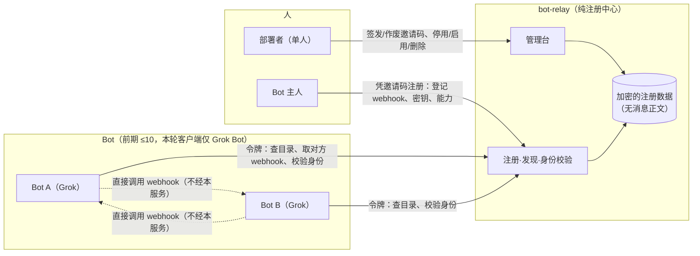
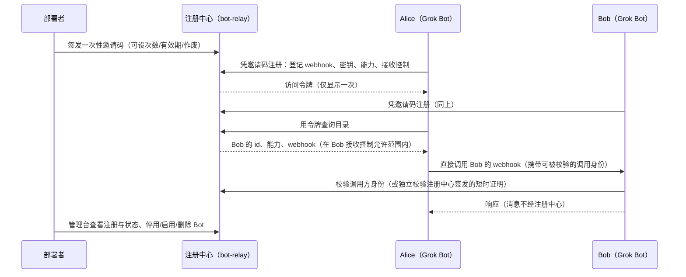

# bot-relay 重设计 PRD（第二稿）——纯注册中心

> 状态：第二稿，待 norther 审阅。依据初稿（commit 63e85b3）及 norther 对初稿 9 个待确认问题的答复（见 §8「已确认决策」）改写。本文只回答「做什么、为什么」，不涉及技术方案与框架选型。

## 1. 背景

bot-relay 的原设想是「互发消息的中继」：Bot 把消息发给本服务，本服务校验、落盘、投递给对方 webhook 或收件箱，并额外承担 A2A 桥接。但这个前提本身不成立：**Bot 本来就有自己的 webhook**。继续中转，就要引入投递重试、收件箱、至少一次与去重、消息存储与保留、A2A 兼容等一整套复杂度；而首批用户只是「几个 Grok Bot 互相找到对方并通信」，不需要任何中间人碰消息。

因此新产品重新定位为**纯注册中心**：

- Bot 在这里注册，登记自己的 webhook 地址、密钥与能力；
- 大家在这里能查到「有谁、各自能做什么、在权限范围内如何找到对方」；
- 互通消息时，两个 Bot **直接调用对方的 webhook**，本服务不在通话路径上，不接收、不转发、不存储消息正文。

规模预期：前期不超过 10 个 Bot（决策 4）。

现状代码体量是「为何要砍」的背景：TypeScript 单进程 + SQLite，`src/` 约 3300 行，其中 A2A 相关 7 个文件约 1200 行；测试 7 个文件约 1360 行。一个为「少数 Grok Bot 互找」服务的系统背下了为消息中继和 A2A 付出的全部面积，本稿将其整体收缩。

## 2. 现状问题

### 2.1 定位问题：为什么不再是中继

原设计把「Bot 互发消息」理解为「消息要经过本服务」，由此产生的复杂度对当前用户过重，这是改为纯注册中心的直接原因（不再逐条写「修复型需求」）：

- **双通道与去重**：webhook 推送与收件箱并存，至少一次语义，去重责任转嫁给客户端（初稿 F1、F4）；
- **消息落盘与无限增长**：消息、A2A 任务明文存储且无保留策略（初稿 F5、S3 的消息部分）；
- **A2A 面积过大**：占 `src/` 近四成代码，与「几个 Grok Bot 互发消息」的首批需求不成比例，且带来回复静默丢失、悬空消息、忙轮询等旁路问题（初稿 F2、F3、C1、C2、R1、R2）；
- **概念密度高**：kind × delivery × allowlist 三态 × hop × 幂等键 × 双令牌（初稿 C3、E4）。

上述能力随定位调整整块砍掉（决策 1、2）。Bot 自己保管自己的消息；注册中心只解决「找到彼此、确认彼此」。

### 2.2 注册中心仍然要面对的问题

改定位后依然成立、本稿要解决的：

| # | 问题 | 依据 |
| --- | --- | --- |
| N1 | **凭证种类过多**：`ADMIN_TOKEN`、中继令牌 `rl_`、A2A 令牌 `a2a_`、webhook 鉴权头、邀请码共 5 种，作用域、生命周期、轮换方式各异 | 初稿 E1 |
| N2 | **注册路径不一致**：浏览器 `/register`、`POST /register`、`POST /bots` 三条路径行为细节不同，表单方式甚至提交不了接收控制字段 | 初稿 E2 |
| N3 | **文档过重**：《集成契约》1032 行、《架构指南》1197 行，大量篇幅解释模式差异与边角行为 | 初稿 E5 |
| N4 | **停用状态对 Bot 不可见**：Bot 只能在调用被 403 时才发现自己被停用 | 初稿 F6 |
| N5 | **管理无审计、缺指标**：邀请码、停用/删除无操作日志；除 `/health` 外无基本可观测数据 | 初稿 O1、O2 |
| N6 | **密钥轮换规则不清**：各类凭证的轮换代价与失效范围靠文档口头维护，无产品化规则 | 初稿 O3 |
| N7 | **webhook 地址与密钥的保密与泄露面无约束**：存储是否加密、日志是否脱敏、谁能看见，均无明确产品规则 | 初稿 S3 的凭证部分（消息正文部分随中继砍掉） |
| N8 | **代理信任陷阱**：`TRUST_PROXY` 全有或全无，管理面来源识别可被伪造头绕过或全家共享限流桶 | 初稿 S1 |
| N9 | **本地开发体验差**：进程不读 `.env`，compose 硬编码端口、不透传关键变量 | 初稿 E3 |

## 3. 目标用户与核心场景

### 3.1 用户

| 用户 | 描述 | 核心诉求 |
| --- | --- | --- |
| 部署者（norther，第一优先） | 在一台小机器上自托管注册中心的个人 | 部署几分钟完成；签发邀请让朋友进来；看得住「谁注册了、谁被停用了」；平时零维护 |
| Bot 主人 | 拿到邀请、要让某个助手账号接入的人（本轮即 Grok Bot 用户） | 注册即用；令牌保存一次；能随时自助更新自己的 webhook 与接收控制 |
| Bot / Agent 本身 | 实际调 API 的程序（Grok Bot 例程） | 读完接入文档即可独立完成：注册 → 发现对方 → 直接调用对方 webhook → 完成互调鉴权 |

### 3.2 核心场景

要点：

- 注册中心不在通话路径上：它只见注册资料与控制面调用，不见消息正文；
- 管理台看的是**注册与状态**（谁在、谁被停用、最近活动），不是投递成功率；
- 目标客户端本轮只考虑 **Grok Bot**（决策 6）。

## 4. 目标与非目标

### 目标

1. **可信的注册与发现服务**：已注册 Bot 能知道「有谁、能力是什么、在权限范围内如何找到对方的 webhook」。
2. **通信不经本服务**：本服务不接收、不转发、不存储消息正文，也因此没有消息保留策略、收件箱、投递状态机、重试与死信。
3. **webhook 地址与密钥保密**：仅授权方可见，存储加密，日志脱敏。
4. **互调身份可确认**：被调方能确认「调用方是本注册中心内已注册、未被停用的某个 Bot」，并得到其稳定 id，而不只信调用方自称。
5. **凭证收敛、文档可自助**：凭证模型明显简化；一份让 Agent 读完就能自己接入的文档，加一份给人看的精简架构与安全说明。
6. **单机轻量自托管**：前期 ≤10 个 Bot，部署和维护简单，不引入多余的运维面。

### 非目标（本轮不做）

- 不做消息中转、收件箱、投递重试、消息存储与消息保留。
- 不做 A2A（整块砍掉，决策 1）。
- 不做多管理员、不做多租户 SaaS（仍是一部署一实例、单部署者）。
- 不兼容 0.1.0 / relay.songyang.xyz，接受所有人重新注册（决策 5）。
- 本轮不做 Grok Bot 以外的官方客户端支持（决策 6）。
- 不做消息内容理解/编排，不做插件市场。

## 5. 功能需求

### P0（本轮必须具备）

| ID | 需求 | 验收标准 |
| --- | --- | --- |
| P0-1 邀请注册 | 部署者生成一次性邀请链接/邀请码；Bot 主人完成注册；注册中心访问令牌仅显示一次 | ① 邀请码可设使用次数与有效期，可随时作废；② 无效/过期/用尽/已作废的码返回同一个明确失败原因；③ 注册成功响应包含令牌明文，此后任何接口不再返回；④ 邀请码只能由部署者创建，Bot 无法自造 |
| P0-2 身份与凭证 | 每个 Bot 一个 id + 一张访问令牌；可自助轮换、可自助作废 | ① 用令牌调用即确定调用者是谁，接口不接受客户端自行声明身份；② 轮换后旧令牌立即失效，新令牌只出现一次；③ 疑似泄露可自助作废，作废即失效；④ 被停用的 Bot 调用业务接口得到含「已停用」语义的明确错误，且能主动查到自己的停用状态 |
| P0-3 登记资料 | 注册或更新时登记：显示名、webhook 地址、webhook 鉴权/密钥、能力说明、接收控制（谁可以找到/调用我） | ① 接收控制三态：全部已注册 Bot / 仅指定 id 列表 / 全部拒绝，默认为「全部已注册 Bot」（决策 7）；② webhook 地址不得指向内网、回环或云元数据地址，登记与变更时都校验；③ 校验不过时返回可定位到字段的明确错误 |
| P0-4 发现 | 已注册且未被停用的 Bot 可查询目录：有哪些 Bot、各自能力与状态；webhook 地址与密钥按接收控制开放 | ① 目录基本信息（id、显示名、能力、注册状态）对所有已注册且未停用的 Bot 可见；② webhook 地址与密钥只返回给该 Bot 接收控制允许的查询者：默认放开，收紧为「仅指定 id」时只有名单内可见，「全部拒绝」时无人可见；③ 未注册方、被停用的 Bot、未登录的管理员会话均拿不到任何 Bot 的 webhook 地址与密钥；④ 查询自己的资料始终完整可见 |
| P0-5 webhook 密钥保管 | 地址与密钥加密存储；可见范围最小化 | ① webhook 地址与密钥加密存储，存储介质泄露不直接等于凭证明文泄露；② 日志、错误信息、管理台常规列表不得出现完整密钥或可直接滥用的完整回调凭据；③ 管理台查看某 Bot 的完整回调凭据需要明确动作且仅限已登录会话 |
| P0-6 互调鉴权 | 两个 Bot 直连调用对方 webhook 时，被调方能确认「调用方是本注册中心内已注册且未被停用的某个 Bot」，而非只信请求里的自称。允许的产品形态：被调方处理请求时向本注册中心校验调用方，或使用本注册中心签发、被调方可独立校验的短时身份证明——具体机制留给技术设计 | ① 被调方可得到调用方的稳定 id；② 停用或除名后，已发出的调用身份在明确的短时窗口内失效或可被拒绝（窗口上限 ≤5 分钟，写入文档）；③ 校验方法写入 Agent 接入文档，Agent 读完能自己实现；④ 注册中心自身不可用不阻断持有效身份的既有直连调用，该可用性语义写入文档；⑤ 本服务不转发消息正文（全程不进通话路径） |
| P0-7 资料变更 | Bot 可自助更新 webhook、密钥、能力、接收控制；旧凭据失效规则明确 | ① 变更对后续发现立即生效；② 令牌轮换后旧令牌立即失效；webhook 密钥轮换后旧密钥随即不可用，已缓存旧密钥者需重新发现——失效规则写入文档；③ 变更与登记走同一套校验（含 webhook 地址安全校验） |
| P0-8 管理台最小集 | 部署者完成日常管理，无需借助 Bot 令牌 | ① Bot 列表可见 id、显示名、能力摘要、状态、最近活动时间，**常规列表不展示 webhook 密钥**；② 可停用/启用/删除 Bot，停用后其发现可见性与互调身份按 P0-6② 失效；③ 可创建/作废邀请码；④ 单部署者，不做多管理员（决策 8） |
| P0-9 安全基线 | 默认配置即安全 | ① 管理台登录与敏感接口有按来源的限流与防爆破；② 出站若会回调/探测 webhook（如可达性检查），默认拒绝内网/回环/云元数据地址、不跟随重定向，且该行为可关闭；本轮产品默认不主动探测（见 P2-4）；③ 管理面与业务面的信任边界明确，不靠「用户读了文档才会做对」（对照 N8） |
| P0-10 基础可观测 | 有健康检查与注册中心口径的基本指标 | ① 健康检查反映进程与存储可用性；② 可看到注册 Bot 数、近期发现/身份校验调用量、失败原因分布等基本指标（形式不限，验收看数据可得）；③ 不出现「投递成功率」「失败队列」等中继指标——本服务无消息 |
| P0-11 文档 | 两份，各司其职 | ① **Agent 接入文档**：读完即可独立完成注册、发现、直连调用与互调鉴权校验，含可复制的请求示例与错误语义；② **给人看的精简说明**：只讲必须知道的架构与安全要点（信任边界、webhook 保密、令牌保管、默认放开的含义），明显短于现状两份千行文档 |

### P1（应当具备，不阻塞第一可用版本）

| ID | 需求 | 验收标准 |
| --- | --- | --- |
| P1-1 管理动作审计 | 邀请码、停用/启用/删除、管理员登录留痕 | ① 各管理动作产生一条记录（时间、对象、来源）；② 管理台可查看最近 N 条 |
| P1-2 接入向导 | 降低「注册完之后干什么」的门槛 | ① 注册成功页给出 Agent 可复制的下一步提示或示例（如一次发现请求的样例） |
| P1-3 变更获知 | 对方 webhook/接收控制变更后，已缓存其地址的 Bot 有办法知道该重新发现 | ① Bot 能通过注册中心判断「我缓存的对方资料是否仍最新」（如目录带更新时间、或可查询变更——行为明确即可，不规定具体技术）；② 该行为写入 Agent 接入文档 |
| P1-4 轮换规则产品化 | 密钥/令牌轮换对管理员与 Bot 都可见、可执行 | ① 轮换步骤、生效时间、旧凭据失效范围在文档内可照做；② 管理台可见各 Bot 最近一次令牌/密钥轮换时间 |

### P2（后续，本轮不承诺）

| ID | 需求 | 验收标准 |
| --- | --- | --- |
| P2-1 更多客户端 | Grok Bot 以外的官方客户端支持 | 以对应客户端的接入演练脚本验收 |
| P2-2 异常通知 | 注册中心自身异常（如连续校验失败激增）提醒部署者 | 可配置渠道，超阈值触发一次，不重复轰炸 |
| P2-3 导出 | 管理台导出 Bot 清单与审计记录 | 机器可读格式 |
| P2-4 webhook 可达性探活 | 手动触发的可达性检查 | 遵守 P0-9② 的出站安全边界，默认关闭 |
| P2-5 重新评估 A2A 或消息中转 | 默认不承诺；若重启须以新定位重新立项评估 | — |

## 6. 非功能需求

**规模与性能**

- 前期 ≤10 个 Bot；单机常规负载下，注册、发现、身份校验类接口要快且可预期：目录查询与身份校验 P95 < 100ms，注册/资料变更 P95 < 500ms（量级按「10 个 Bot 的目录查询」定，不按消息吞吐定）。
- 被调方按在线方式校验身份时，校验耗时不应成为直连调用的显著负担（同上 P95 口径）。

**可靠性**

- 注册数据不能丢：已确认的注册与变更在崩溃重启后仍然存在，目录与接收控制权限保持正确。
- 存储损坏可恢复：备份与恢复步骤写入文档并可验证。
- 无「在途消息」概念——本服务不持有消息，重启窗口内只影响注册/发现/校验，不影响 Bot 间已建立的直连调用。

**安全**

- webhook 地址与密钥：加密存储、日志脱敏、最小可见范围（P0-5）。
- 管理台：会话过期、CSRF 防护、按来源的登录限流与防爆破，默认配置即安全。
- SSRF 防护：登记与（若提供的）探测场景下，默认拒绝内网/回环/云元数据地址、不跟随重定向。
- 管理面与业务面信任边界明确，不依赖部署纪律兜底（对照 N8）。

**部署与运维**

- 启动简单：一条命令 + 必要秘密即可运行；配置项与文档一一对应。
- 不兼容 0.1.0 / relay.songyang.xyz：升级/迁移统一声明为「重新注册」（决策 5）。
- 运行时保持轻量，单机即可；不引入为规模预留的运维面。

## 7. 成功指标

| 指标 | 现状基线 | 目标 |
| --- | --- | --- |
| Agent 自主接入 | 需通读 2 份千行文档与 30+ 行演练脚本 | Agent 读完一份接入文档，即可独立完成「注册 → 发现 → 直连调用并完成互调鉴权」（接入耗时以此口径验收，决策 9） |
| 给人看的说明 | 《架构指南》1197 行 + 《集成契约》1032 行 | 一份精简说明覆盖架构与安全要点，数量级在百行以内 |
| 需要理解的凭证种类 | 5 种（ADMIN_TOKEN、rl_、a2a_、webhook 头、邀请码） | 明显减少，目标 ≤3（部署者凭证、Bot 访问令牌、邀请码；Bot 自己的 webhook 密钥属登记资料，不算新增凭证） |
| webhook 密钥保护 | 无明确产品规则（N7） | 未授权方无法从常规接口、管理列表或日志中获得任何 Bot 的 webhook 密钥 |
| 消息正文 | 明文落盘（初稿 S3） | 本服务存储中无消息正文（结构上不存在） |
| 管理动作可追溯 | 0 条审计记录 | 100% 管理动作留痕（与 P1-1 优先级对齐：审计落地后验收） |

## 8. 已确认决策（本稿约束）

1. **A2A 整块砍掉**：不作为任何优先级的功能保留；现状问题中的 A2A 条目只作为「为何要改定位」的动机。
2. **推送 + 收件箱双通道砍掉**：服务只当注册中心；通信由两个 Bot 直接调用对方 webhook，不经本服务中转。
3. **本服务不存消息正文**，因此没有消息保留策略；但各 Bot 的 webhook 地址与密钥必须保密：仅授权方可见、存储加密、日志脱敏。
4. **前期规模 ≤10 个 Bot**。
5. **不兼容 0.1.0 / relay.songyang.xyz**，接受所有人重新注册。
6. **客户端本轮只支持 Grok Bot**。
7. **接收控制默认放开**（易用优先），可收紧为仅指定 id 或全部拒绝。
8. **不做多管理员**。
9. **接入耗时以 Agent 读完接入文档、自主完成接入为验收口径**；同时提供一份给人看的精简架构与安全说明。

## 9. 仍待确认

1. **发现结果中 webhook 密钥的可见性**：本稿默认「有权限的查询者同时获得地址与密钥」（P0-4②）。若互调身份证明（P0-6）已足够完成鉴权，是否改为「只给地址、密钥不下发」？后者可显著缩小保密面，但要求被调方 webhook 完全依赖身份证明做鉴权——请确认走哪条边界。
2. **webhook 可达性探活**：本稿按「本轮不做，P2 提供手动触发且默认关闭」处理（P2-4）。若希望注册/变更时即验证可达性，请确认，需求将补充相应行为与出站安全边界。
