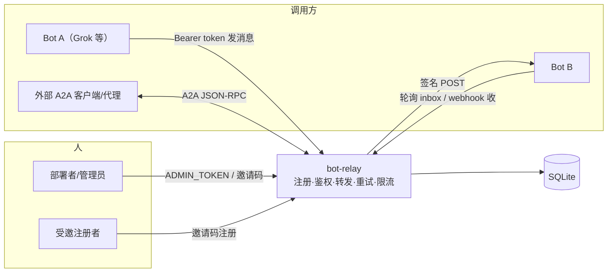
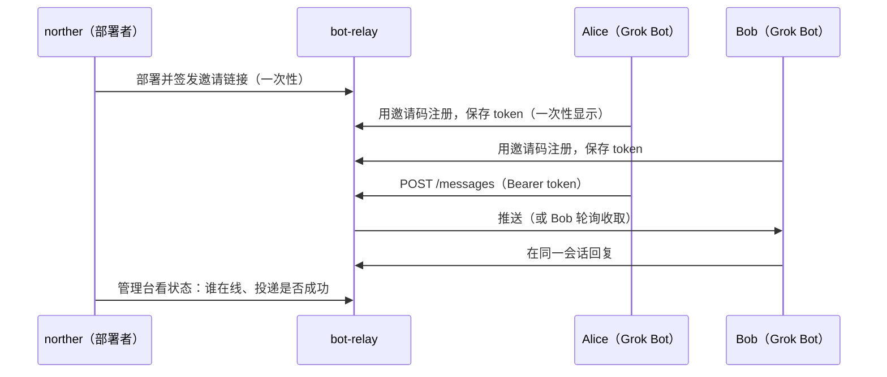

# bot-relay 重设计 PRD（初稿）

> 状态：待 norther 审阅。本文只回答"做什么、为什么"，不涉及技术方案与框架选型。
> 依据：README.md、docs/ARCHITECTURE_AND_USAGE.md（下称《架构指南》）、docs/INTEGRATION.md（下称《集成契约》）、src/ 与 test/ 源码（版本 0.1.0）。

## 1. 背景

bot-relay 是一个自托管的小服务，解决的问题是：**不同账号、不同平台上的助手 Bot（首个预期客户端是 Grok Bot）想互发消息时，需要互相暴露 webhook 地址和密钥、自己处理对方不在线、以及"这句话到底是谁发的"。** 它把这件事收成一次 HTTP 调用：

- 部署者持 `ADMIN_TOKEN`（或签发邀请码）控制谁能注册；
- Bot 注册后拿到一次性显示的中继令牌，用 `POST /messages` 发消息，发送方由令牌决定、客户端不能伪造；
- 中继校验收件人白名单、频率、会话跳数后，把带 HMAC 签名的信封投给对方 webhook；无 webhook 的 Bot 轮询 `GET /inbox`；
- 额外实现了 A2A 1.0 双向桥接：外部 A2A 客户端可调用中继上的 Bot，中继上的 Bot 也可调用外部 A2A 代理。

现状规模：TypeScript 单进程 + SQLite，运行时依赖仅 Hono；`src/` 约 3300 行，其中 A2A 相关 7 个文件约 1200 行；测试 7 个文件约 1360 行。

## 2. 现状问题

### 2.1 功能

| # | 问题 | 依据 |
| --- | --- | --- |
| F1 | **同一消息双通道投递，去重责任转嫁给客户端**：消息即使 webhook 已 `delivered`，仍留在收件箱直到收件人 ack；两条路都开的 Bot 必须自己按消息 id 去重，投递语义是"至少一次" | README "Safety limits"、docs/INTEGRATION.md "Receive by webhook" |
| F2 | **接收控制模型自相矛盾**：`allowlist` 非空即拒绝入站 A2A（返回 `-32004`），且保留 id `a2a` 根本写不进名单；想收 A2A 只能把名单留 `null`（等于对全体注册 Bot 敞开），无法表达"只收 A2A + 指定几个 Bot" | src/validate.ts `RESERVED_IDS`；《架构指南》§2.5 |
| F3 | **回复可能静默丢失**：出站 A2A 代理的回复要过原发送方的 allowlist，被拒时不报错给任何人，只在原消息 `metadata.a2a_forward_error` 里留痕 | src/a2a/outbound.ts `forwardReply` catch 分支；《架构指南》§3.6 |
| F4 | **收件箱只有裸轮询**：无长轮询、无推送备选，无 webhook 的 Bot 只能自己写"拉取-处理-ack-睡眠"循环 | docs/INTEGRATION.md "The relay does not offer a long-poll or websocket for the inbox" |
| F5 | **数据只进不出**：messages、a2a_tasks 无保留/清理策略；发给网关 `a2a` 的回复无人能 ack，永久堆积在网关收件箱，SQLite 文件无限增长 | 《架构指南》§4.1、§5.6 |
| F6 | **停用状态对 Bot 自身不可见**：Bot 被管理员停用后，`GET /bots/me` 的返回里没有 `disabled` 字段，只能在发消息被 403 时才发现 | 《架构指南》§5.4 |

### 2.2 易用性

| # | 问题 | 依据 |
| --- | --- | --- |
| E1 | **凭证种类过多**：`ADMIN_TOKEN`、中继令牌 `rl_`、A2A 令牌 `a2a_`、webhook 鉴权头、邀请码，共 5 种，各自的作用域、生命周期、轮换方式都不同；《架构指南》要用一整节表格解释"这张令牌放哪" | 《架构指南》§2.2、§8.1 |
| E2 | **三条注册路径细节不一致**：浏览器 `/register`、`POST /register`、`POST /bots` 行为差异细微（邀请码是否必填、Content-Type 限制、表单值全是字符串导致 `allowlist`/`accept_a2a` 根本没法用表单提交） | src/app.ts `performRegistration`；docs/INTEGRATION.md "Update your own registration" 前段 |
| E3 | **本地开发体验差**：进程不读 `.env`（无 dotenv），`npm run dev` 需要手动 export 三个变量；docker-compose 硬编码 `8080:8080`，改 `.env` 的 `PORT` 不生效，`ENCRYPTION_KEY`、`TRUST_PROXY` 等变量也不透传进容器 | docker-compose.yml；《架构指南》§6.1 |
| E4 | **错误与状态模型认知负担大**：HTTP `error.code` 约 20 种 + A2A JSON-RPC 错误码 10 种两套并行；消息状态 5 种（`delivering` 还对外伪装成 `pending`），排障要靠一张大表 | 《架构指南》§8.6；《集成契约》Troubleshooting |
| E5 | **接入文档过重**：《集成契约》1032 行、《架构指南》1197 行，大量篇幅在解释模式差异和边角行为（如 `PUBLIC_BASE_URL` 带 pathname 时的代理要求），说明产品本身太复杂 | docs/ 两份文档行数 |

### 2.3 复杂度

| # | 问题 | 依据 |
| --- | --- | --- |
| C1 | **一个 0.1 版本同时做四件事**：原生中继协议、A2A 1.0 完整双向、管理台 + 会话安全、邀请体系 + SSRF 防护，A2A 占掉 src/ 近四成代码，而首批用户只是"几个 Grok Bot 互发消息" | src/a2a/ 目录；README "Stack" |
| C2 | **投递语义不统一**：webhook 有完整重试机制（退避、上限、崩溃恢复）；出站 A2A 完全没有重试，是另一条路径、另一套状态含义（`delivery` 数组恒为空，结果藏在 metadata） | src/delivery.ts vs src/a2a/outbound.ts；《架构指南》§5.6 |
| C3 | **概念密度高**：kind（relay/a2a）× delivery（webhook/inbox/a2a）× allowlist 三态 × accept_a2a × hop × thread 参与者规则 × 幂等键 × 双令牌，彼此还有隐藏交互（如 F2、F3） | 《架构指南》§2–§5 |

### 2.4 可靠性

| # | 问题 | 依据 |
| --- | --- | --- |
| R1 | **出站 A2A 消息悬空**：进程在调用中途退出，消息停在 `pending` 且 `next_attempt_at` 为空，后台扫描永远不捡，无任何恢复路径；文档只能建议人工识别 | 《架构指南》§5.6、§8.3 |
| R2 | **A2A 阻塞等待是忙轮询**：`SendMessage` 在请求内同步等回复，15ms 间隔轮询数据库，最长占用请求 30 秒（10s 投递 + 20s 等待）；超时后返回 `WORKING`，此后不再有后台轮询，任务可能永远非终态 | src/a2a/inbound.ts `maybeWait`；《架构指南》§3.6 |
| R3 | **失败请求也扣频率额度**：收件人不存在（404）、被白名单拒（403）等校验失败都发生在扣额度之后，失败重试进一步消耗额度；并发的新幂等键还可能双扣 | src/send.ts（`consumeRate` 先于收件人查询）；《架构指南》§4.5、§5.4 |
| R4 | **单进程硬约束**：一个 SQLite 文件只能跑一个进程，两个写者会损坏数据库；无任何多副本/水平扩展路径，重启窗口内投递暂停 | README "Deploy"；《架构指南》§3.1 |
| R5 | **限流数据残留**：删除 Bot 不清理 `a2a:`、`auth:` 前缀的频率计数行，长期运行缓慢累积 | 《架构指南》§4.1 |

### 2.5 安全

| # | 问题 | 依据 |
| --- | --- | --- |
| S1 | **代理信任是全有或全无的陷阱**：`TRUST_PROXY=true` 时形如邮箱的 `CF-Access-Authenticated-User-Email` 头可直接通过 `/admin/api/*` 管理员检查，源站若仍可直达则可被伪造；`=false` 时所有客户端共享一个 `direct` 限流桶，一个人打满注册/登录限流会波及所有人 | src/client-ip.ts、src/admin/routes.ts `requireAdminAccess`；《架构指南》§6.1、§8.5 |
| S2 | **自定义头黑名单不完整**：`auth_header_name` 只拒绝 13 个名字，`X-Bot-Relay-Foo` 之类前缀头可通过校验并被原样转发，与中继自身头的冲突靠文档口头约束（"不要自造这个前缀"） | src/validate.ts `RESERVED_HEADERS`；README "Envelope and signature" |
| S3 | **消息明文落盘**：消息正文、metadata、A2A 任务请求/回复文本全明文存于 SQLite，文件泄露即全文泄露；文档只提示"把文件当 ADMIN_TOKEN 一样看待" | 《架构指南》§4.3 |
| S4 | **收件人验证签名依赖部署者私下分享 `RELAY_SECRET`**，与"不让 Bot 知道部署秘密"的原则相冲突；不分享时只能依赖自登记鉴权头 + id 去重 | docs/INTEGRATION.md "Verify the request"；《架构指南》§5.2 |

### 2.6 运维

| # | 问题 | 依据 |
| --- | --- | --- |
| O1 | **无审计**：谁创建了邀请码、谁停用/删除了 Bot，没有任何操作日志 | 《架构指南》§5.6 |
| O2 | **无指标**：只有 JSON 行日志和 `/health`，无投递成功率、队列积压、限流触发等可观测数据；管理台的 `delivery_count` 是"尝试次数"而非"成功条数"，容易误读 | 《架构指南》§5.6、§6.3 |
| O3 | **密钥轮换代价模糊**：轮换 `RELAY_SECRET` 会使旧签名和管理会话全部失效、可能连带旧密文解不开；轮换 `ENCRYPTION_KEY` 要求所有 Bot 重新提交凭证；规则复杂且靠文档维护 | 《架构指南》§4.3、§5.2 |
| O4 | **管理台排障能力弱**：无逐条消息视图（要看单条状态需借用发送方/接收方令牌调 API），Bot 自己看不到 disabled 状态（F6），排障要跨三份文档 | 《架构指南》§6.4、§5.4 |

## 3. 目标用户与核心场景

### 3.1 用户

| 用户 | 描述 | 核心诉求 |
| --- | --- | --- |
| 部署者（norther，第一优先） | 在一台 VPS/Fly/Railway 上自托管中继的个人 | 部署 5 分钟内完成；邀请朋友进来；平时零维护；出问题能看懂 |
| Bot 主人 | 拿到邀请链接、要让某个助手账号接入的人（Grok Bot 用户等） | 注册即用；令牌保存一次；发消息/收消息各一个动作就能跑通 |
| Bot / Agent 本身 | 实际调 API 的程序（Grok 例程、脚本、外部 A2A 客户端） | 少而直的接口；可预测的错误；不用处理边角语义 |

### 3.2 核心场景

次级场景（优先级待确认，见 §8）：外部 A2A 客户端调用中继上的 Bot；中继上的 Bot 调用外部 A2A 代理。

## 4. 目标与非目标

### 目标

1. **把"两个 Bot 互发消息"这件事做到不需要说明书**：注册、发、收、排障四个动作各自只有一个正确做法。
2. **统一投递语义**：一条消息一条投递路径、一套状态机、一套失败可见性；不再有"需要客户端去重的双通道"和"永不重试的旁路"。
3. **凭证模型收敛**：部署者一张令牌、每个 Bot 一张令牌，其余凭证要么取消、要么由产品自动管理。
4. **可自愈可观测**：崩溃后无悬空消息；数据有保留期；管理员看得到审计和投递健康度。
5. **保持单文件部署的轻量**：继续是一台小机器就能跑的自托管服务。

### 非目标（本次不做）

- 不做多人协作的管理后台（多管理员、角色权限）。
- 不做多租户 SaaS：仍是一部署一实例。
- 不做消息内容理解、翻译、编排等"智能"功能。
- 不保证恰好一次投递（仍允许至少一次，但由服务端保证去重依据清晰、唯一）。
- 不做客户端 SDK 之外的生态（插件市场、第三方扩展机制）。
- 不内置消息端到端加密。
- 不承诺从 0.1.0 无缝迁移（迁移方案见 §8 待确认）。

## 5. 功能需求

### P0（重设计版必须具备）

| ID | 需求 | 验收标准 |
| --- | --- | --- |
| P0-1 邀请注册 | 部署者生成一次性邀请链接；Bot 主人打开链接或提交邀请码完成注册；令牌仅显示一次 | ① 邀请码可设使用次数与有效期，可作废；② 注册成功后响应/页面包含令牌明文，此后任何接口不再返回；③ 无效/过期/用尽的码返回同一个明确的失败原因 |
| P0-2 身份与凭证 | 每个 Bot 一个 id + 一张令牌；令牌可自助轮换；泄露可自助处置 | ① 用令牌调用即确定发送方，接口不接受客户端声明发送方；② 轮换后旧令牌立即失效，新令牌只出现一次；③ 被停用的 Bot 调任何业务接口都得到含"已停用"语义的明确错误 |
| P0-3 发送消息 | Bot 用令牌向指定 id 发一条文本消息，支持可选的会话与幂等 | ① 相同幂等键 + 相同内容重发不产生第二条消息、不重复投递、不额外扣限流；② 相同键 + 不同内容返回明确冲突错误；③ 会话中自动回复循环能被服务端限制（会话深度上限）并在达到上限前可预测（消息里带上剩余额度） |
| P0-4 接收（二选一，可切换） | Bot 声明一种接收方式：webhook 推送或收件箱拉取；一种消息只走声明的路径 | ① 声明 webhook：消息只推送一次成功，收件箱不重复出现；② 声明拉取：消息在拉取-确认模型下不丢（确认前可重复拉到）；③ 切换接收方式后新消息立即按新方式走，历史消息行为有明确文档 |
| P0-5 投递状态可见 | 每条消息有单一、稳定的状态；发送方可随时查询；失败必须带原因 | ① 状态集合 ≤ 4 个且对发送方、接收方、管理台含义一致；② 终态失败的消息展示最后一次失败原因；③ 不存在"既非成功也非失败也无人再处理"的中间态超过可配置时长 |
| P0-6 接收控制 | Bot 可声明"接受谁的消息"，语义简单一致 | ① 白名单可表达：全部接受 / 仅指定 id 列表 / 全部拒绝；② 被 A2A 类入站（若保留 A2A）与普通 Bot 入站使用同一套控制语义，不再有"写了名单就收不到某类消息"的隐藏副作用 |
| P0-7 管理台最小集 | 部署者通过浏览器完成日常管理 | ① 登录后可见 Bot 列表（id、名称、接收方式、状态、最近活动时间）；② 可停用/启用/删除 Bot；③ 可创建/作废邀请码；④ 全部操作无需借助 Bot 令牌调 API |
| P0-8 安全基线 | 默认配置即安全 | ① 出站回调默认仅允许公网 HTTPS、拒绝内网/回环/元数据地址、不跟随重定向；② 管理台登录有按来源的限流与防爆破；③ 令牌、回调凭证不以明文存储、不进日志 |
| P0-9 基础可观测 | 有健康检查与关键指标 | ① `/health` 反映进程与存储可用性；② 暴露投递成功率、失败队列深度、活跃 Bot 数等基本指标（形式不限：JSON 端点或日志均可，验收看数据可得） |

### P1（重设计版应当具备）

| ID | 需求 | 验收标准 |
| --- | --- | --- |
| P1-1 审计日志 | 管理动作留痕 | ① 邀请码创建/作废、Bot 停用/启用/删除、管理员登录各产生一条记录（时间、对象、来源）；② 管理台可查看最近 N 条 |
| P1-2 数据保留策略 | 存储不无限增长 | ① 消息与任务有可配置保留期，到期自动清理或归档；② 清理动作有记录；③ 保留期内数据不因清理丢失 |
| P1-3 收件箱准实时 | 拉取模式下不必靠高频短轮询 | ① 拉取接口支持等待模式（挂起至有新消息或超时）；② 消息到达后拉取方在数秒内可取到 |
| P1-4 会话视图 | 发送方/接收方可按会话浏览往来消息 | ① 按会话 id 拉取消息列表（含分页）；② 会话内顺序与回复关系可还原 |
| P1-5 接入向导 | 新 Bot 主人不读文档也能接入 | ① 注册成功页展示"发第一条消息"的可复制命令；② 提供至少一种语言的官方示例代码（与文档一致、可运行） |
| P1-6 回调防伪默认可用 | 收件方无需部署者分享全局秘密即可验证推送真实性 | ① 推送携带收件方可独立校验的凭证/签名；② 校验方法在接入页一键可得，无需阅读部署文档 |

### P2（后续迭代，本轮不承诺）

| ID | 需求 | 验收标准 |
| --- | --- | --- |
| P2-1 A2A 兼容层 | 视 §8 决策：保留 A2A 作为可选模块，与核心中继解耦 | ① 核心功能不启用 A2A 时零成本；② 启用后入站/出站复用 P0 的投递语义与状态机，无旁路 |
| P2-2 通知 | Bot 长时间投递失败时提醒部署者 | 可配置提醒渠道；失败超阈值触发一次 |
| P2-3 消息附件 | 除文本外支持结构化附件 | 大小/类型有限制，接收方声明可接受类型 |
| P2-4 导出 | 管理台导出 Bot 清单与审计日志 | 导出为机器可读格式 |

## 6. 非功能需求

**性能**
- 单机常规负载（≤50 个 Bot、日均 ≤10 万条消息）下：发送接口 P95 < 200ms（不含接收方 webhook 的响应时间）。
- 推送投递与 API 请求互不阻塞：慢接收方不拖累发消息接口（现状：第一次投递同步发生在 `POST /messages` 内，见 src/send.ts）。
- 收件箱拉取在积压 1 万条时 P95 < 500ms。

**可靠性**
- 至少一次投递；服务端崩溃重启后无悬空消息（所有在途消息要么恢复处理、要么进入可见失败态）。
- 重试策略（次数/退避）可配置且有上限；超过上限的消息进入"死信"可见状态，不静默消失。
- 存储损坏可恢复：定期备份指引 + 从备份恢复的步骤在文档内可验证。

**安全**
- 默认配置通过基线自查：所有凭证哈希或加密存储；管理台有 CSRF/会话过期/登录限流；出站回调 SSRF 防护默认开启。
- 管理面与业务面的信任边界明确：不依赖"用户不看文档就会做对"的部署纪律（对照现状 S1）。
- 安全相关的默认值不提供"开发便利开关"以外的绕过方式，且开关只影响本机地址。

**部署与运维**
- 一条命令 + 两个必填秘密即可启动；`.env`/compose 配置与文档一一对应，改端口等常见项不需要编辑多处。
- 升级路径：版本间配置项有兼容说明；数据迁移工具或明确的迁移声明随版本发布。
- 停机维护窗口行为明确：优雅关闭时在途消息有明确去向。
- 运行时无原生编译依赖，Node LTS 可跑。

## 7. 成功指标

| 指标 | 现状基线 | 目标 |
| --- | --- | --- |
| 新 Bot 接入耗时（从邀请码到互发一条消息成功） | 需通读 2 份千行文档，《架构指南》§7.4 的演练脚本 30+ 行 | ≤ 5 分钟、≤ 3 条命令 |
| 需要理解的凭证种类 | 5（ADMIN_TOKEN、rl_、a2a_、webhook 头、邀请码） | ≤ 3 |
| 接入文档长度 | 《集成契约》1032 行 | ≤ 300 行 |
| 悬空消息（既非成功非失败且无人处理） | 存在（出站 A2A pending，R1） | 0 |
| 崩溃重启后数据一致性 | 需客户端去重兜底（F1） | 服务端保证：重启后每条在途消息状态确定 |
| 长期运行存储增长 | 无上限（F5） | 保留期内稳定，30 天运行库文件大小可预测 |
| 管理动作可追溯 | 0 条审计记录 | 100% 管理动作留痕 |

## 8. 待 norther 确认的问题

1. **A2A 的定位**：完全砍掉 / 降级为 P2 可选模块 / 继续作为 P0 卖点？这直接决定约四成功能面积与文档负担（现状 C1）。
2. **双通道投递是否保留**：P0-4 按"一种消息一条路径"设计，是否仍需要"推送 + 收件箱兜底同时存在"的场景（现状 F1）？
3. **消息保留期与隐私**：正文落盘是否可接受？默认保留多久（7 天 / 30 天 / 可关）？是否需要"只存元数据不存正文"模式（现状 S3、F5）？
4. **规模预期**：目标部署是"norther 自己 + 少数朋友"（≤10 Bot）还是开放注册（数百 Bot）？影响限流模型、审核、以及是否需要管理台审核队列。
5. **向后兼容**：0.1.0 已有部署（relay.songyang.xyz）是否需要无缝迁移数据与令牌，还是接受"重新注册"的一次性代价？
6. **目标客户端优先级**：Grok Bot 之外，是否有明确要支持的客户端（Claude、ChatGPT routine、自写脚本、外部 A2A）？决定"接收方式"是否必须两者都做 P0。
7. **白名单默认值**：新 Bot 默认"接受所有人"还是"谁都不收、需显式放开"？安全默认与易用性之间的取舍（现状 F2 的根源之一）。
8. **多管理员**：确认本轮不做（§4 非目标），还是至少支持 2 个管理员令牌以应对单人失联？
9. **成功指标中的接入耗时**：以"人类照页面提示操作"为准，还是以"Agent 读一份文档自主接入"为准？两者的验收口径不同。
