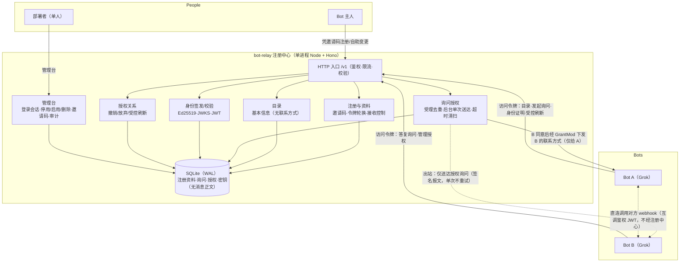
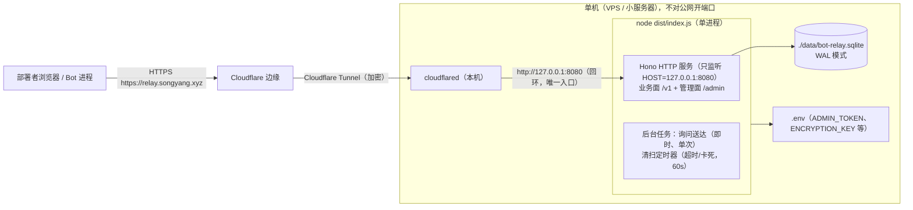
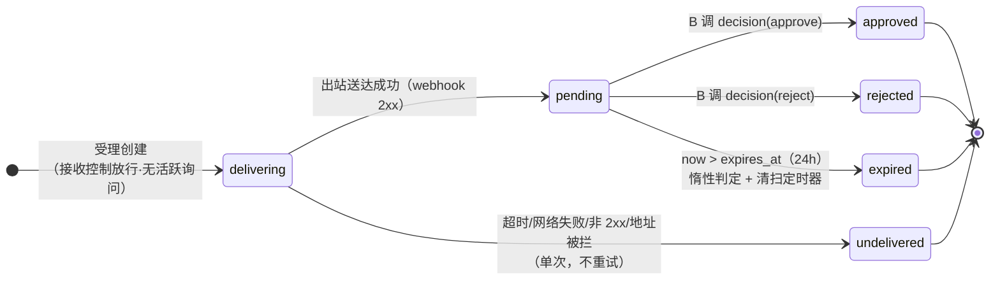
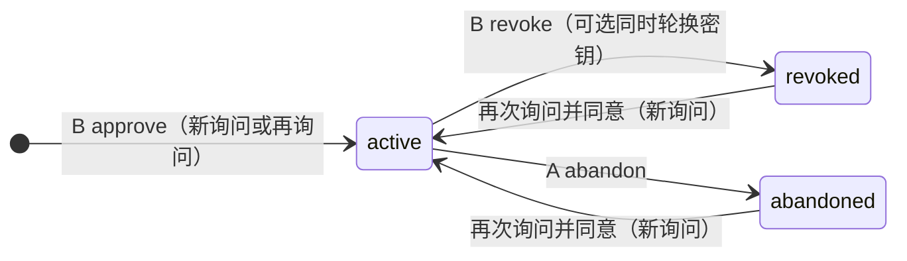
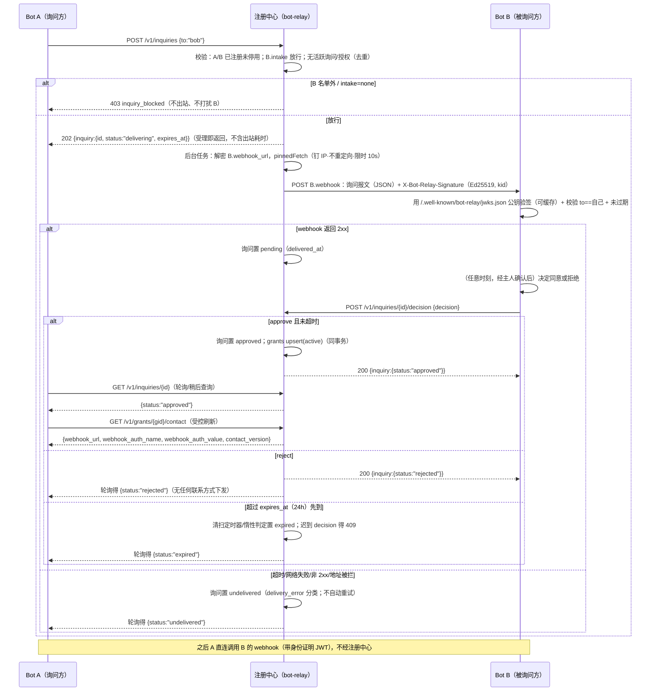

# bot-relay 重设计技术设计（第二稿）：纯注册中心

> 状态：技术设计第二稿，待 norther 审阅。本文依据技术设计初稿（commit `b16dd37`）修订；初稿依据定稿 PRD（`docs/redesign/PRD.md`，commit `993ba42`，决策 1–12 全部生效）与当前仓库代码（代码基线为 commit `07c6143`，自该提交起 `src/` 未再改动）。norther 对初稿 3 条「待拍板」的答复已全部落地，整理为 §15「已确认决策」（决策 D1–D3），全文相关章节已按其改写。本文仍只回答「怎么做」：技术选型、数据模型、API、状态机、安全机制与实施计划，均为可开工粒度，不含大段业务代码。
>
> 范围约束（与 PRD 一致）：纯注册中心，不中转、不存储消息；联系方式经询问后授权下发，不做自动同意；本轮不做可达性探活；≤10 个 Bot；客户端仅考虑 Grok Bot 的接入现实；不兼容旧 0.1.0 实例（域名沿用 `relay.songyang.xyz`，见决策 D1/D2），升级 = 重新注册，不做数据迁移。

## 1. 设计目标与范围

**目标**（对齐 PRD §4）：

1. 可信的注册与发现：目录可见「有谁、能做什么」；webhook 地址与密钥的唯一获取途径是「发起询问 → 对方亲自同意」（决策 10、12）。
2. 注册中心不在通话路径上：不接收、不转发、不存储消息正文；对 Bot webhook 的出站调用**仅用于送达授权询问**这一件事。
3. 联系方式保密：加密存储、日志脱敏、仅下发被授权方。
4. 互调身份可确认：被调方可独立校验「调用方是本注册中心内已注册、未停用的某个 Bot」并得到稳定 id；注册中心不可用不阻断持有效证明的既有直连（P0-7④）。
5. 凭证收敛到 3 种：部署者凭证（`ADMIN_TOKEN`）、Bot 访问令牌（`br_` 前缀）、邀请码（`inv_` 前缀）。Bot 自己的 webhook 鉴权头属登记资料，不算新增凭证。
6. 单机轻量：TypeScript + Hono + SQLite（`node:sqlite`）+ 单进程 Node 22，延续现有栈，不换框架、不加运行时依赖（Ed25519/JWT 用 `node:crypto` 内建能力实现）。

**为什么不用 Java 25**：继续用 TypeScript，不换 Java 25。①**复用现有代码**：本仓库已有可用的 TypeScript/Hono 控制面骨架（邀请、管理台、加密、SSRF、会话等），换 Java 等于放弃复用、几乎重写；②**内存占用**：目标是一台小机器上的轻量自托管服务，Node 单进程更符合这个体量，引入 JDK 25 会明显抬高常驻内存；③**规模**：前期不超过 10 个 Bot，全是控制面（注册、目录、询问授权、短时身份证明），没有消息中转吞吐压力，换栈没有性能收益。

**优先级取舍**：

| 级别 | 本设计的处理 |
| --- | --- |
| P0-1 ~ P0-12 | 全部覆盖，是本设计的主体（§4–§13） |
| P1-1 审计 | **纳入本轮**（阶段 D）：一张 `audit_events` 表 + 管理台最近记录视图，成本低、PRD 成功指标依赖它 |
| P1-2 接入向导 | **纳入本轮**（阶段 D）：注册成功页（JSON 与页面两条路径都给）附「下一步」可复制示例 |
| P1-3 变更获知 | **纳入本轮**（阶段 B）：目录条目带 `updated_at` 与 `contact_version`；已授权方经受控刷新拿新资料，被撤销后刷新得到明确 410（写入 Agent 文档） |
| P1-4 轮换产品化 | **纳入本轮**（阶段 C/D）：轮换步骤写入两份文档；管理台 Bot 列表显示最近令牌/密钥轮换时间；「撤销 + 一并轮换」作为撤销接口的选项 |
| P2 全部 | 不做，仅保留 P2-4 探活、P2-1 更多客户端等条目在 PRD 中占位；本设计不为它们预留机制 |

P1-1～P1-4 的范围已确认（决策 D3，§15）：**全部随本轮交付**，不存在「推迟 P1-2/P1-4 以更快发布」的选项。

**非目标**：消息中转/收件箱/投递重试、A2A、自动同意、探活、多管理员、多租户、消息内容理解（PRD §4 非目标，逐条生效）。

## 2. 现状代码：复用与删除

现状 `src/` 约 4150 行（含 `src/a2a/` 7 文件约 990 行、`src/admin/` 2 文件约 350 行），测试 8 文件约 1490 行。处理原则：**控制面骨架保留演进，消息面与 A2A 整块删除**。

### 2.1 复用或小改后复用

| 文件 | 处理 | 说明 |
| --- | --- | --- |
| `src/errors.ts` | 原样复用 | `HttpError` / `isUniqueConstraint` 不变 |
| `src/ids.ts` | 小改 | 保留随机 id 生成，前缀改为 `inq_`、`grt_`（`msg_`/`thr_` 不再需要） |
| `src/deps.ts` | 复用 | `Deps {config, db, now, fetchImpl, lookup}` 注入模式不变，测试可替换时钟与网络 |
| `src/secret.ts` | 小改 | 保留 AES-256-GCM `seal/open` 与 `hashToken`（sha256）；**删除 v1/v2 双密钥版本**（不迁移旧数据，只保留 `ENCRYPTION_KEY` 派生的单版本）；令牌前缀 `rl_`→`br_`，删除 `newA2aToken` |
| `src/ssrf.ts` | 复用 + 增强 | `assertWebhookUrl`（登记静态校验）与 `pinnedFetch`（连接时解析并钉住 IP、拒绝重定向）整体保留，用于询问出站；增强点见 §9.1 |
| `src/session.ts` | 小改 | 无状态 HMAC 签名 Cookie 会话与 CSRF 令牌复用；签名密钥改为首启生成、存库的 `server_secret`（不再依赖 `RELAY_SECRET`，见 §4.3） |
| `src/admin/routes.ts`、`src/admin/pages.ts` | 复用骨架 | 登录/登出/会话/CSRF/Bot 列表/停用/启用/删除/邀请码全部保留；**删除 Cloudflare Access 邮箱旁路**（`cfAccessEmail`，N8 信任边界问题）；新增凭据查看与审计视图（§10） |
| `src/validate.ts` | 复用骨架 | 保留 `parseBotId/parseDisplayName/parseHeaderName/parseHeaderValue/rejectUnknown/isPlainObject`；删除消息/线程/幂等键解析；新增 `capabilities`（≤500 字）、`intake` 三态校验 |
| `src/auth.ts` | 小改 | `requireBot` 增加停用判定：被停用 Bot 调业务接口得 `403 bot_disabled`（`GET /v1/me` 例外，用于自查状态，P0-2④ / N4） |
| `src/app.ts` | 复用中间件骨架 | 安全响应头（nosniff/CSP/Referrer-Policy）、统一错误 JSON、64KB 请求体上限、`Cache-Control: no-store` 保留；业务路由整体重写为 `/v1` 命名空间（§5） |
| `src/config.ts` | 重写（收敛） | 配置项集合换血（§12.2），解析函数（`intEnv/boolEnv/secretEnv`）复用 |
| `src/db.ts` | 部分复用 | `openDatabase`、事务、`rate_hits`、`invites` 系列保留；删除 `messages/idempotency_keys/delivery_attempts/a2a_tasks` 相关与启动 `requeueInFlight`、A2A 内建系统 Bot；新增 `inquiries/grants/registry_keys/kv/audit_events`（§4） |
| `test/helpers.ts` | 复用 | `makeApp`（内存库+固定时钟）、`api`、`startWebhook`（本地 mock webhook，收请求、可控状态码）是接口测试基础 |
| `Dockerfile` | 基本复用 | 多阶段构建、`node` 用户、`/health` healthcheck 不变 |
| `docker-compose.yml`、`.env.example` | 修改对齐 | compose 改为 `env_file: .env` 整体透传（修 E3「进程不读 .env、compose 硬编码」），宿主侧端口仅回环发布 `127.0.0.1:8080:8080`（决策 D1，不对公网开端口）；`.env.example` 换成收敛后的配置集（§12.2） |

### 2.2 整模块删除

| 对象 | 内容 |
| --- | --- |
| `src/a2a/` 全部 7 文件 | `bridge.ts`、`card.ts`、`constants.ts`、`inbound.ts`、`outbound.ts`、`protocol.ts`、`routes.ts`（约 990 行），连同 `A2A_GATEWAY_ID` 内建系统 Bot、Agent Card 路由、JSON-RPC 双向桥接 |
| 消息中继 4 文件 | `src/delivery.ts`（投递 worker/重试/退避）、`src/send.ts`（发消息/线程/hop/幂等）、`src/envelope.ts`（签名信封）、`src/sign.ts`（HMAC 投递签名，由 Ed25519 注册中心签名取代，见 §7） |
| 数据表 | `messages`、`idempotency_keys`、`delivery_attempts`、`a2a_tasks`；`bots` 表中 A2A 专用列（`kind/a2a_*`） |
| `src/present.ts` | 消息呈现与 `delivery: webhook\|inbox\|a2a` 判定随消息面删除；Bot 呈现并入新路由层 |
| 路由 | `POST /messages`、`GET /messages/:id`、`GET /inbox`、`POST /inbox/ack`、`GET /bots/:id`（中继语义）、A2A 全部路由、`POST /bots`（与 `/register` 二选一的旧路径，N2：注册路径收敛为单一 `POST /v1/register`） |
| 测试 | `test/a2a.test.ts`、`test/messages.test.ts`、`test/sign.test.ts` 删除；`test/safety.test.ts`、`test/hardening.test.ts`、`test/register.test.ts` 重写（保留可复用断言：SSRF 拦截、登录限流、邀请码生命周期） |
| 文档章节 | `docs/INTEGRATION.md`（1031 行）、`docs/ARCHITECTURE_AND_USAGE.md`（1196 行）整体替换为两份新文档（P0-12，阶段 D）；`README.md` 重写。旧文档中的中继/A2A 语义不带入新设计 |

### 2.3 新建

| 模块 | 职责 |
| --- | --- |
| `src/inquiry.ts` | 询问状态机、受理去重、后台单次送达（复用 `pinnedFetch`）、惰性超时 + 清扫定时器 |
| `src/grants.ts` | 授权关系生命周期：撤销（可一并轮换）、放弃、受控刷新（联系方式唯一下发出口） |
| `src/identity.ts` | 注册中心 Ed25519 密钥管理（首启生成、加密存库）、身份证明签发（JWT/EdDSA）、JWKS 发布、在线核实端点、询问出站报文签名 |
| 数据表 | `inquiries`、`grants`、`registry_keys`、`kv`、`audit_events`（§4） |
| 文档 | `docs/AGENT_GUIDE.md`（Agent 接入）与 `docs/OVERVIEW.md`（给人看的精简说明），见 §14 阶段 D |

## 3. 整体架构

### 3.1 模块视图



要点：

- 注册中心对 Bot webhook 的出站**只有一条边**：`InqMod → B`，仅用于送达授权询问，单次送达、不重试、不跟随重定向（§6、§9.1）。
- A↔B 的直连调用完全不经过本服务；本服务不解析、不转发、不存储任何消息正文。
- 联系方式（webhook 地址 + 密钥）的唯一下发出口是 `GrantMod`（受控刷新，§5）。

### 3.2 部署/进程视图



- **接入形态（决策 D1）**：域名沿用 `relay.songyang.xyz`，公网唯一入口是 Cloudflare Tunnel；服务只监听回环 `127.0.0.1:8080`，由本机 cloudflared 直连该地址，前面不加 Caddy/nginx，也不对公网开任何端口。`TRUSTED_PROXIES` 只信任本机 tunnel 客户端（`127.0.0.1/32`，必要时含 `::1/128`），客户端 IP 取 `CF-Connecting-IP`（§9.2）。本图是目标形态设计，不构成对现有 Tunnel/cloudflared、防火墙或运行中 0.1.0 服务的任何变更动作（切换见 §12.1）。
- 单进程内完成全部控制面工作；「后台送达」是进程内的异步任务（受理后立即调度，限时 10s），不是常驻消息队列——系统中没有在途消息。
- 崩溃重启的影响面：`delivering` 状态的询问在启动清扫时记为「未送达」（§6.3）；已确认的注册、授权关系、询问状态全部持久化在 SQLite。

## 4. 数据模型

存储：SQLite 单文件（`node:sqlite`，WAL，`busy_timeout=3000`），全新 schema（不迁移旧库，决策 5）。时间戳一律 Unix 毫秒整数。**没有消息正文表——结构上不存在任何消息/任务/投递表。**

### 4.1 表结构

**`bots`**（Bot 注册资料，一 Bot 一行）

| 列 | 类型 | 说明 |
| --- | --- | --- |
| `id` | TEXT PK | 主人自选，2–32 位 `[a-z0-9][a-z0-9_-]`，保留字：`me`、`admin`、`registry` |
| `display_name` | TEXT NOT NULL | 1–80 字符 |
| `capabilities` | TEXT NOT NULL DEFAULT '' | 能力说明，≤500 字符，目录展示 |
| `webhook_url_enc` | TEXT NOT NULL | **加密**：AES-256-GCM(ENCRYPTION_KEY)。webhook 地址属联系方式 |
| `webhook_auth_name` | TEXT NOT NULL | 鉴权头名（如 `Authorization`），明文（非机密，管理台可见） |
| `webhook_auth_value_enc` | TEXT NOT NULL | **加密**：同上。webhook 密钥 |
| `token_hash` | TEXT NOT NULL UNIQUE | 访问令牌 sha256 哈希，**只存哈希**，令牌明文仅注册/轮换响应中出现一次 |
| `token_set_at` / `token_revoked_at` | INTEGER / INTEGER NULL | 最近轮换时间（P1-4）；`token_revoked_at` 非空 = 已作废（P0-2③） |
| `disabled` | INTEGER NOT NULL DEFAULT 0 | 停用标记 |
| `intake_mode` | TEXT NOT NULL DEFAULT 'open' | 接收控制：`open` / `allowlist` / `none`（P0-3，决策 7） |
| `intake_allowlist` | TEXT NULL | JSON 数组（Bot id 列表），仅 `allowlist` 模式生效 |
| `contact_version` | INTEGER NOT NULL DEFAULT 1 | 联系方式版本号：`webhook_url`/`webhook_auth_value` 任一变更即 +1（P1-3、受控刷新对账） |
| `webhook_secret_set_at` | INTEGER NOT NULL | webhook 密钥最近轮换时间（P1-4 管理台展示） |
| `created_at` / `updated_at` / `last_seen_at` | INTEGER | `last_seen_at`：最近一次通过鉴权的调用（管理台「最近活动」） |

索引：`UNIQUE(token_hash)`；`idx_bots_disabled(disabled)`（目录/管理列表）。

**`invites`**（邀请码，沿用现状结构）

`id INTEGER PK AUTOINCREMENT`、`code_hash TEXT UNIQUE`（sha256，只存哈希）、`code_prefix TEXT`（前 12 字符，供管理台辨认）、`label TEXT NULL`、`max_uses INTEGER`、`uses INTEGER`、`expires_at INTEGER NULL`、`revoked_at INTEGER NULL`、`created_at INTEGER`。

**`inquiries`**（授权询问，一次询问一行）

| 列 | 类型 | 说明 |
| --- | --- | --- |
| `id` | TEXT PK | `inq_` + 24 字节随机 |
| `requester_id` / `target_id` | TEXT NOT NULL | 询问方 A / 被询问方 B |
| `status` | TEXT NOT NULL | `delivering` → `pending` → `approved`\|`rejected`\|`expired`；`delivering` → `undelivered`（§6.1） |
| `created_at` / `expires_at` | INTEGER NOT NULL | `expires_at = created_at + INQUIRY_TTL_SEC`（默认 24h，不因任何操作重置） |
| `delivered_at` / `decided_at` | INTEGER NULL | 送达成功时间 / B 答复时间 |
| `delivery_error` | TEXT NULL | 未送达原因分类（`timeout` / `http_4xx` / `http_5xx` / `blocked_address` / `connection_failed`），脱敏摘要 |

索引：`UNIQUE idx_inquiry_active(requester_id, target_id) WHERE status IN ('delivering','pending')`（数据库层保证「同一对至多一条活跃询问」）；`idx_inquiry_target(target_id, status)`（B 查看待确认）。

**`grants`**（授权关系，一对 Bot 一个方向一行）

| 列 | 类型 | 说明 |
| --- | --- | --- |
| `id` | TEXT PK | `grt_` + 16 字节随机 |
| `requester_id` / `target_id` | TEXT NOT NULL | A（拿到联系方式的一方）/ B（给出联系方式的一方） |
| `inquiry_id` | TEXT NOT NULL | 最近一次促成本授权的询问（追溯） |
| `granted_at` | INTEGER NOT NULL | 最近一次同意时间（撤销后再次同意则刷新） |
| `revoked_at` / `abandoned_at` | INTEGER NULL | B 撤销 / A 放弃；两者皆空 = `active` |
| `refreshed_at` / `refreshed_contact_version` | INTEGER / INTEGER | A 最近一次受控刷新的时间与所取版本（P1-3 对账） |

索引：`UNIQUE(requester_id, target_id)`。授权关系与单次询问分开建模：询问是「一次事件」（终态后不可变，留作记录与审计），授权是「一段关系」（可撤销/放弃后经新询问重新激活：同一行重置 `revoked_at`/`abandoned_at` 并更新 `inquiry_id`/`granted_at`）。

**`registry_keys`**（注册中心签名密钥，Ed25519）

`kid TEXT PK`、`private_key_enc TEXT NOT NULL`（**加密**：PKCS8 私钥，AES-256-GCM(ENCRYPTION_KEY)）、`public_key TEXT NOT NULL`（SPKI base64，公开）、`created_at INTEGER`、`retired_at INTEGER NULL`（非空 = 只用于验签，不再签发）。轮换：插入新行，旧行 `retired_at = now`，JWKS 在退休窗口（1 小时，> 令牌 TTL）内同时发布两把公钥（§7.4）。

**`kv`**（服务自身杂项密钥）

`name TEXT PK, value TEXT`。存 `server_secret`（首启随机生成，用于管理台会话 Cookie 的 HMAC 签名与 CSRF，替代原 `RELAY_SECRET`）。存库而非环境变量：轮换 `ENCRYPTION_KEY` 不影响登录会话；泄露 DB 而不泄露 `ENCRYPTION_KEY` 时 私钥/联系方式仍安全，会话可伪造属可接受面（会话 ≤12h 且需再过登录限流）。

**`audit_events`**（审计，P1-1，本轮做）

`id INTEGER PK AUTOINCREMENT`、`at INTEGER`、`actor TEXT`（`admin` 或 Bot id）、`action TEXT`（见 §10.3）、`object TEXT`（操作对象 id）、`detail TEXT NULL`（JSON，脱敏）、`source TEXT`（来源 IP）。索引 `idx_audit_at(at)`。管理台查最近 N 条（默认 100，上限 500）。

**`rate_hits`**（限流计数，复用改造）

`key TEXT NOT NULL, created_at INTEGER NOT NULL` + `idx_rate_hits(key, created_at)`。键从 `bot_id` 泛化为任意字符串（如 `register:1.2.3.4`、`inquiry:alice`、`pair:alice>bob`），复用现有 `consumeRate` 窗口计数逻辑。

### 4.2 加密与哈希的边界

| 数据 | 存储形态 |
| --- | --- |
| 访问令牌（`br_…`）、邀请码（`inv_…`） | **只存 sha256 哈希**；明文仅出现一次 |
| `webhook_url`、`webhook_auth_value`、Ed25519 私钥 | AES-256-GCM 加密（密钥派生自 `ENCRYPTION_KEY`，`src/secret.ts`） |
| `webhook_auth_name`、公钥、显示名、能力、intake 配置 | 明文（非机密） |
| 管理会话 | 无表：无状态 HMAC 签名 Cookie（`server_secret`），含 `exp` + `csrf`，复用 `src/session.ts` |

### 4.3 没有消息正文

本服务任何表中都不存在消息、任务、投递、收件箱概念；授权询问本身只有元数据（谁向谁、何时、状态），送达给 B 的询问报文不在本服务落盘。

## 5. API 列表

统一约定：JSON 请求/响应；错误体 `{"error":{"code","message",...}}`（复用现状）；业务面鉴权一律 `Authorization: Bearer br_…`；被停用 Bot 调用业务接口（`GET /v1/me` 除外）返回 `403 bot_disabled`；令牌无效/缺失/已作废返回 `401 unauthorized`；限流返回 `429 rate_limited`（附 `retry_after`）。

### 5.1 公开与元信息

| 方法 路径 | 鉴权 | 请求 → 响应 | 关键错误 |
| --- | --- | --- | --- |
| `GET /health` | 无 | → `{ok, version, db:"ok"}`；存储不可用时 503 | — |
| `GET /.well-known/bot-relay/jwks.json` | 无 | → `{keys:[{kid, kty:"OKP", crv:"Ed25519", x}]}`（有效公钥集合，含退休窗口内的旧钥） | — |

### 5.2 注册与自身凭证

| 方法 路径 | 鉴权 | 请求 → 响应 | 关键错误 |
| --- | --- | --- | --- |
| `POST /v1/register` | 邀请码（`invite_code` 字段） | `{id, display_name, capabilities, webhook_url, webhook_auth_name, webhook_auth_value, intake:{mode, allowlist?}, invite_code}` → 201 `{bot:{…完整资料…}, token:"br_…"}`（令牌**仅此一次**返回） | `403 invite_invalid`（无效/过期/用尽/作废同一错误）；`409 id_taken`；`400 invalid_webhook`（可定位到字段，含内网/回环/元数据地址）；`429`（按来源限流） |
| `GET /v1/me` | Bot 令牌 | → 完整自身资料（含 `disabled`、`intake`、自己的联系方式、`contact_version`、`token_set_at`）。停用 Bot 也可调用（N4 自查停用状态） | — |
| `PATCH /v1/me` | Bot 令牌（未停用） | 可选字段：`display_name`、`capabilities`、`webhook_url`、`webhook_auth_name`、`webhook_auth_value`、`intake` → 200 更新后资料。变更 `webhook_*` 时 `contact_version` +1（已授权方需受控刷新，§8） | `400 invalid_webhook`（与登记同一套校验，P0-8④） |
| `POST /v1/me/token/rotate` | Bot 令牌 | → 200 `{token:"br_…"}`（新令牌仅此一次；旧令牌**立即**失效，P0-2②） | — |
| `POST /v1/me/token/revoke` | Bot 令牌 | → 200 `{revoked:true}`。此后该 Bot 所有接口 401；账户保留，恢复 = 重新注册或管理员删除后重注（P0-2③，疑泄露时的死停开关；能安全收新令牌时用 rotate 即可） | — |

`webhook_auth_value` 变更即「轮换 webhook 密钥」：旧行立即被新值覆盖（库里与下发中都只有新值），详见 §8。

### 5.3 目录（发现）

| 方法 路径 | 鉴权 | 请求 → 响应 | 关键错误 |
| --- | --- | --- | --- |
| `GET /v1/directory` | Bot 令牌（未停用） | → `{bots:[{id, display_name, capabilities, status:"active"\|"disabled", updated_at}]}`。**不含**任何 webhook 地址、密钥、接收控制明细（P0-4①） | `403 bot_disabled` |
| `GET /v1/directory/:id` | 同上 | → 单条（字段同上） | `404 not_found` |

目录对全部已注册 Bot 可见（含被停用者，标注 `status:"disabled"`）；被停用的**调用方**拿不到目录（P0-4⑥）。

### 5.4 询问授权（A 侧 = 询问方）

| 方法 路径 | 鉴权 | 请求 → 响应 | 关键错误 |
| --- | --- | --- | --- |
| `POST /v1/inquiries` | Bot 令牌 | `{to:"bob"}` → 受理与去重规则见下；有活跃授权时 200 `{status:"approved", contact:{…}}`（受控刷新）；新建时 202 `{inquiry:{id, status:"delivering"\|"pending", expires_at}}` | `400 invalid_request`（不能询问自己）；`404 target_not_found`；`403 inquiry_blocked`（B 的接收控制拒绝：`none` 模式或 `allowlist` 名单外——**不创建询问、不出站打扰 B**，P0-4⑤）；`429 inquiry_rate_limited`（防骚扰：对同一 B 新建询问 ≤5 次/小时；一般限流同 §9.2） |
| `GET /v1/inquiries?role=requester\|target&status=…` | Bot 令牌 | → 按角色列出询问（A 看自己发起的，B 看发给自己的） | — |
| `GET /v1/inquiries/:id` | Bot 令牌（当事方） | → `{inquiry:{id, from, to, status, created_at, expires_at, delivered_at, decided_at}}`；`status ∈ delivering/pending/approved/rejected/expired/undelivered` | `404 not_found` |

**`POST /v1/inquiries` 的去重规则（P0-5⑤，全部落库由唯一索引+事务保证）**：

1. A 对 B 已有 `active` 授权 → 不新建、不询问 B，直接 200 返回 `contact`（受控刷新语义）。
2. A 对 B 已有 `delivering`/`pending` 询问 → 不新建、不重复送达、**不重置 `expires_at`**，200 返回现有询问。
3. 否则（无询问，或最近询问已终结：`rejected/expired/undelivered`，或授权已撤销/放弃）→ 新建询问，202 返回。
4. 接收控制检查在创建**之前**：名单外/全拒绝 → `403 inquiry_blocked`，不产生任何行、不出站。

### 5.5 询问授权（B 侧 = 被询问方）与授权管理

| 方法 路径 | 鉴权 | 请求 → 响应 | 关键错误 |
| --- | --- | --- | --- |
| `GET /v1/inquiries?role=target&status=pending` | Bot 令牌 | B 列出自己的待确认询问（webhook 送达之外的自查通道；送达报文丢失时 B 仍可发现） | — |
| `POST /v1/inquiries/:id/decision` | Bot 令牌（必须是该询问的 `target`） | `{decision:"approve"\|"reject"}` → 200 `{inquiry:{…终态…}}`。`approve` 时同事务 upsert `grants` 行（§4.1），B 的询问状态记 `approved`。**这是 B 表达同意/拒绝的唯一入口**（异步回调式，理由见 §6.2） | `403 not_allowed`（非当事方）；`409 inquiry_closed`（已终结——含迟到答复打到已 `expired` 的询问，先惰性置 `expired` 再拒绝）；`400 invalid_request` |
| `GET /v1/grants?role=given\|received` | Bot 令牌 | B：我授权了谁；A：我获得了谁的授权资格。条目 `{id, peer:{id, display_name}, granted_at, refreshed_at, revoked_at, abandoned_at}`，**不含联系方式** | — |
| `GET /v1/grants/:id/contact` | Bot 令牌（必须是该授权的 `requester` 且 `active`） | → `{webhook_url, webhook_auth_name, webhook_auth_value, contact_version, fetched_at}`，并记录 `refreshed_at`/`refreshed_contact_version`（受控刷新，联系方式唯一下发出口之二） | `410 grant_inactive`（已撤销/已放弃/目标已停用——明确失败而非静默旧值，P0-5②、P1-3②） |
| `POST /v1/grants/:id/abandon` | Bot 令牌（`requester`） | → 200 `{abandoned:true}`。放弃后失去受控刷新资格，再获得须重新询问（P0-5③） | `409 grant_inactive` |
| `POST /v1/grants/:id/revoke` | Bot 令牌（`target`） | `{rotate_webhook_secret?:"新密钥值"}` → 200 `{revoked:true, webhook_secret_rotated:bool}`。撤销后不再向 A 下发；A 的刷新得 `410`。携带 `rotate_webhook_secret` 时同事务更新 B 的密钥并 `contact_version`+1（「撤销时一并轮换」选项，P0-8③） | `409 grant_inactive` |

**不做自动同意（决策 12）**：任何接收控制设置下都没有「免确认」路径；`intake` 只决定「谁能发起询问」（`POST /v1/inquiries` 是否被 `inquiry_blocked` 拦截），`pending → approved` 的唯一迁移是 B 亲自调 `decision` 接口。默认 `intake.mode=open` 的含义是「目录可见 + 可被询问」，不是「自动给联系方式」。

### 5.6 互调鉴权（身份证明）

| 方法 路径 | 鉴权 | 请求 → 响应 | 关键错误 |
| --- | --- | --- | --- |
| `POST /v1/identity-token` | Bot 令牌（未停用） | `{aud:"<目标 bot id>"}`（必填）→ `{token:"<JWT>", expires_at}`。JWT 为标准 EdDSA 紧凑格式，含 `aud`，有效期 `IDENTITY_TOKEN_TTL_SEC`（默认 300s，上限 300s，P0-7②） | `403 bot_disabled`；`400 aud_required`；`404 target_not_found`（不存在/已停用）；`403 no_grant`（双方无生效 grant） |
| `POST /v1/identity/verify` | Bot 令牌 | `{token}` → `{valid:bool, id, display_name, disabled}`。**在线核实通道**（被调方 stricter 模式用；也可只用 JWKS 离线验签，见 §7） | `401 invalid_token`（格式/签名/过期无效） |
| `GET /v1/bots/:id/status` | Bot 令牌 | → `{id, display_name, disabled}`（停用状态实时查询，配合 P0-7② 在线吊销） | `404 not_found` |

### 5.7 管理台（页面 + 管理 API）

鉴权：浏览器走登录会话 Cookie（`POST /admin/login`，`ADMIN_TOKEN` 换取签名 Cookie + CSRF，12h；复用现状），程序化调用可继续用 `Authorization: Bearer <ADMIN_TOKEN>`。所有变更操作要求 CSRF 头（会话路径）。

| 方法 路径 | 鉴权 | 说明 |
| --- | --- | --- |
| `GET/POST /admin/login`、`POST /admin/logout`、`GET /admin` | 会话 | 登录页/仪表盘（复用现状骨架；按来源限流防爆破） |
| `GET /admin/api/bots` | 部署者 | 列表：`{id, display_name, capabilities(摘要), disabled, created_at, last_seen_at, token_set_at, webhook_secret_set_at}`。**常规列表不下发 webhook 地址与密钥**（P0-6③、P0-9①） |
| `POST /admin/api/bots/:id/disable` / `:id/enable` | 部署者 | 停用/启用。停用即整体掐断：目录标注、不可发起/答复询问、不签发身份证明、已有身份证明 ≤5 分钟窗口自然失效（§7） |
| `DELETE /admin/api/bots/:id` | 部署者 | 删除：连同其令牌、询问、授权关系一并清除（P0-9②） |
| `GET /admin/api/bots/:id/credentials` | 部署者（会话 + CSRF，**明确动作**） | 查看该 Bot 完整回调凭据（解密后的 `webhook_url`、`webhook_auth_name/value`），P0-6④；记审计 `credentials.viewed` |
| `GET/POST /admin/api/invites`、`POST /admin/api/invites/:id/revoke` | 部署者 | 邀请码创建（`max_uses`/`ttl_sec`/`label`，明文仅创建响应出现一次）/作废，复用现状 |
| `GET /admin/api/audit?limit=&before=` | 部署者 | 最近审计记录（P1-1，§10.3） |
| `GET /metrics` | 部署者 | Prometheus 文本（§11） |

注册网页 `GET /register`（预填邀请码的表单页，提交到 `POST /v1/register`）与 `POST /v1/register` JSON 共用同一实现（修 N2：一条注册路径、同一套字段校验）；成功页附下一步示例（P1-2）。

## 6. 询问授权：状态机 + 时序

### 6.1 状态机



- 六态中 `delivering` 是短暂的过渡态（受理响应即返回它，通常 10 秒内迁移为 `pending` 或 `undelivered`）；对外承诺的五个稳定态即 PRD 的 待确认/已同意/已拒绝/已超时/未送达。
- **全部终态不可变**：迟到的 `decision` 打到 `expired/rejected/undelivered` 的询问返回 `409 inquiry_closed`，不改变状态；A 终结后再次申请走新询问（§5.4 规则 3）。
- `approved` 询问与授权关系的联动：`approve` 成功 = 询问置 `approved` + `grants` 行 upsert（首次创建 granted_at；撤销/放弃后再同意则重置为再次 active）。撤销/放弃作用于**授权关系**，不回改历史询问记录。

授权关系（`grants`）的状态：



### 6.2 交互方式拍板：B 异步回调注册中心（不是同步 HTTP 响应）

PRD P0-5① 把「同步响应 vs 回调」留给技术设计。**拍板：异步回调式**——注册中心把询问送达 B 的 webhook，B 之后用自己的访问令牌调 `POST /v1/inquiries/:id/decision` 表态。

理由：Grok Bot 例程的现实是 webhook 处理器里通常无法在同一 HTTP 响应内完成主人确认（主人确认往往发生在后续对话轮次）；若要求同步响应，Grok 例程只能伪造「同意」。异步回调让 B 在任意时刻（主人答复后）表态，24 小时窗口足够。防伪造与防骚扰由三点保证：

1. **送达报文可验真**：出站询问带注册中心 Ed25519 签名，B 用公开 JWKS 验证（§6.3），第三方无法伪造询问骚扰 B（P0-5⑦）；
2. **decision 需 B 的访问令牌**：只有被询问的 Bot 本人能表态，且询问 id（`inq_` + 24 字节随机）不可猜测；
3. **`GET /v1/inquiries?role=target`**：B 可随时自查待确认列表，不依赖单次 webhook 推送。

### 6.3 时序图（与 PRD §5.1 对齐 + 实现层细节）



### 6.4 规则清单（与 PRD 一致，写入 Agent 文档）

- 超时默认 **24 小时**（`INQUIRY_TTL_SEC`，默认 86400，可配置），超时即终结；迟到答复不改变已终结询问。
- 送达失败**单次即记「未送达」**，不自动重试轰炸；A 在出站限时（10s）+ 轮询间隔内即可看到。
- 已有 `delivering/pending` 询问时重复申请：不新建、不重复送达、不重置时限，返回现有状态（§5.4 规则 2）。
- 已授权后再申请：直接返回联系方式（受控刷新），**不再询问 B**。
- 终结后再次申请：新询问（受 §9.2 的对pair频率上限约束）。
- 名单外（`intake=none` 或 `allowlist` 不含 A）：直接 `403 inquiry_blocked`，**不向 B 出站**。
- **每次都必须 B 亲自确认**（决策 12）：没有任何自动同意路径。

### 6.5 后台任务与崩溃一致性

- 受理成功后立即调度送达任务（进程内异步），限时 `INQUIRY_DELIVERY_TIMEOUT_MS`（默认 10s）；「受理耗时」不含出站耗时（PRD 非功能）。
- 清扫定时器（60s 一次）：①`pending` 且 `expires_at < now` → `expired`（记审计/指标）；②`delivering` 且滞留 > 60s（进程崩溃残留）→ `undelivered`（启动时亦执行一次）。
- 询问创建/决定/撤销等状态迁移均在 SQLite 事务内完成，活跃询问唯一性由部分唯一索引兜底。

## 7. 互调鉴权机制

**拍板：短时身份证明 + 被调方可独立校验（离线验签为主，在线核实为可选加强）。** 依据 PRD P0-7④：注册中心不可用不得阻断持有效身份的既有直连——「每次回调注册中心校验」不满足该可用性语义，故不采用为主路径。

### 7.1 机制

- 注册中心首启生成 **Ed25519** 密钥对（`registry_keys` 表，私钥加密存库），`kid` 标识；此后用它签发两种东西：①Bot 身份证明（JWT）；②询问出站报文签名（§6.3）。**选非对称签名而非 HMAC 的原因**：若用对称密钥，每个 Bot 都要持注册中心主密钥才能互相验证，任何 Bot 即可伪造任意其他 Bot 的身份；非对称下 Bot 只需公开公钥即可验证，无法伪造。
- A 调用 B 的 webhook 时，在 B 的鉴权头之外**必须**带上身份证明，放独立头：`X-Bot-Relay-Identity: <JWT>`（不影响 B 自己的 webhook 鉴权头）；B 对缺失或无效者应拒绝。注册中心不在通话路径上，无法代加，故在接入指南、注册 `next_steps` 与 `GET /v1/me.direct_call` 中明示。
- **受众绑定（防冒充）**：签发时必填 `aud`（目标 bot id，须已注册、未停用，且与调用方之间有生效 grant，任一方向），写入 JWT `aud` claim；接收方必须校验 `aud === 自己的 id`，否则拒绝。这样 B 无法把 A 发给 B 的令牌转手去冒充 A 调用 C。`POST /v1/identity/verify` 支持 `audience`（缺省为调用者自己），不符返回 `401 invalid_token`（`reason: bad_audience`）。上线即必填、无过渡期（当时仅两个自有 Bot，旧令牌 ≤300s 自然失效）。

### 7.2 身份证明（JWT / EdDSA）

标准 JWT 紧凑序列化，报文示例（很短的字段示例，非实现代码）：

```json
// header
{"alg":"EdDSA","typ":"JWT","kid":"rk_2026a"}
// claims
{"iss":"https://relay.songyang.xyz","sub":"alice","aud":"bob","name":"Alice",
 "iat":1763000000,"exp":1763000300,"jti":"jti_…"}
```

- `iss` = `PUBLIC_BASE_URL`（注册中心对外 origin，本实例默认写死 `https://relay.songyang.xyz`，决策 D1）；`sub` = 调用方 Bot id（稳定 id，P0-7①）；`aud` = 本次调用的目标 Bot id（必填，防转手冒充）；`name` = 签发时显示名快照；`exp - iat = IDENTITY_TOKEN_TTL_SEC`，**默认与上限均 300s**（P0-7②）。
- 签发：`POST /v1/identity-token`（A 的访问令牌 + `{"aud":"<目标 id>"}` 换 JWT），被停用 Bot 拒绝签发；目标须存在、未停用，且与 A 有生效 grant（任一方向）。

### 7.3 被调方（B）的校验流程（写入 Agent 接入文档，P0-7③）

1. 取公钥：`GET /.well-known/bot-relay/jwks.json`（公网可读；按 `kid` 匹配，本地缓存 ≥1 小时，验签失败时强制刷新一次）。
2. 验证 JWT：Ed25519 签名、`exp` 未过、`iss` 是自己登记的注册中心 origin、`aud` 等于自己的 id、`kid` 在密钥集合内 → 得到调用方 `sub`（稳定 id）。
3. （可选加强）`POST /v1/identity/verify` 或 `GET /v1/bots/:id/status` 在线确认未停用。**注册中心不可用时退回第 2 步的离线结论**：签名与 `exp` 仍有效的调用放行——这满足 P0-7④，停用影响被限制在 ≤5 分钟窗口内（P0-7②）。
4. 本服务全程不在通话路径上（P0-7⑤）：校验只消费 HTTP 头里的 JWT，消息体是 A↔B 之间的事。

### 7.4 密钥分发、轮换与停用生效

| 事件 | 机制 | 生效时间 |
| --- | --- | --- |
| 初次分发 | JWKS 端点公开公钥，无需登记交换 | 即时 |
| 密钥轮换 | 管理台/配置触发：新 `kid` 插入并开始签发；旧钥 `retired_at = now`，JWKS 继续发布至退休窗口（1 小时）结束 | 旧 JWT 自然过期（≤5 分钟）；验签方在 JWKS 刷新后即接受新钥 |
| Bot 停用/删除 | 停止签发新 JWT；存量 JWT 最长 300s 后自然失效；加强模式下在线核实立即拒绝 | 离线 ≤5 分钟；在线即时（P0-7②） |
| 注册中心宕机 | 已发 JWT 在有效期内仍可被离线校验，直连不受阻断 | —（P0-7④） |

私钥加密存库（AES-256-GCM / `ENCRYPTION_KEY`），DB 泄露不等于签名能力泄露；`ENCRYPTION_KEY` 泄露则需轮换密钥并重签（文档给出步骤）。

## 8. webhook 密钥的加密存储与轮换

- **算法与密钥来源**：沿用 `src/secret.ts` 的 AES-256-GCM，密钥由环境变量 `ENCRYPTION_KEY`（必填，≥32 字符，`openssl rand -hex 32`）经 SHA-256 域分隔派生。现有实现够用，改动仅两点：删除 `v1:`（RELAY_SECRET 派生）兼容分支——不迁移旧数据（决策 5），只保留单版本前缀；加密范围扩大到 `webhook_url`（原实现只加密鉴权值）。
- **轮换（B 侧主动）**：`PATCH /v1/me` 提交新 `webhook_auth_value`（或新 `webhook_url`）即完成轮换——旧值立即被覆盖，库里与一切下发中**只剩新值**；`contact_version` +1。轮换不触发重新询问、不清空授权（P0-8②③）。
- **已授权方获取新联系方式**：`GET /v1/grants/:id/contact`（受控刷新）——不必重新询问，但必须回到注册中心取，未授权/被撤销/已放弃/被停用者一律失败（`410`/`403`）。A 缓存的旧密钥在 B 轮换前仍可能有效，文档明示（PRD P0-8③）。
- **撤销与轮换的关系**（P0-8③）：撤销 = `grants.revoked_at` 置位，此后**不再下发**（刷新得 410），授权名单不清空（B 可见历史）；轮换 = 换新值后仍向 `active` 授权方下发。「要立即掐断旧缓存」时用 `POST /v1/grants/:id/revoke` 的 `rotate_webhook_secret` 选项：撤销 + 同事务换新密钥——旧密钥立即作废，文档与管理台/接口都提供该组合。
- **可见性**：管理台常规列表与全部日志只出现脱敏形态（密钥不出现；webhook URL 最多展示 host）；完整凭据仅 `GET /admin/api/bots/:id/credentials`（会话 + CSRF + 审计）与受控刷新响应中出现。

## 9. SSRF 防护与限流

### 9.1 SSRF（复用并改进 `src/ssrf.ts`）

- **登记/变更静态校验**（不发起可达性请求，决策 11）：`assertWebhookUrl` 整体保留——强制 https（`ALLOW_HTTP_WEBHOOKS` 仅供本地测试）、拒绝携带凭证/fragment 的 URL、拒绝 `localhost/.local/云元数据` 主机名、DNS 解析后逐 IP 过 BlockList（私网/回环/CGNAT/链路本地/组播/保留段/TEST-NET 等）。错误信息可定位到字段（P0-3③）。
- **改进点**：①BlockList 补 `240.0.0.0/4`（保留段，现状遗漏）与 `2002::/16`（6to4）；②出站读取响应体设上限（4KB）并主动 cancel，防恶意端点拖死连接；③解析失败一律按「地址不允许」处理。
- **询问出站**：`pinnedFetch` 保留其核心设计——连接时重新解析 DNS 并把 socket 钉到已验证 IP（防 DNS rebinding TOCTOU）、**从不跟随重定向**（3xx 一律视为送达失败）、独立超时。出站报文带固定 `User-Agent: bot-relay/<version>`。
- **本轮不做任何探活**（决策 11）：出站调用只存在于「询问送达」一条代码路径，测试与代码评审以「`pinnedFetch` 调用点唯一」为准绳。

### 9.2 限流与来源识别

- **来源识别（修 N8，替代 `TRUST_PROXY` 布尔开关；取值按决策 D1 拍定）**：新增 `TRUSTED_PROXIES`（CIDR 列表，本实例默认与推荐值 `127.0.0.1/32,::1/128`——只信任本机 cloudflared 这一个代理）。客户端 IP 一律取 `CF-Connecting-IP`，但**仅当 TCP 对端地址命中 `TRUSTED_PROXIES` 时才采信该头**；对端未命中信任列表时一律用 socket 地址，并忽略 `CF-Connecting-IP`、`X-Forwarded-For` 等一切代理头——伪造头无效。（本实例 `HOST=127.0.0.1`，能出现在回环上的只有本机 cloudflared 与部署者本机进程，后者伪造头属可接受信任面。）「`X-Forwarded-For` 最右侧跳」仅作为其它部署形态（多级自管反代）的兼容备注，本实例默认且推荐的方案是 **`CF-Connecting-IP` + 只信任本机 cloudflared**。管理面与业务面共用同一来源识别，不再有「全有或全无」；同时删除 Cloudflare Access 邮箱旁路（§2.1）。
- **限流口径**（`rate_hits` 窗口计数，窗口 60s，均可配置）：

| 场景 | 键 | 默认额度 |
| --- | --- | --- |
| 注册 `POST /v1/register` | 来源 IP | 10/min |
| 管理登录 `POST /admin/login` | 来源 IP | 10/min（防爆破；失败也计数） |
| 发起询问 `POST /v1/inquiries` | Bot id | 10/min |
| 对同一 B 新建询问 | `(A,B)` 对 | 5/hour（防「终结后反复骚扰」） |
| 询问答复 / 撤销 / 放弃 / 受控刷新 | Bot id | 30/min |
| 身份证明签发 `POST /v1/identity-token` | Bot id | 30/min |
| 在线核实 `POST /v1/identity/verify` | Bot id | 60/min |
| 目录查询 | Bot id | 60/min |
| 询问出站送达 | 目标 Bot id | 20/hour（配合无重试策略的兜底） |

- 超额统一 `429 rate_limited` + `retry_after`。按来源 IP 计数的场景（注册、管理登录）在本实例的口径：经 cloudflared 进来的请求对端命中 `TRUSTED_PROXIES`，按 `CF-Connecting-IP`（真实客户端 IP）分桶；部署者从本机直连回环的请求没有该头，按 socket 地址（127.0.0.1）共享一个桶，两者互不挤占（§12.1、决策 D1）。

## 10. 管理台

- **最小集**（P0-9）：Bot 列表（id、显示名、能力摘要、状态、最近活动 `last_seen_at`、最近令牌/密钥轮换时间——P1-4；**不含任何 webhook 密钥**）；停用/启用/删除；邀请码创建/作废；单部署者，无多管理员（决策 8）。
- **授权关系不经管理台**：成对授权（谁授权了谁）由 Bot 主人经自己的令牌自助管理（§5.5）；管理台不提供逐对干预——要整体掐断某 Bot，停用即可（停用 = 不签发身份证明 + 目录标灰 + 不可收发询问 + 存量证明 ≤5 分钟失效）。
- **凭据查看**：`GET /admin/api/bots/:id/credentials` 为明确动作（会话 + CSRF + 审计留痕），常规列表永不出密钥（P0-6④）。
- **审计视图（P1-1）**：`GET /admin/api/audit` 分页展示最近事件；`action` 取值：`invite.created`、`invite.revoked`、`admin.login.ok`、`admin.login.fail`、`bot.disabled`、`bot.enabled`、`bot.deleted`、`credentials.viewed`、`key.rotated`、`inquiry.created`、`inquiry.delivered`、`inquiry.undelivered`、`inquiry.decided`、`inquiry.expired`、`grant.revoked`、`grant.abandoned`、`token.rotated`、`token.revoked`、`webhook.rotated`。管理动作 100% 留痕（PRD 成功指标）。

## 11. 可观测

- **健康检查**：`GET /health` 返回进程与存储可用性（`db.ping()` 失败 503）——沿用现状，Docker healthcheck 不变。
- **指标**：`GET /metrics`（部署者鉴权）输出 Prometheus 文本。**只设控制面指标，无任何中继/投递指标**（P0-11③）：
  - 规模：`bots_registered`、`bots_disabled`（gauge）、`grants_active`（gauge）
  - 询问：`inquiries_created_total`、`inquiry_outcome_total{outcome=pending|undelivered|approved|rejected|expired}`、`inquiry_delivery_failures_total{reason=timeout|http_error|blocked|network}`
  - 身份：`identity_tokens_issued_total`、`identity_verify_total{result=valid|invalid|disabled}`（仅在线核实口径）
  - 发现：`directory_lookups_total`、`grants_refresh_total`
  - 安全：`rate_limited_total{scope}`、`admin_login_failures_total`
  - 时延：`http_request_duration_seconds`（业务面直方图，验收 P95 口径：目录/身份 <100ms、注册/询问受理 <500ms）
- **日志**：单行 JSON 到 stdout（沿用现状风格）。字段：`level/msg/route/status/bot_id/inquiry_id/duration`；**脱敏规则**：任何令牌、邀请码、webhook 密钥、JWT 不落日志；webhook URL 最多记 host；错误消息复用 `delivery_error` 分类枚举而非原始异常文本。审计细节进 `audit_events` 表而非日志。

## 12. 部署方式（仅设计，不实施）

### 12.1 目标形态（接入按决策 D1，退役按决策 D2）

- **一条命令**：`docker compose up -d --build`（推荐）；或裸机 `node --env-file=.env dist/index.js`（Node 22 原生读 `.env`，修 E3「进程不读 .env」）。
- **接入形态（决策 D1）**：域名继续用 `relay.songyang.xyz`（不切新域名）；公网唯一入口是 Cloudflare Tunnel——由本机 cloudflared 把 `https://relay.songyang.xyz` 回源到 `http://127.0.0.1:8080`。服务**只监听 `HOST=127.0.0.1`**，不对公网开任何端口，前面不加 Caddy/nginx，也不需要额外反代层。本节仅描述目标形态，不构成对现有 cloudflared/Tunnel、防火墙或运行中 0.1.0 服务的任何变更动作。
- **必要秘密**：`ADMIN_TOKEN`、`ENCRYPTION_KEY`（必填，生成命令写进 `.env.example` 与文档）；`PUBLIC_BASE_URL` 必填（身份证明 `iss`、邀请注册链接都依赖它），本实例与全部文档示例写死 `https://relay.songyang.xyz`。接入恒为 HTTPS（Cloudflare 终结），管理台会话 Cookie 一律带 `Secure`。
- **compose 修正**：服务定义改为 `env_file: .env` 整体透传（新增配置自动生效，不再逐项硬编码映射）；容器内端口固定 8080，宿主侧**仅回环发布** `127.0.0.1:8080:8080` 供本机 cloudflared 回源（不写 `${PORT:-8080}:8080` 这类对公网暴露的映射，也不绑定 `0.0.0.0`）；数据卷挂 `/data`（SQLite WAL 三件套）；healthcheck 沿用 `/health`。裸机形态更简单：进程直接 `HOST=127.0.0.1` 监听回环，无需任何端口发布。
- **管理面信任边界**：管理台与业务面同一入口（公网 → Cloudflare Tunnel → 本机回环），`TRUSTED_PROXIES` 填 `127.0.0.1/32`（必要时加 `::1/128`，§9.2）；登录（限流 + 会话）+ CSRF 是第二道防线（P0-10③）。SSH 隧道仅作为排障备注（绕过 Tunnel 直连回环调试时仍受同一登录/限流保护），不是本实例的默认形态。
- **备份与恢复**：备份 = 数据卷（或 `data/` 目录）+ `.env`（`ENCRYPTION_KEY` 丢失 = 联系方式与私钥永久不可解密，文档显著声明）；恢复 = 换回数据目录与同 `.env` 启动，授权关系随注册数据一并恢复（PRD 可靠性）。
- **不兼容声明与旧实例退役（决策 D2；PRD 决策 5）**：不兼容旧 0.1.0 实例；升级路径 = 新库新部署，所有 Bot 凭新邀请码重新注册。切换日**直接停掉旧 0.1.0 实例，换成新版**——不留「拒绝并提示重新注册」公告窗口，不做新旧并存；域名与「Tunnel → 本机回环」的入口形态保持不变，重新注册的告知由部署者经自有渠道完成。

### 12.2 配置项（`.env.example` 目标集）

保留/改名：`PORT`、`HOST`（默认 `127.0.0.1`，只监听回环、不对公网开端口，决策 D1）、`DATABASE_PATH`、`ADMIN_TOKEN`、`ENCRYPTION_KEY`（改必填）、`PUBLIC_BASE_URL`（改必填；本实例与示例均 `https://relay.songyang.xyz`，决策 D1）、`TRUSTED_PROXIES`（新增，CIDR 逗号分隔，替代 `TRUST_PROXY`；默认与推荐值 `127.0.0.1/32,::1/128`，即只信任本机 cloudflared）、`ADMIN_SESSION_TTL_SEC`、`ALLOW_HTTP_WEBHOOKS`、`ALLOW_PRIVATE_WEBHOOKS`（默认 false，仅本地测试）、`RATE_LIMIT_WINDOW_SEC`。
新增：`INQUIRY_TTL_SEC`（默认 86400）、`INQUIRY_DELIVERY_TIMEOUT_MS`（默认 10000）、`IDENTITY_TOKEN_TTL_SEC`（默认 300，上限 300）、各限流额度覆盖项（`REGISTER_RATE_PER_MIN`、`LOGIN_RATE_PER_MIN`、`INQUIRY_RATE_PER_MIN`、`INQUIRY_PAIR_RATE_PER_HOUR`、`DEFAULT_RATE_PER_MIN`）。
删除：`RELAY_SECRET`、`MAX_HOPS`、`DELIVERY_*`、`BODY_MAX_CHARS`、`METADATA_MAX_CHARS`、`SIGNATURE_TOLERANCE_SEC`、`IDEMPOTENCY_TTL_SEC`、`A2A_*`、`TRUST_PROXY`、`AUTH_RATE_LIMIT_MAX`。

## 13. 测试策略

| 类别 | 覆盖内容 | 形式 |
| --- | --- | --- |
| 邀请与注册 | 邀请码次数/有效期/作废；同一失败原因（`invite_invalid`）；注册响应令牌仅出现一次、之后任何接口不返回；`id` 冲突 409；`/register` 表单与 JSON 同构 | 接口测试（`makeApp` 内存库） |
| 目录保密 | 目录/单查**不含** `webhook_url`/密钥字段；被停用调用方 403；被停用目标显示 `status:"disabled"` | 接口测试（含响应字段白名单断言） |
| 询问状态机 | 全部迁移路径：delivering→pending/undelivered（mock webhook 2xx/非 2xx/超时/拒重定向）；pending→approved/rejected；pending→expired（`deps.now` 快进 24h）；迟到 decision 409；重复申请不新建/不重置 `expires_at`；已授权再申请直接回联系方式；终结后再申请是新询问；接收控制 `none`/名单外 `inquiry_blocked` 且 **mock webhook 零命中**；对pair频率上限 | 接口测试 + `startWebhook` 断言出站次数/报文/签名头 |
| 不做自动同意 | `intake=open` 下无任何「不经 decision 即 approved」的路径（穷举 API 面）；decision 必须由 target 的令牌调用 | 接口测试 |
| 撤销/放弃/受控刷新 | 撤销后刷新 410、轮换后刷新得新值且 `contact_version` 递增、放弃后 410 且再申请走新询问、`rotate_webhook_secret` 组合后旧值从库与响应中消失 | 接口测试 |
| 互调鉴权 | JWT 签发/验签/过期/错 `iss`/错 `kid`；停用后拒签发；停用后存量 JWT 在窗口内离线仍验签通过、在线 verify 返回 disabled；JWKS 含退休窗口旧钥；询问报文签名可被公钥验证、篡改/重放（超时容差外）被拒 | 单测（`node:crypto` 直接验签）+ 接口测试 |
| SSRF | BlockList 全段逐条（含新增 240/4、2002::/16）；解析失败拒绝；`pinnedFetch` 不跟随 3xx、钉 IP（mock DNS 重绑定场景）；出站响应体上限 | 单测 + `startWebhook` |
| 加密与脱敏 | 密文落库（直读 DB 断言无明文）；日志 spy 断言无令牌/密钥/JWT、URL 只有 host；管理台常规列表与审计 detail 无密钥 | 单测 + 接口测试 |
| 管理台权限 | 未登录 401、CSRF 缺失 403、登录限流 429；停用/启用/删除级联（授权关系同删）；credentials 需会话+CSRF 且记审计；`TRUSTED_PROXIES` 来源识别：对端命中 `127.0.0.1/32` 时采信 `CF-Connecting-IP`，未信任对端的伪造 `CF-Connecting-IP`/`X-Forwarded-For` 无效、回退 socket 地址 | 接口测试 |
| 旧测试 | `test/a2a.test.ts`、`test/messages.test.ts`、`test/sign.test.ts` 删除；`safety/hardening/register` 重写保留 SSRF/限流/邀请断言 | — |

类型检查 `npm run typecheck` 与 `npm run test` 全绿是每个阶段的完成条件之一（§14）。

## 14. 分阶段实施计划

| 阶段 | 内容 | 交付物 | 完成标准（验收） |
| --- | --- | --- | --- |
| **A 砍除与骨架** | 删 `src/a2a/`、`delivery/send/envelope/sign`、消息/A2A 表与路由、旧测试与文档中相应章节；`db.ts` 换新 schema；`secret.ts` 单密钥版本；`config.ts` 收敛 | 可启动的空注册中心 | typecheck+测试绿；`/health` 200；代码中无消息/A2A 路径；`pinnedFetch` 无调用点（唯一出站点在阶段 B 加入） |
| **B 注册 + 目录 + 询问授权（P0 核心）** | `bots/invites` 全流程、`/v1/register`+`/register` 页、`/v1/me`、目录、`inquiries/grants` 表与状态机、后台送达与清扫、`inquiry`/`grants` 模块、`intake` 三态、管理台最小集 | 可用的注册中心 | PRD P0-1~P0-5、P0-9 验收标准全过（§13 对应测试）；两 Bot 端到端演练：注册→查目录→询问→同意→拿到联系方式 |
| **C 互调鉴权 + 轮换 + 安全基线** | `identity.ts`（Ed25519/JWT/JWKS）、identity-token/verify/bots/:id/status、询问报文签名、令牌轮换/作废、webhook 密钥轮换与受控刷新收紧、`TRUSTED_PROXIES`、全部限流、credentials 视图 | 安全闭环的注册中心 | PRD P0-6~P0-8、P0-10 验收标准全过；停用窗口 ≤5 分钟有测试证明 |
| **D 文档 + 可观测 + P1（全部纳入）** | P1-1～P1-4 **全部**随本阶段交付（决策 D3，无推迟选项）：`docs/AGENT_GUIDE.md`（A/B 两侧接入，含可复制示例与错误语义）、`docs/OVERVIEW.md`（百行级给人看的说明）、`/metrics`、`audit_events` + 管理台审计视图（P1-1）、P1-2 向导页、P1-3 目录 `updated_at`/`contact_version`、P1-4 轮换可见、README 重写、`.env.example`/compose 对齐 | 定稿文档与可观测 | PRD P0-11、P0-12 验收；P1-1~P1-4 验收；按 PRD 成功指标演练「Agent 读完一份文档自主接入」 |

每阶段一次独立可评审的提交序列；阶段 B 结束即可邀请真实 Grok Bot 试用（缺互调鉴权的 C 能力时先以「信任 webhook 鉴权头」过渡，不对外承诺）。本设计阶段不写任何实现代码。

## 15. 已确认决策（norther 对初稿「待拍板」的答复）

初稿遗留的 3 条「待拍板」已由 norther 答复并确认，编号 **D1–D3**（区别于 PRD 的决策 1–12），全文相关章节已按其改写：

- **D1 域名与接入形态**：继续用现有域名 `relay.songyang.xyz`，不切新域名；入口继续用 Cloudflare Tunnel（cloudflared）。服务只监听 `127.0.0.1`（`HOST=127.0.0.1`），不对公网开端口，前面不加 Caddy/nginx——Tunnel 连到本机回环地址即可，无需再暴露或额外反代一层。`TRUSTED_PROXIES` 按「只有本机 cloudflared」设置：`127.0.0.1/32`（必要时加 `::1/128`）；客户端 IP 取 `CF-Connecting-IP`，且仅当请求确实来自该受信代理时才采信，未信任来源一律用 socket 地址、忽略伪造头（§9.2）。`PUBLIC_BASE_URL`、JWT `iss`、Cookie `Secure` 与全部文档示例默认写死 `https://relay.songyang.xyz`（§3.2、§7.2、§12）。
- **D2 旧 0.1.0 实例退役**：切换日直接停掉旧的 0.1.0 实例，换成新版；不留「拒绝并提示重新注册」公告窗口，也不做新旧并存。仍声明不兼容、所有人重新注册，只是没有过渡公告期（§12.1）。
- **D3 P1 范围**：P1-1～P1-4 全部在本轮交付（§1 优先级取舍、§14 阶段 D），不再提供「可推迟 P1-2/P1-4」的选项。

## 16. 仍待确认

本稿已无待拍板项：初稿 3 条均已在 §15 确认，其余技术选型与参数均可在本设计内自行拍定，暂无会影响实现方向的新问题。
